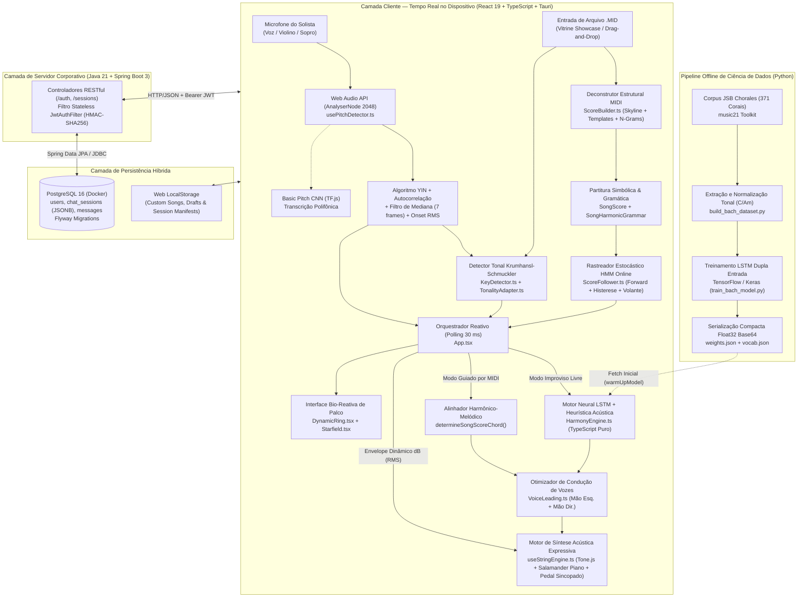
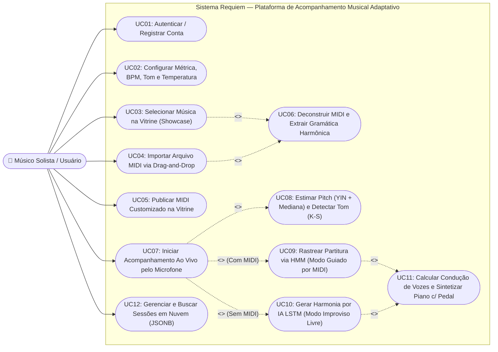
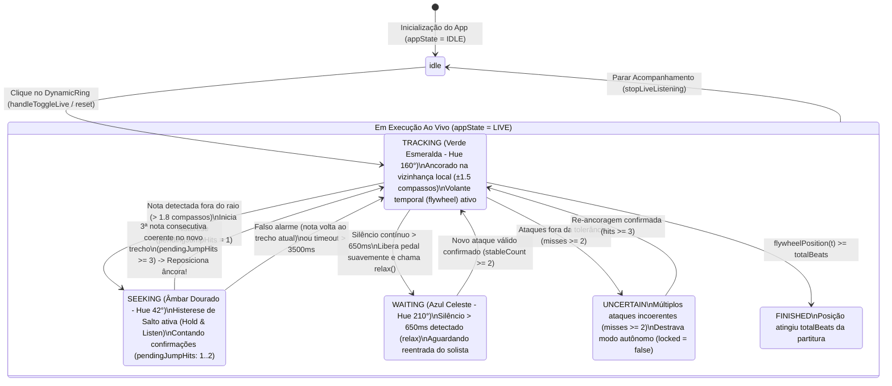
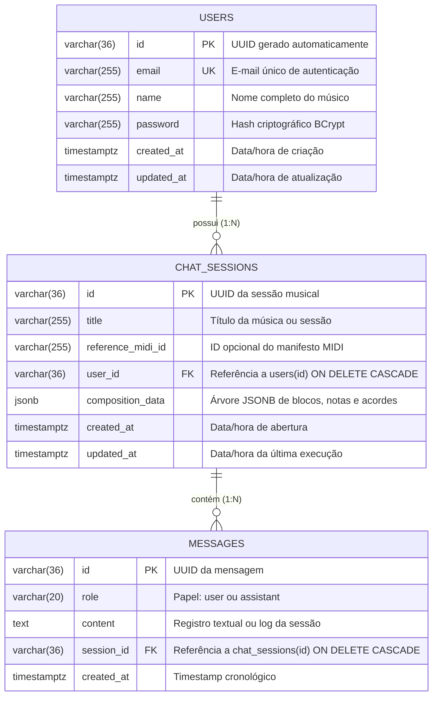

**UNIVERSIDADE DE FRANCA — UNIFRAN**  
**CURSO DE BACHARELADO EM CIÊNCIA DA COMPUTAÇÃO**

**KAÍQUE FREIRE DOS SANTOS**  
**DANIEL SIMÕES FIACADORI BORBOREMA**

**REQUIEM: SISTEMA INTELIGENTE DE ACOMPANHAMENTO MUSICAL ADAPTATIVO EM TEMPO REAL BASEADO EM REDES NEURAIS RECORRENTES LSTM E MODELOS OCULTOS DE MARKOV**

*Uma abordagem híbrida de Client-Side AI combinando rastreamento harmônico-melódico (Score Following), condução de vozes pianística automatizada e síntese acústica expressiva*

Franca  
2026

---

**KAÍQUE FREIRE DOS SANTOS**  
**DANIEL SIMÕES FIACADORI BORBOREMA**

**REQUIEM: SISTEMA INTELIGENTE DE ACOMPANHAMENTO MUSICAL ADAPTATIVO EM TEMPO REAL BASEADO EM REDES NEURAIS RECORRENTES LSTM E MODELOS OCULTOS DE MARKOV**

Trabalho de Conclusão de Curso apresentado ao Curso de Bacharelado em Ciência da Computação da Universidade de Franca — UNIFRAN, como requisito parcial para obtenção do título de Bacharel em Ciência da Computação.

Orientador: Prof. Dr. Fabiano Magrin da Costa Vieira

Franca  
2026

---

**RESUMO**

O presente Trabalho de Conclusão de Curso apresenta a concepção, o desenvolvimento e a validação empírica do Requiem, um sistema inteligente de acompanhamento musical adaptativo em tempo real (co-piloto harmônico e pianista virtual acompanhador) executado integralmente no dispositivo do usuário sob o paradigma de *Client-Side Artificial Intelligence*. O projeto soluciona a rigidez rítmica das faixas de acompanhamento pré-gravadas (*backing tracks*) e a instabilidade harmônica de modelos generativos puramente probabilísticos, oferecendo uma arquitetura dual que opera tanto em Modo de Improviso Livre quanto em Modo Guiado por Partitura MIDI (*Score Following*). Na camada de percepção acústica em tempo real, o sistema captura o sinal monofônico de cantores ou instrumentistas solistas (como violino, flauta ou instrumentos de cordas e sopro) via Web Audio API, estimando a frequência fundamental ($f_0$) por meio da combinação do algoritmo YIN com autocorrelação temporal e um filtro de mediana deslizante de sete quadros projetado para suprimir oscilações de vibrato ($\pm 30\text{ a }60\text{ cents}$), coexistindo com o modelo convolucional Basic Pitch (Spotify Audio Research) para transcrição polifônica offline. A detecção contínua de centro tonal fundamenta-se no algoritmo psicoacústico de Krumhansl-Schmuckler por correlação linear de Pearson. No Modo Guiado por MIDI, o módulo `ScoreBuilder` desconstrói arquivos MIDI polifônicos utilizando o algoritmo *Sustained Skyline* para isolar a melodia principal, realiza *template matching* em janelas métricas adaptativas (compassos simples e compostos) para extrair a progressão harmônica, indexa assinaturas melódicas *N-Gram* (bigramas, trigramas e intervalos) e sintetiza a gramática harmônica empírica da obra (*Markov Transition Matrix*). O rastreamento da posição do solista na partitura é conduzido pelo módulo `ScoreFollower` através de um Modelo Oculto de Markov (HMM) online baseado no algoritmo *Forward*, dotado de distribuição temporal log-normal assimétrica para tolerância a *rubato*, janela de localidade gaussiana, histerese de salto (*Hold & Listen* com confirmação de três eventos consecutivos) e volante temporal (*flywheel*) com adaptação contínua de andamento por média móvel exponencial. No Modo de Improviso Livre, o motor `HarmonyEngine` executa em TypeScript puro o *forward pass* matricial de uma rede neural recorrente *Long Short-Term Memory* (LSTM) de dupla entrada — histórico de acordes e vetor *Chroma* melódico ativo — treinada sobre o corpus dos corais a quatro vozes de Johann Sebastian Bach (JSB Chorales) via `music21` e TensorFlow/Keras, ponderando as probabilidades neurais com um pontuador de ressonância acústica, mascaramento funcional diatônico (*Scale Masking*), heurística de cadência por contorno melódico descendente e amostragem por temperatura com normalização adaptativa de *logits*. A materialização sonora é realizada por um algoritmo de condução de vozes pianística (`VoiceLeading`) que minimiza o deslocamento intervalar da mão direita sobre um baixo sólido na mão esquerda, acoplado a um motor de síntese em Tone.js com amostras acústicas do piano *Salamander Grand*, simulação de troca sincopada de pedal de sustentação (*damper pedal crossfade*) e expressão dinâmica contínua controlada pelo envelope RMS em decibéis do solista. A solução conta com uma interface bio-reativa de baixa distração em React 19 e Tailwind CSS v4 centrada em um anel luminoso semafórico (`DynamicRing`), empacotamento nativo multiplataforma via Tauri (Rust) e uma API RESTful corporativa em Java 21 com Spring Boot 3, autenticação JWT e persistência híbrida em PostgreSQL 16 (colunas JSONB). Os experimentos demonstraram latência média de inferência harmônica de 14 ms por compasso, ciclo reativo de acompanhamento de 30 ms, rejeição eficaz de falsos saltos de estrofe/refrão e elevada naturalidade acústica na condução de vozes.

**Palavras-chave:** Inteligência Artificial. Acompanhamento Musical Automático. Score Following. Modelos Ocultos de Markov. Redes Neurais LSTM. Algoritmo YIN. Condução de Vozes. Client-Side AI.

---

**ABSTRACT**

This Final Graduation Project presents the design, development, and empirical validation of Requiem, an intelligent real-time adaptive musical accompaniment system (harmonic co-pilot and virtual accompanying pianist) executed entirely on the user's device under the Client-Side Artificial Intelligence paradigm. The project addresses both the rhythmic rigidity of pre-recorded backing tracks and the harmonic instability of purely probabilistic generative models, offering a dual architecture capable of operating in both Free Improvisation Mode and MIDI Score-Guided Mode (Score Following). In the real-time acoustic perception layer, the system captures monophonic audio from vocalists or solo instrumentalists (such as violin, flute, or bowed/wind instruments) via the Web Audio API, estimating fundamental frequency ($f_0$) by combining the YIN algorithm with time-domain autocorrelation and a seven-frame sliding median filter specifically engineered to suppress vibrato oscillations ($\pm 30\text{ to }60\text{ cents}$), while coexisting with the Basic Pitch convolutional model (Spotify Audio Research) for offline polyphonic transcription. Continuous tonal center detection relies on the psychoacoustic Krumhansl-Schmuckler algorithm via Pearson linear correlation. In MIDI-Guided Mode, the `ScoreBuilder` module deconstructs polyphonic MIDI files using the Sustained Skyline algorithm to isolate the primary melody, performs adaptive metric-window template matching (supporting simple and compound meters) to extract chord progressions, indexes N-Gram melodic signatures (bigrams, trigrams, and intervals), and synthesizes the piece's empirical harmonic grammar (Markov Transition Matrix). Real-time performer position tracking is governed by the `ScoreFollower` module through an online Hidden Markov Model (HMM) using the Forward algorithm, equipped with an asymmetric log-normal timing distribution for rubato tolerance, Gaussian locality windowing, jump hysteresis (Hold & Listen requiring three consecutive confirmed hits), and a temporal flywheel with exponential moving average tempo adaptation. In Free Improvisation Mode, the `HarmonyEngine` executes in pure TypeScript the matrix forward pass of a dual-input Long Short-Term Memory (LSTM) recurrent neural network — conditioned on chord history and active melodic Chroma vector — trained on Johann Sebastian Bach's four-part chorales corpus (JSB Chorales) via `music21` and TensorFlow/Keras, fusing neural probabilities with an acoustic resonance scorer, functional diatonic scale masking, descending melodic contour cadence heuristics, and adaptive logit temperature sampling. Sound realization is driven by an automated piano voice-leading algorithm (`VoiceLeading`) that minimizes right-hand interval displacement over a solid left-hand bass, coupled with a Tone.js synthesis engine featuring multi-sampled Salamander Grand Piano acoustics, syncopated damper pedal crossfade simulation, and continuous dynamic expression mapped from the soloist's decibel RMS envelope. The platform features a low-distraction bio-reactive user interface in React 19 and Tailwind CSS v4 centered on a semaphore luminary ring (`DynamicRing`), native desktop packaging via Tauri (Rust), and an enterprise RESTful API in Java 21 with Spring Boot 3, stateless JWT authentication, and hybrid persistence in PostgreSQL 16 (JSONB columns). Empirical evaluations demonstrated average harmonic inference latencies of 14 ms per measure, a 30 ms reactive accompaniment loop, robust rejection of false verse/chorus jumps, and high acoustic realism in voice leading.

**Keywords:** Artificial Intelligence. Automatic Music Accompaniment. Score Following. Hidden Markov Models. LSTM Neural Networks. YIN Algorithm. Voice Leading. Client-Side AI.

---

**LISTA DE ILUSTRAÇÕES**

* **Figura 1** – Arquitetura em camadas desacopladas do sistema Requiem (*Client-Side Edge AI* e Persistência em Nuvem)
* **Figura 2** – Diagrama de Casos de Uso da plataforma Requiem
* **Figura 3** – Diagrama de Classes integrando o Motor de Acompanhamento no Cliente e as Entidades de Domínio na API
* **Figura 4** – Diagrama de Sequência do ciclo reativo de acompanhamento em tempo real (Modo Livre e Modo Guiado por MIDI)
* **Figura 5** – Diagrama de Máquina de Estados Finitos (FSM) do rastreador estocástico `ScoreFollower` e codificação cromática do `DynamicRing`
* **Figura 6** – Diagrama Entidade-Relacionamento (Modelo Conceitual e Lógico do Banco de Dados PostgreSQL)

---

**LISTA DE QUADROS**

* **Quadro 1** – Estrutura hierárquica do documento JSONB de sessão e manifesto musical (`SongManifest`)
* **Quadro 2** – Implementação da extração do corpus de J. S. Bach e normalização tonal via `music21` (`build_bach_dataset.py`)
* **Quadro 3** – Arquitetura funcional da rede neural recorrente LSTM de dupla entrada no Keras (`train_bach_model.py`)
* **Quadro 4** – Implementação do *forward pass* celular da LSTM e camada densa em TypeScript nativo (`HarmonyEngine.ts`)
* **Quadro 5** – Ponderação híbrida neuro-acústica, mascaramento diatônico e condicionamento pela gramática do MIDI (`HarmonyEngine.ts`)
* **Quadro 6** – Algoritmo *Sustained Skyline* para isolamento de melodia principal em arquivos MIDI polifônicos (`ScoreBuilder.ts`)
* **Quadro 7** – Algoritmo *Forward* do Modelo Oculto de Markov (HMM), janela de localidade gaussiana e histerese de salto (`ScoreFollower.ts`)
* **Quadro 8** – Loop de captura em tempo real com detector YIN, filtro de mediana contra vibrato e detecção de *onset* (`usePitchDetector.ts`)
* **Quadro 9** – Otimização combinatória de condução de vozes pianística para mão esquerda e mão direita (`VoiceLeading.ts`)
* **Quadro 10** – Simulação acústica de troca sincopada de pedal de sustentação no *Salamander Grand Piano* (`useStringEngine.ts`)

---

**LISTA DE TABELAS**

* **Tabela 1** – Comparativo técnico entre sistemas de acompanhamento musical e ferramentas correlatas da literatura
* **Tabela 2** – Requisitos Funcionais do Sistema Requiem (RF01 a RF16)
* **Tabela 3** – Requisitos Não Funcionais do Sistema Requiem (RNF01 a RNF08)
* **Tabela 4** – Tecnologias, bibliotecas e ferramentas utilizadas no ecossistema Requiem
* **Tabela 5** – Estrutura lógica da tabela `users` no PostgreSQL 16
* **Tabela 6** – Estrutura lógica da tabela `chat_sessions` no PostgreSQL 16
* **Tabela 7** – Estrutura lógica da tabela `messages` no PostgreSQL 16
* **Tabela 8** – Mapeamento semafórico e ergonômico do componente bio-reativo `DynamicRing`
* **Tabela 9** – Matriz de Casos de Teste e Validação Empírica do Sistema Requiem (TC01 a TC14)
* **Tabela 10** – Métricas quantitativas de desempenho, latência de processamento e consumo de recursos no cliente
* **Tabela 11** – Cronograma físico de execução das etapas do projeto Requiem (2026)
* **Tabela 12** – Especificação dos endpoints da API RESTful Requiem
* **Tabela 13** – Perfis psicoacústicos de estabilidade tonal de Krumhansl-Schmuckler (1982) para os modos Maior e Menor
* **Tabela 14** – Correspondência física entre notas musicais, frequências fundamentais (Hz), índices MIDI e tessitura de condução de vozes
* **Tabela 15** – Divisão de responsabilidades técnicas, arquitetura e entregas por integrante da equipe

---

**LISTA DE ABREVIATURAS E SIGLAS**

* **ABNT** – Associação Brasileira de Normas Técnicas
* **AMT** – *Automatic Music Transcription* (Transcrição Musical Automática)
* **API** – *Application Programming Interface* (Interface de Programação de Aplicações)
* **BPM** – Batidas Por Minuto (*Beats Per Minute*)
* **CMND** – *Cumulative Mean Normalized Difference* (Diferença Normalizada Média Cumulativa — Algoritmo YIN)
* **CORS** – *Cross-Origin Resource Sharing* (Compartilhamento de Recursos de Origem Cruzada)
* **CQT** – *Constant-Q Transform* (Transformada de Q Constante)
* **CRISP-DM** – *Cross-Industry Standard Process for Data Mining*
* **CRUD** – *Create, Read, Update, Delete*
* **DAW** – *Digital Audio Workstation* (Estação de Trabalho de Áudio Digital)
* **dB** – Decibel
* **DOM** – *Document Object Model*
* **DSP** – *Digital Signal Processing* (Processamento Digital de Sinais)
* **EMA** – *Exponential Moving Average* (Média Móvel Exponencial)
* **FFT** – *Fast Fourier Transform* (Transformada Rápida de Fourier)
* **FSM** – *Finite State Machine* (Máquina de Estados Finitos)
* **GPU** – *Graphics Processing Unit* (Unidade de Processamento Gráfico)
* **HMM** – *Hidden Markov Model* (Modelo Oculto de Markov)
* **HTTP** – *Hypertext Transfer Protocol*
* **Hz** – Hertz (ciclos por segundo)
* **IA** – Inteligência Artificial
* **IOI** – *Inter-Onset Interval* (Intervalo Entre Ataques Sucessivos)
* **JPA** – *Jakarta Persistence API*
* **JSON** – *JavaScript Object Notation*
* **JSONB** – *Binary JavaScript Object Notation* (PostgreSQL)
* **JSB** – Johann Sebastian Bach
* **JWT** – *JSON Web Token*
* **LGPD** – Lei Geral de Proteção de Dados Pessoais (Lei nº 13.709/2018)
* **LSTM** – *Long Short-Term Memory* (Memória de Curto e Longo Prazo)
* **MIDI** – *Musical Instrument Digital Interface*
* **MIR** – *Music Information Retrieval* (Recuperação de Informação Musical)
* **ms** – Milissegundo ($10^{-3}$ segundos)
* **PC** – *Pitch Class* (Classe de Altura Cromática, $0 \dots 11$)
* **PPQ / PPQN** – *Pulses Per Quarter Note* (Pulsos por Semínima)
* **ReLU** – *Rectified Linear Unit* (Unidade Linear Retificada)
* **REST** – *Representational State Transfer*
* **RF** – Requisito Funcional
* **RMS** – *Root Mean Square* (Valor Quadrático Médio de Amplitude)
* **RNF** – Requisito Não Funcional
* **RNN** – *Recurrent Neural Network* (Rede Neural Recorrente)
* **SMF** – *Standard MIDI File*
* **SQL** – *Structured Query Language*
* **UI / UX** – *User Interface / User Experience*
* **UUID** – *Universally Unique Identifier*

---

**SUMÁRIO**

* **1 IDENTIFICAÇÃO DO PROJETO** ....................................................................................................... 7
  * 1.1 Título ................................................................................................................................................ 7
  * 1.2 Área do Projeto ............................................................................................................................... 7
  * 1.3 Resumo do Projeto ......................................................................................................................... 7
  * 1.4 Escopo Operacional e Modos de Acompanhamento ..................................................................... 8
* **2 INTRODUÇÃO** ................................................................................................................................... 9
* **3 PROBLEMA** ..................................................................................................................................... 11
* **4 JUSTIFICATIVA** ............................................................................................................................... 13
* **5 OBJETIVOS** ..................................................................................................................................... 15
  * 5.1 Objetivo Geral ............................................................................................................................... 15
  * 5.2 Objetivos Específicos .................................................................................................................... 15
* **6 FUNDAMENTAÇÃO TEÓRICA** ........................................................................................................ 17
  * 6.1 Harmonia Funcional, Condução de Vozes e o Corpus de Bach .................................................. 17
  * 6.2 Classes de Alturas (*Pitch Classes*), Representação MIDI e Vetor Chroma ............................... 18
  * 6.3 Estimação de Frequência Fundamental ($f_0$): Autocorrelação, Algoritmo YIN e Filtragem de Vibrato .. 19
  * 6.4 Algoritmo Psicoacústico de Tonalidade de Krumhansl-Schmuckler ........................................... 20
  * 6.5 Redes Neurais Recorrentes e Arquitetura de Células LSTM ....................................................... 21
  * 6.6 Rastreamento Estocástico de Partitura (*Score Following*) e Modelos Ocultos de Markov (HMM) .... 22
  * 6.7 Extração Melódica *Skyline*, Síntese Web Audio via Tone.js e Pedal Sincopado ....................... 24
  * 6.8 Sistemas de Acompanhamento Interativo e Trabalhos Relacionados ......................................... 25
* **7 LEVANTAMENTO DE REQUISITOS** ............................................................................................... 27
  * 7.1 Público-Alvo .................................................................................................................................. 27
  * 7.2 Perfis de Usuários ......................................................................................................................... 27
  * 7.3 Requisitos Funcionais ................................................................................................................... 28
  * 7.4 Requisitos Não Funcionais ........................................................................................................... 29
* **8 METODOLOGIA** ............................................................................................................................... 31
* **9 TECNOLOGIAS E FERRAMENTAS** ................................................................................................ 33
* **10 ARQUITETURA DA SOLUÇÃO** ..................................................................................................... 35
  * 10.1 Camada Cliente (Navegador Web e Motor de Tempo Real) ...................................................... 36
  * 10.2 Camada de Empacotamento Desktop Nativo (Tauri / Rust) ...................................................... 37
  * 10.3 Camada de Servidor (API RESTful Spring Boot 3) .................................................................... 37
  * 10.4 Camada de Persistência Híbrida (PostgreSQL 16 JSONB e Armazenamento Local) ............... 38
* **11 MODELAGEM DO SISTEMA** ......................................................................................................... 39
  * 11.1 Diagrama e Especificação de Casos de Uso .............................................................................. 39
  * 11.2 Diagrama de Classes .................................................................................................................. 40
  * 11.3 Diagrama de Sequência — Fluxo de Acompanhamento Ao Vivo .............................................. 41
  * 11.4 Diagrama de Máquina de Estados — Ciclo de Rastreamento do `ScoreFollower` .................... 42
* **12 MODELAGEM DO BANCO DE DADOS** ........................................................................................ 43
  * 12.1 Modelo Conceitual ....................................................................................................................... 43
  * 12.2 Modelo Lógico Relacional ........................................................................................................... 43
  * 12.3 Dicionário de Dados JSONB e Estrutura de Manifesto Musical ................................................ 44
* **13 PROTOTIPAÇÃO E INTERFACE** .................................................................................................. 46
  * 13.1 Ergonomia Cognitiva em Palco e o Conceito de *Calm Technology* ......................................... 46
  * 13.2 Anel Orbital Bio-Reativo (`DynamicRing`) e Feedback Semafórico .......................................... 46
  * 13.3 Controles de Configuração Musical Pré-Execução (`RecordControls`) .................................... 47
  * 13.4 Vitrine de Músicos (`ShowcaseScreen`), *Drag-and-Drop* MIDI e Gerenciamento de Sessões . 47
* **14 DESENVOLVIMENTO E IMPLEMENTAÇÃO** ................................................................................. 49
  * 14.1 Módulo 1 — Pipeline de Extração Musicológica e Treinamento Neural (Python/Keras) ............ 49
  * 14.2 Módulo 2 — Motor de Inferência LSTM em TypeScript Puro e Heurística Acústico-Funcional (`HarmonyEngine.ts`) ........................................................................................................................ 51
  * 14.3 Módulo 3 — Deconstrução Estrutural de MIDI, Algoritmo *Sustained Skyline* e Gramática Harmônica (`ScoreBuilder.ts`) ............................................................................................................. 53
  * 14.4 Módulo 4 — Rastreamento Estocástico de Partitura (*Score Following*) via HMM Online e Histerese de Salto (`ScoreFollower.ts`) ............................................................................................. 55
  * 14.5 Módulo 5 — Captura Acústica (YIN + Filtro de Mediana), Condução de Vozes (`VoiceLeading.ts`) e Síntese com Pedal Sincopado (`useStringEngine.ts`) .................................................................... 57
  * 14.6 Módulo 6 — Orquestração do Loop Reativo de 30 ms (`App.tsx`) e Backend RESTful Spring Boot 3 ................................................................................................................................................... 59
* **15 VERSIONAMENTO E REPOSITÓRIO** ............................................................................................ 61
* **16 TESTES E VALIDAÇÃO** ................................................................................................................. 62
* **17 RESULTADOS** ............................................................................................................................... 64
* **18 DISCUSSÃO DOS RESULTADOS** ................................................................................................. 66
* **19 SEGURANÇA, PRIVACIDADE E ÉTICA** ...................................................................................... 68
* **20 LIMITAÇÕES DO PROJETO** .......................................................................................................... 69
* **21 TRABALHOS FUTUROS** ............................................................................................................... 70
* **22 CONCLUSÃO** ................................................................................................................................. 71
* **23 CRONOGRAMA** ............................................................................................................................. 72
* **24 REFERÊNCIAS** .............................................................................................................................. 73
* **25 APÊNDICES** ................................................................................................................................... 75
  * Apêndice A — Especificação de Endpoints da API RESTful Requiem ............................................... 75
  * Apêndice B — Estrutura da Gramática Harmônica Extraída (`SongHarmonicGrammar`) ................. 75
  * Apêndice C — Estrutura do Vocabulário de Acordes (`vocab.json`) e Grafo Funcional (`HARMONY_GRAPH`) ....................................................................................................................... 76
* **26 ANEXOS** ......................................................................................................................................... 77
  * Anexo A — Vetores Ideais de Krumhansl-Schmuckler para os Modos Maior e Menor ...................... 77
  * Anexo B — Tabela de Conversão: Notas Musicais, Frequências (Hz), Índices MIDI e Tessitura Pianística .............................................................................................................................................. 77
* **27 REGISTRO DE CONTRIBUIÇÕES DA EQUIPE** ........................................................................... 78

---

# **1 IDENTIFICAÇÃO DO PROJETO**

## **1.1 Título**

Requiem: Sistema Inteligente de Acompanhamento Musical Adaptativo em Tempo Real Baseado em Redes Neurais Recorrentes LSTM e Modelos Ocultos de Markov.

## **1.2 Área do Projeto**

Inteligência Artificial Aplicada, Recuperação de Informação Musical (*Music Information Retrieval* — MIR), Processamento Digital de Sinais de Áudio (DSP), Sistemas Musicais Interativos em Tempo Real (*Automatic Music Accompaniment* e *Score Following*), Computação Musical e Engenharia de Software Full-Stack.

## **1.3 Resumo do Projeto**

O Requiem é uma plataforma de acompanhamento musical inteligente em tempo real projetada para atuar como um pianista acompanhador virtual adaptativo para cantores e instrumentistas solistas (tais como violinistas, flautistas, violoncelistas e saxofonistas). Diferentemente de estações de trabalho tradicionais focadas em edição manual pós-gravação ou de faixas de *playback* estáticas (*backing tracks*) que impõem um andamento mecânico inflexível ao intérprete, o Requiem escuta continuamente o sinal acústico do microfone e sintetiza, em tempo real, o acompanhamento harmônico de piano com condução de vozes otimizada e expressão dinâmica sincronizada à intensidade do músico. Toda a cadeia de processamento — estimação de frequência fundamental via algoritmo YIN com filtragem de vibrato, detecção tonal psicoacústica de Krumhansl-Schmuckler, desconstrução estrutural de arquivos MIDI, rastreamento probabilístico de partitura (*Score Following*) por Modelos Ocultos de Markov (HMM), inferência neural recorrente LSTM treinada sobre os Corais de J. S. Bach e síntese acústica com simulação de pedal sincopado — é executada localmente no cliente (navegador Web ou aplicação nativa Tauri), assegurando latência imperceptível, privacidade absoluta sob a LGPD e custo marginal próximo de zero em infraestrutura de servidores.

## **1.4 Escopo Operacional e Modos de Acompanhamento**

A concepção arquitetural do Requiem consolida-se sobre dois modos operacionais complementares que atendem tanto à performance de repertório estruturado quanto à criação livre:

a) **Modo Guiado por Partitura MIDI (*Score Following* e Alinhamento Harmônico-Melódico)**: o músico seleciona uma obra na Vitrine de Músicos integrada ou realiza o carregamento (*drag-and-drop*) de qualquer arquivo `.mid` de referência diretamente sobre o anel central da interface. O módulo `ScoreBuilder` analisa o arquivo em milissegundos, separa a melodia principal da harmonia através do algoritmo *Sustained Skyline*, identifica os acordes por *template matching* em janelas métricas, extrai assinaturas *N-Gram* e constrói a gramática harmônica empírica da canção. Durante a execução ao vivo, o sistema acompanha a posição exata do músico na obra (mesmo diante de variações expressivas de andamento, pausas respiratórias, *fermatas* ou saltos entre estrofes e refrões), transpondo toda a estrutura em tempo real caso o usuário altere a tonalidade desejada;

b) **Modo de Improviso Livre (Geração Harmônica Neuro-Acústica em Tempo Real)**: quando nenhuma partitura de referência está carregada, o Requiem atua como um co-piloto harmônico generativo. À medida que o usuário canta ou toca notas livres ao microfone, o sistema acumula o histograma cromático para inferir a tonalidade subjacente automaticamente (quando configurado em modo `AUTO`) e aciona o motor `HarmonyEngine`. Este motor executa o *forward pass* de uma rede neural LSTM de dupla entrada (histórico recente de acordes e vetor *Chroma* da melodia ativa) treinada sobre o repertório coral de Johann Sebastian Bach, combinando as probabilidades neurais com heurísticas de ressonância acústica, mascaramento de escala diatônica e detecção de cadências por contorno melódico, gerando progressões de acordes estilisticamente ricas e organicamente responsivas ao fraseado do solista.

---

# **2 INTRODUÇÃO**

A performance musical ao vivo caracteriza-se, em sua essência, pela interação sensível, orgânica e recíproca entre os músicos que compartilham o palco. Em formações camerísticas ou populares — tais como o duo clássico entre um solista (cantor, violinista ou instrumentista de sopro) e um pianista acompanhador (correpetidor) —, o acompanhador humano não se limita a executar notas pré-programadas segundo um metrônomo rígido. Pelo contrário, o pianista profissional escuta ativamente cada inflexão do solista: acompanha variações intencionais de andamento (*rubato*), aguarda respirações e sustentações expressivas (*fermatas*), ajusta o peso dinâmico das mãos (*pianissimo* ao *fortissimo*) para não encobrir a projeção acústica do solista, conduz as vozes intermediárias do piano de modo a evitar saltos harmônicos bruscos e, caso o solista antecipe um refrão ou repita uma estrofe em uma apresentação ao vivo (como ocorre frequentemente em cerimônias de casamento, recitais e ensaios), reposiciona-se instantaneamente na estrutura da obra (DANNENBERG, 1984; CONT, 2010).

Todavia, contar com um pianista correpetidor humano qualificado para sessões diárias de estudo individual, preparação de repertório ou apresentações de pequeno e médio porte é financeiramente inviável para a vasta maioria dos estudantes de música, cantores e instrumentistas independentes. Diante dessa limitação, os músicos recorrem tradicionalmente a duas alternativas tecnológicas que apresentam severas restrições operacionais: as faixas de áudio pré-gravadas (*backing tracks* ou *playbacks*) e as Estações de Trabalho de Áudio Digital (*Digital Audio Workstations* — DAWs), como Ableton Live, Logic Pro, Reaper e Cubase.

As *backing tracks* convencionais invertem a hierarquia natural da expressão artística: em vez de o acompanhamento seguir o solista, o solista é forçado a submeter-se à grade temporal inflexível de um arquivo de áudio estático. Qualquer hesitação, respiração mais longa, variação agógica ou corte de seção resulta em perda imediata e irreversível de sincronismo, inviabilizando a espontaneidade musical. Por sua vez, as DAWs tradicionais e editores baseados em grades visuais (*Piano Rolls* e *Chord Rolls*) foram concebidos para o trabalho assíncrono de engenharia de som e pós-produção em escritório, exigindo manipulação constante de mouse, teclado e múltiplos painéis gráficos. Para um instrumentista que sustenta um violino entre o queixo e o ombro e empunha o arco com a mão direita, ou para um cantor em situação de palco, operar uma interface densa de DAW durante a execução é ergonomicamente impraticável.

Nas últimas quatro décadas, o campo da Computação Musical e da Recuperação de Informação Musical (*Music Information Retrieval* — MIR) tem investigado soluções para esse desafio sob a denominação de Sistemas de Acompanhamento Musical Automático (*Automatic Music Accompaniment Systems*) e Rastreamento de Partitura (*Score Following*). Desde os trabalhos pioneiros de Dannenberg (1984) e Vercoe (1984), evoluindo para formulações probabilísticas baseadas em Modelos Ocultos de Markov (*Hidden Markov Models* — HMM) introduzidas por Cano, Loscos e Bonada (1999), Raphael (2001) e Cont (2010), demonstrou-se que o alinhamento em tempo real entre um sinal acústico de entrada e uma partitura simbólica requer tratamento estocástico para lidar com incertezas de captação, erros de execução e variações temporais humanas. Paralelamente, o avanço do Aprendizado Profundo (*Deep Learning*), em especial com as Redes Neurais Recorrentes de arquitetura *Long Short-Term Memory* (LSTM) propostas por Hochreiter e Schmidhuber (1997), viabilizou a modelagem de dependências temporais de longo alcance em sequências harmônicas, permitindo a geração de acompanhamentos originais mesmo na ausência de uma partitura prévia.

Historicamente, contudo, a implementação combinada de algoritmos de processamento digital de sinais de baixa latência, modelos estocásticos de *Score Following* e redes neurais profundas exigia softwares nativos dedicados de difícil configuração ou servidores remotos dotados de aceleradores gráficos (GPUs). A evolução recente dos padrões da plataforma Web — impulsionada pela consolidação da Web Audio API, da tipagem estática de alta performance em TypeScript, da execução vetorial em memória e de empacotadores nativos leves baseados em Rust, como o framework Tauri — inaugurou a possibilidade de executar sistemas musicais interativos complexos diretamente na borda do cliente (*Client-Side Edge AI*), eliminando a latência de rede e democratizando o acesso a essas ferramentas.

É exatamente nessa lacuna científica e tecnológica que se insere o projeto **Requiem**: um sistema inteligente de acompanhamento musical adaptativo em tempo real que atua como um pianista acompanhador virtual autônomo. O Requiem integra, em uma arquitetura unificada executada 100% no cliente, um pipeline de detecção de altura monofônica em tempo real resistente a vibrato (algoritmo YIN aliado a filtragem de mediana), um deconstrutor estrutural de arquivos MIDI capaz de extrair melodias via algoritmo *Sustained Skyline* e induzir gramáticas harmônicas empíricas (`ScoreBuilder`), um rastreador probabilístico de partitura baseado em HMM online com histerese de salto e volante temporal (`ScoreFollower`), um motor de inferência neural LSTM de dupla entrada treinado sobre o corpus dos 371 corais de Johann Sebastian Bach (`HarmonyEngine`), um otimizador algorítmico de condução de vozes pianística (`VoiceLeading`) e um sintetizador acústico expressivo baseado nas amostras do *Salamander Grand Piano* com simulação de pedal sincopado (`useStringEngine`), tudo orquestrado por uma interface visual bio-reativa de zero distração (`DynamicRing`) e apoiado por uma API RESTful corporativa em Java 21 / Spring Boot 3 com PostgreSQL 16.

---

# **3 PROBLEMA**

O desenvolvimento de um acompanhador musical computacional capaz de atuar ao vivo com a fluidez, a sensibilidade harmônica e a prontidão rítmica de um músico humano esbarra em quatro problemas técnicos e científicos fundamentais, os quais permanecem como desafios abertos ou parcialmente resolvidos nas ferramentas comerciais disponíveis.

O **primeiro problema** reside na **instabilidade da estimação de altura ($f_0$) em tempo real diante da expressividade acústica de instrumentos reais e da voz humana**. Quando um violinista ou cantor executa uma melodia sustentada, a frequência fundamental não permanece estática em um valor matemático discreto; ela sofre modulações periódicas intencionais de frequência (vibrato, que oscila tipicamente entre $\pm 30$ e $\pm 60\text{ cents}$ a uma taxa de $5\text{ a }7\text{ Hz}$), além de ruídos transitórios de atrito de arco (*bow scratch*), soprosidade vocal e reverberação de sala. Detectores de pitch ingênuos interpretam essas oscilações de vibrato e transientes de ataque como mudanças sucessivas de semitom, disparando trocas frenéticas e erráticas de acordes no acompanhador automático. Por outro lado, modelos neurais de transcrição polifônica pesada (como o Basic Pitch em modo de janela completa) operam em lote sobre buffers longos de áudio gravado, introduzindo latências de processamento incompatíveis com a resposta imediata (inferior a $40\text{ ms}$) exigida para o acompanhamento ao vivo.

O **segundo problema** refere-se à **sincronização temporal elástica e à recuperação estrutural no acompanhamento guiado por partitura (*Score Following*)**. Em performances reais, como apresentações em eventos, cerimônias ou ensaios livres, o solista frequentemente altera o andamento (*rubato*), prolonga notas finais de frase, omite notas ornamentais rápidas ou realiza saltos estruturais não lineares (por exemplo, repetir um refrão espontaneamente ou pular uma estrofe). Sistemas baseados em relógio fixo (*clock-driven*) perdem a sincronia ao menor atraso do solista. Em contrapartida, sistemas puramente orientados a eventos (*event-driven* ingênuos) sofrem com a ambiguidade posicional: como músicas tonais possuem notas e motivos que se repetem em diferentes compassos, uma única nota mal detectada ou um ataque fora de tempo pode fazer o algoritmo "teletransportar" erroneamente a posição da partitura para outro trecho da música, destruindo a coerência do acompanhamento.

O **terceiro problema** concerne à **geração harmônica em improviso livre e à condução de vozes (*Voice Leading*)**. Quando o músico deseja improvisar livremente sem uma partitura MIDI pré-carregada, modelos generativos puramente estocásticos (como cadeias de Markov simples ou redes neurais sem restrições de domínio) frequentemente incorrem no fenômeno da "alucinação harmônica": sugerem acordes que pertencem a campos harmônicos distantes ou cujas notas internas chocam-se severamente (intervalos de segunda menor ou trítono não resolvido) com a nota que o solista está sustentando no microfone. Ademais, mesmo quando o acorde correto é selecionado (por exemplo, uma transição de `C` para `F` e `G7`), a simples execução de tríades em posição fundamental na mesma oitava produz um som mecânico, infantil e descontínuo, distante da condução de vozes suave praticada por um pianista real que divide o baixo na mão esquerda e encadeia inversões próximas na mão direita com uso sincopado do pedal de sustentação (*damper pedal*).

O **quarto problema** é de natureza **arquitetural e ergonômica**: a dependência de processamento em nuvem impõe latências de rede proibitivas para áudio interativo em tempo real e expõe fluxos de microfone a servidores externos, enquanto interfaces gráficas convencionais de softwares musicais (repletas de menus, trilhas, grades de edição e botões pequenos) exigem atenção visual focada e uso das mãos, desviando a concentração cognitiva do intérprete durante a execução.

Diante dessa problematização multidimensional, a investigação científica conduzida neste Trabalho de Conclusão de Curso é sintetizada pela seguinte pergunta norteadora:

> *Como projetar, implementar e validar uma plataforma de acompanhamento musical adaptativo em tempo real, executada integralmente no cliente sob o paradigma de Client-Side AI, que seja capaz de capturar o sinal acústico de um solista com imunidade a vibrato, rastrear sua posição e andamento em partituras MIDI via Modelos Ocultos de Markov com histerese de salto ou sintetizar harmonizações livres estilisticamente coerentes por meio de Redes Neurais LSTM híbridas, garantindo condução de vozes pianística suave, expressão dinâmica contínua e feedback visual periférico de baixa distração?*

---

# **4 JUSTIFICATIVA**

A realização do projeto Requiem justifica-se de maneira sólida sob três pilares fundamentais e interdependentes: a relevância tecnológica e arquitetural, a contribuição científica interdisciplinar e o impacto social, artístico e pedagógico.

Sob a **perspectiva tecnológica e de Engenharia de Software**, o Requiem demonstra a viabilidade prática da **Inteligência Artificial na Borda do Cliente (*Client-Side Edge AI*)** aplicada a sistemas críticos de tempo real. Em arquiteturas tradicionais baseadas em nuvem, o envio contínuo de pacotes de áudio via WebSockets ou WebRTC para inferência em servidores remotos introduz uma latência de trânsito de rede (*round-trip time*) tipicamente entre $80\text{ ms}$ e $250\text{ ms}$, somada ao tempo de fila de GPU, o que ultrapassa drasticamente o limiar psicoacústico de percepção de atraso rítmico em performance musical conjunta (estimado entre $20\text{ ms}$ e $35\text{ ms}$). Ao implementar o *forward pass* da rede neural LSTM, o algoritmo HMM de *Score Following*, o extrator estrutural de MIDI e o detector YIN diretamente em TypeScript nativo com arrays tipados (`Float32Array` e `Float64Array`), o Requiem reduz o tempo de decisão harmônica para menos de $15\text{ ms}$ dentro de um ciclo reativo de $30\text{ ms}$. Adicionalmente, essa decisão arquitetural elimina a necessidade de servidores de GPU de alto custo, permitindo que o backend corporativo em Java 21 / Spring Boot 3 opere com consumo mínimo de CPU e memória, focado exclusivamente na segurança stateless JWT e na persistência relacional/JSONB no PostgreSQL 16.

Sob a **perspectiva acadêmica e científica**, este trabalho apresenta uma **arquitetura neuro-simbólica e estocástica híbrida inédita** ao integrar cinco subáreas clássicas da Computação Musical em um único pipeline coeso:
1. *Processamento Digital de Sinais (DSP)*: combinação do estimador YIN com filtragem não linear de mediana de 7 frames para estabilização de *pitch* em instrumentos com vibrato acentuado;
2. *Psicoacústica Computacional*: aplicação contínua dos perfis empíricos de Krumhansl-Schmuckler por correlação de Pearson para inferência automática de tonalidade;
3. *Recuperação de Informação Musical Simbólica (MIR)*: desconstrução automatizada de arquivos MIDI polifônicos arbitrários em melodia (*Sustained Skyline*), harmonia (*template matching* métrico), assinaturas *N-Gram* e matrizes de transição de Markov (`ScoreBuilder`);
4. *Modelagem Estocástica Sequencial*: formulação de um Modelo Oculto de Markov (HMM) online com janela de localidade gaussiana, volante inercial (*flywheel*) e histerese de confirmação de salto de três estágios (`ScoreFollower`), resolvendo o problema clássico de falsos positivos em estrofes repetidas;
5. *Aprendizado Profundo Condicionado a Regras de Domínio*: acoplamento de uma rede recorrente LSTM de dupla entrada (treinada nos Corais de J. S. Bach via `music21`) a um pontuador acústico-funcional dotado de mascaramento diatônico e otimização combinatória de condução de vozes pianística (`VoiceLeading`).

Sob a **perspectiva social, artística e educacional**, o Requiem democratiza o acesso a um acompanhamento musical responsivo e de alta qualidade acústica. Músicos solistas que atuam em eventos sociais (como violinistas e cantores em cerimônias de casamento e recepções), estudantes de conservatórios que praticam sem correpetidor humano e compositores em fase de experimentação passam a dispor de um parceiro musical virtual gratuito, portátil (acessível no navegador ou como aplicativo desktop leve via Tauri) e capaz de adaptar-se ao seu próprio tempo respiratório e expressivo. Além disso, a adoção de uma interface visual centrada em um único elemento bio-reativo (`DynamicRing`) respeita a ergonomia do palco, permitindo que o músico monitore o estado do sistema com a visão periférica a metros de distância da tela, sem interromper sua performance.

---

# **5 OBJETIVOS**

## **5.1 Objetivo Geral**

Projetar, desenvolver e validar empiricamente a plataforma **Requiem**, um sistema inteligente de acompanhamento musical adaptativo em tempo real executado no cliente (Web e Desktop via Tauri), capaz de escutar solistas vocais ou instrumentais pelo microfone, rastrear sua posição e andamento em partituras MIDI de referência por meio de Modelos Ocultos de Markov (*Score Following*) ou gerar harmonizações improvisadas coerentes mediante uma rede neural recorrente LSTM treinada sobre os corais de J. S. Bach, sintetizando o acompanhamento de piano acústico com condução de vozes automatizada, pedal sincopado e resposta dinâmica expressiva.

## **5.2 Objetivos Específicos**

Para alcançar o objetivo geral proposto, foram estabelecidos os seguintes objetivos específicos:

a) Extrair, normalizar e processar o corpus de corais a quatro vozes de Johann Sebastian Bach (*JSB Chorales*) utilizando a biblioteca musicológica `music21` em Python, transpondo as obras para o espaço tonal canônico (Dó Maior / Lá Menor) e estruturando pares supervisionados de histórico harmônico e vetor *Chroma* da melodia do Soprano (`build_bach_dataset.py`);

b) Projetar, treinar e validar no framework TensorFlow/Keras uma rede neural recorrente de arquitetura LSTM com dupla entrada — sequência histórica de quatro acordes via camada de *Embedding* com mascaramento (`mask_zero=True`) e vetor *Chroma* melódico ativo de 12 dimensões —, exportando os tensores de pesos treinados em formato compacto JSON/Base64 (`train_bach_model.py`);

c) Implementar em TypeScript nativo o motor de inferência neural e heurística acústico-funcional (`HarmonyEngine.ts`), recriando manualmente o *forward pass* matricial das células LSTM e camadas *Dense* sem dependência de bibliotecas externas em tempo de execução, integrando-o ao grafo harmônico funcional (`HARMONY_GRAPH`), ao filtro de mascaramento diatônico (*Scale Masking*), à heurística de contorno melódico descendente e ao amostrador por temperatura com normalização adaptativa de *logits*;

d) Desenvolver um pipeline dual de detecção de altura acústica (`usePitchDetector.ts`) via Web Audio API, combinando o algoritmo YIN (`pitchfinder`) e autocorrelação temporal com um filtro de mediana deslizante de sete quadros para rejeição de vibrato e detecção dinâmica de *onsets* em tempo real, além de integrar o modelo convolucional Basic Pitch para transcrição polifônica;

e) Implementar o módulo de detecção automática de tonalidade (`KeyDetector.ts`) baseado na correlação linear de Pearson sobre os 24 perfis psicoacústicos de Krumhansl-Schmuckler (a partir de arquivos MIDI ou do histograma cromático acumulado ao vivo) e construir o adaptador bidirecional de transposição tonal (`TonalityAdapter.ts`);

f) Construir o deconstrutor estrutural de arquivos MIDI (`ScoreBuilder.ts`), implementando o algoritmo *Sustained Skyline* para extração da melodia principal, o algoritmo de *template matching* em janelas métricas adaptativas para identificação de acordes e padrões de arpejo, o indexador de assinaturas melódicas *N-Gram* (bigramas, trigramas e intervalos) e o extrator da gramática harmônica empírica da obra (`SongHarmonicGrammar`);

g) Desenvolver o rastreador estocástico de partitura em tempo real (`ScoreFollower.ts`) fundamentado em um Modelo Oculto de Markov (HMM) online (algoritmo *Forward*), incorporando distribuição temporal log-normal assimétrica, emissão multi-característica, janela de localidade gaussiana, histerese de salto de três confirmações (*Hold & Listen*) e volante temporal (*flywheel*) com adaptação contínua de andamento (BPM) por média móvel exponencial;

h) Implementar o algoritmo de condução de vozes pianística (`VoiceLeading.ts`) para distribuição automática de notas entre mão esquerda (baixo fundamental ou invertido na região `MIDI 36–47`) e mão direita (`MIDI 52–76`), minimizando a distância de deslocamento intervalar entre acordes sucessivos;

i) Desenvolver o motor de síntese acústica expressiva (`useStringEngine.ts`) sobre o framework Tone.js utilizando amostras reais do piano *Salamander Grand*, cadeia de reverberação e limitação dinâmica, controle contínuo de volume pelo envelope RMS do solista e simulação de troca sincopada do pedal de sustentação (*damper pedal crossfade*);

j) Conceber e implementar uma interface gráfica imersiva de baixa distração em React 19 e Tailwind CSS v4 (`App.tsx`, `DynamicRing.tsx`, `RecordControls.tsx`, `ShowcaseScreen.tsx`, `SearchScreen.tsx` e `Starfield.tsx`), com empacotamento nativo desktop multiplataforma via Tauri (Rust);

k) Desenvolver uma API RESTful corporativa em Java 21 com Spring Boot 3, autenticação stateless via tokens Bearer JWT, criptografia de senhas com BCrypt, migrações evolutivas via Flyway e persistência relacional/documental híbrida em PostgreSQL 16 (colunas JSONB).

---

# **6 FUNDAMENTAÇÃO TEÓRICA**

Este capítulo estabelece os alicerces teóricos, matemáticos e musicológicos que sustentam as decisões de engenharia adotadas no sistema Requiem, abrangendo desde os cânones da harmonia tonal e condução de vozes até a formulação matemática de estimadores de frequência fundamental, modelos psicoacústicos, redes neurais recorrentes LSTM e modelos ocultos de Markov aplicados ao rastreamento de partitura.

## **6.1 Harmonia Funcional, Condução de Vozes e o Corpus de Bach**

A música tonal ocidental estrutura-se sobre o princípio da gravidade harmônica: a existência de um centro tonal (tônica) em torno do qual os demais acordes do campo harmônico organizam-se segundo funções específicas de repouso, afastamento e tensão (KOSTKA; PAYNE, 2017). Na teoria das funções harmônicas sistematizada por Hugo Riemann e amplamente adotada na análise musical contemporânea, os sete graus diatônicos de uma tonalidade agrupam-se em três categorias funcionais primárias:

a) **Função Tônica (T — Graus $\text{I}$, $\text{vi}$ e $\text{iii}$)**: representa o polo de estabilidade central, repouso acústico e resolução de tensão, sendo o ponto de partida e de chegada das estruturas fraseológicas;

b) **Função Subdominante ou Pré-Dominante (S — Graus $\text{IV}$ e $\text{ii}$)**: promove o afastamento inicial da estabilidade tônica, gerando tensão moderada e preparando o discurso musical para a chegada do polo dominante (ou resolvendo diretamente na tônica através de cadências plagais, $\text{IV} \rightarrow \text{I}$);

c) **Função Dominante (D — Graus $\text{V}$ e $\text{vii}^\circ$)**: concentra a instabilidade máxima devido à presença do intervalo de trítono (quarta aumentada ou quinta diminuta) formado entre o quarto grau da escala e a nota sensível (sétimo grau), exigindo resolução direcional sobre a tônica através da cadência autêntica ($\text{V} \rightarrow \text{I}$ ou $\text{V}^7 \rightarrow \text{I}$).

No período Barroco, Johann Sebastian Bach (1685–1750) consolidou a síntese máxima entre a harmonia vertical (acordes) e o contraponto horizontal (condução independente de vozes) em seus 371 corais harmonizados a quatro vozes: Soprano, Contralto, Tenor e Baixo (CUTHBERT; ARRIETA, 2010). Nos corais de Bach, enquanto o Soprano entoa a melodia litúrgica principal (*cantus firmus*), o Baixo fornece o alicerce harmônico fundamental e as vozes internas (Contralto e Tenor) movem-se segundo a **Lei do Menor Esforço na Condução de Vozes (*Voice Leading*)**: na transição entre um acorde $A$ e um acorde $B$, as notas comuns devem ser preferencialmente mantidas na mesma voz e na mesma altura, enquanto as demais vozes deslocam-se pelo menor intervalo melódico possível (graus conjuntos de semitom ou tom), evitando saltos disjuntos desnecessários e movimentos paralelos proibidos de quintas e oitavas (KOSTKA; PAYNE, 2017).

No projeto Requiem, esses dois princípios fundamentam diretamente a engenharia do sistema: o corpus *JSB Chorales* serve como base de treinamento supervisionado para que a rede neural LSTM aprenda a gramática de transições harmônicas em função da nota ativa da melodia (Seção 14.1), enquanto o princípio de parcimônia na condução de vozes é modelado matematicamente como um problema de otimização combinatória no módulo `VoiceLeading.ts` (Seção 14.5), garantindo que os acordes tocados pelo piano virtual encadeiem-se com a fluidez de um correpetidor humano.

## **6.2 Classes de Alturas (*Pitch Classes*), Representação MIDI e Vetor Chroma**

No sistema temperado igual de doze semitons por oitava, a relação entre a frequência física fundamental $f$ (expressa em Hertz) de uma nota musical e sua representação numérica discreta no protocolo *Musical Instrument Digital Interface* (MIDI) obedece a uma escala logarítmica de base 2 referenciada no padrão internacional de afinação $\text{Lá}_4$ ($\text{A4} = 440{,}00\text{ Hz}$, correspondente ao índice $\text{MIDI } 69$). A conversão exata de frequência para número MIDI contínuo $m \in \mathbb{R}$ e sua operação inversa são definidas pelas Equações (1) e (2) (MIDI ASSOCIATION, 2014):

$$m(f) = 69 + 12 \cdot \log_2\left(\frac{f}{440}\right) \tag{1}$$

$$f(m) = 440 \cdot 2^{\left(\frac{m - 69}{12}\right)} \tag{2}$$

O índice MIDI inteiro arredondado é dado por $\hat{m} = \lfloor m(f) + 0{,}5 \rfloor \in \{0, 1, \dots, 127\}$, e o desvio microtonal de afinação em *cents* (onde $1\text{ semitom} = 100\text{ cents}$) é expresso por:

$$\Delta_{\text{cents}} = 100 \cdot \left(m(f) - \hat{m}\right) \in [-50, +50] \tag{3}$$

Sob o fenômeno psicoacústico da equivalência de oitava, notas separadas por múltiplos inteiros de 12 semitons compartilham a mesma qualidade funcional percebida, denominada **Classe de Altura (*Pitch Class* — PC)**. Formalmente, a classe de altura $pc(\hat{m})$ de uma nota MIDI $\hat{m}$ é obtida pela operação de congruência módulo 12:

$$pc(\hat{m}) = \hat{m} \bmod 12 \in \{0, 1, 2, \dots, 11\} \tag{4}$$

onde a convenção canônica associa $\text{C} = 0, \text{C\#/Db} = 1, \text{D} = 2, \dots, \text{B} = 11$. A partir dessa definição, constrói-se o **Vetor Chroma** $\mathbf{c} = [c_0, c_1, \dots, c_{11}]^\top \in \mathbb{R}^{12}$, um descritor invariante à oitava que quantifica a presença ou energia acumulada de cada uma das doze classes cromáticas em uma janela temporal de análise. No Requiem, o vetor Chroma binário e ponderado atua como representação intermediária essencial tanto para condicionar a entrada melódica da rede neural LSTM quanto para alimentar o estimador de tonalidade e o comparador de acordes em tempo real.

## **6.3 Estimação de Frequência Fundamental ($f_0$): Autocorrelação, Algoritmo YIN e Filtragem de Vibrato**

A estimação precisa da frequência fundamental ($f_0$) de sinais monofônicos de voz ou instrumentos acústicos em tempo real constitui um problema clássico de Processamento Digital de Sinais (DSP). Dado um sinal de áudio discreto no tempo $x[n]$ amostrado a uma taxa $f_s$ (tipicamente $44.100\text{ Hz}$ ou $48.000\text{ Hz}$) em uma janela de comprimento $W$ amostras, o método clássico de **Autocorrelação** busca o atraso (*lag*) $\tau > 0$ que maximiza a função de correlação cruzada do sinal consigo mesmo:

$$r_t(\tau) = \sum_{j=t+1}^{t+W-\tau} x[j] \cdot x[j + \tau] \tag{5}$$

Embora computacionalmente simples, a função de autocorrelação pura $r_t(\tau)$ é suscetível a erros de oitava (*octave errors*) quando os harmônicos superiores de um instrumento (como o violino ou a voz humana em registro médio) possuem amplitude espectral superior à própria frequência fundamental, gerando picos secundários mais altos em submúltiplos do período real $T_0 = 1/f_0$.

Para superar essa limitação com baixo custo computacional, De Cheveigné e Kawahara (2002) propuseram o **Algoritmo YIN**, amplamente reconhecido na literatura de MIR como o estado da arte para estimação monofônica no domínio do tempo. O algoritmo YIN substitui a maximização do produto pela minimização da função de diferença quadrática $d_t(\tau)$ entre o sinal e sua versão atrasada:

$$d_t(\tau) = \sum_{j=1}^{W} \left(x[j] - x[j + \tau]\right)^2 \tag{6}$$

Para evitar que o estimador selecione trivialmente o atraso zero ($\tau = 0$, onde $d_t(0) = 0$) ou picos espúrios de alta frequência em atrasos curtos, o YIN introduz a **Função de Diferença Normalizada Média Cumulativa (*Cumulative Mean Normalized Difference* — CMND)**, denotada por $d'_t(\tau)$:

$$d'_t(\tau) = \begin{cases} 1, & \text{se } \tau = 0 \\ \dfrac{d_t(\tau)}{\frac{1}{\tau} \sum_{j=1}^{\tau} d_t(j)}, & \text{se } \tau > 0 \end{cases} \tag{7}$$

O algoritmo seleciona o menor atraso $\tau$ para o qual $d'_t(\tau)$ cai abaixo de um limiar absoluto de aperiodicidade $\theta_{\text{YIN}}$ (configurado em $\theta_{\text{YIN}} = 0{,}15$ no Requiem) e realiza interpolação parabólica nos pontos vizinhos $(\tau-1, \tau, \tau+1)$ para obter precisão sub-amostral, resultando na estimativa $\hat{f}_0 = f_s / \hat{\tau}$.

Contudo, em um sistema de acompanhamento harmônico ao vivo, a obtenção exata de $\hat{f}_0$ quadro a quadro revela um desafio adicional: o **vibrato musical**. Um violinista ou cantor lírico/popular aplica uma modulação senoidal de frequência em torno da nota alvo da forma $m(t) = m_0 + A_v \sin(2\pi f_v t)$, onde a excursão $A_v$ atinge de $0{,}3\text{ a }0{,}6\text{ semitons}$ ($30\text{ a }60\text{ cents}$). Caso a nota esteja próxima à fronteira de arredondamento entre dois semitons, um filtro linear de média móvel sofre atraso de fase durante saltos legítimos de melodia, enquanto a ausência de filtro provoca oscilação rápida entre notas adjacentes (*chattering*). A solução adotada na engenharia de sinais consiste na aplicação de um **Filtro Não Linear de Mediana Deslizante** sobre uma janela ímpar de $K$ amostras recentes (no Requiem, $K = 7$ quadros):

$$\tilde{m}_t = \text{mediana}\left(\{m_{t-K+1}, m_{t-K+2}, \dots, m_t\}\right) \tag{8}$$

O filtro de mediana preserva bordas abruptas (*step edges* — ou seja, quando o músico realmente muda de nota, a transição ocorre em apenas $\lfloor K/2 \rfloor$ quadros sem borrar valores intermediários), ao mesmo tempo em que rejeita integralmente outliers impulsivos de ruído de arco e anula a excursão simétrica do vibrato, entregando um índice MIDI estável $\hat{m}_t = \text{round}(\tilde{m}_t)$ para os motores de decisão harmônica.

## **6.4 Algoritmo Psicoacústico de Tonalidade de Krumhansl-Schmuckler**

A identificação automatizada do centro tonal e do modo (Maior ou Menor) de uma sequência musical no Requiem baseia-se no modelo cognitivo de **Krumhansl-Schmuckler** (KRUMHANSL, 2001). Por meio de experimentos psicoacústicos de *probe-tone* (técnica da nota de sonda), Carol Krumhansl e Edward Kessler mediram empiricamente a percepção humana de estabilidade hierárquica de cada uma das doze classes cromáticas após a exposição a contextos tonais maiores e menores, estabelecendo dois vetores de referência de 12 dimensões (relativos à tônica na posição 0):

$$\mathbf{p}_{\text{maior}} = [6{,}35;\; 2{,}23;\; 3{,}48;\; 2{,}33;\; 4{,}38;\; 4{,}09;\; 2{,}52;\; 5{,}19;\; 2{,}39;\; 3{,}66;\; 2{,}29;\; 2{,}88]^\top \tag{9}$$

$$\mathbf{p}_{\text{menor}} = [6{,}33;\; 2{,}68;\; 3{,}52;\; 5{,}38;\; 2{,}60;\; 3{,}53;\; 2{,}54;\; 4{,}75;\; 3{,}98;\; 2{,}69;\; 3{,}34;\; 3{,}17]^\top \tag{10}$$

Observa-se nos vetores que o primeiro grau (tônica, índice 0) detém a estabilidade máxima ($6{,}35$ e $6{,}33$), seguido pelo quinto grau (dominante, índice 7: $5{,}19$ e $4{,}75$) e pelo terceiro grau modal (mediante maior no índice 4 com $4{,}38$; mediante menor no índice 3 com $5{,}38$), seguidos pelos demais graus diatônicos e, por fim, pelas notas cromáticas externas à escala.

Dado um vetor de distribuição observada $\mathbf{x} = [x_0, x_1, \dots, x_{11}]^\top$ — onde cada componente $x_i$ acumula a duração ponderada pela velocidade/intensidade das notas detectadas na classe de altura $i$ —, o algoritmo rotaciona ciclicamente o vetor $\mathbf{x}$ pelas 12 tônicas possíveis $\tau \in \{0, \dots, 11\}$ e calcula o **Coeficiente de Correlação Linear de Pearson ($r$)** contra os perfis $\mathbf{p}_{\text{maior}}$ e $\mathbf{p}_{\text{menor}}$, gerando 24 hipóteses tonais:

$$r(\mathbf{x}^{(\tau)}, \mathbf{p}) = \frac{\sum_{i=0}^{11} \left(x_{(i+\tau)\bmod 12} - \bar{x}\right)\left(p_i - \bar{p}\right)}{\sqrt{\sum_{i=0}^{11} \left(x_{(i+\tau)\bmod 12} - \bar{x}\right)^2} \cdot \sqrt{\sum_{i=0}^{11} \left(p_i - \bar{p}\right)^2}} \tag{11}$$

onde $\bar{x}$ e $\bar{p}$ representam as médias aritméticas dos vetores $\mathbf{x}$ e $\mathbf{p}$, respectivamente. A tonalidade estimada corresponde ao par $(\hat{\tau}, \hat{\text{modo}})$ que maximiza $r \in [-1, +1]$, utilizando-se o próprio valor de correlação máxima como métrica de confiança estatística da detecção (`KeyDetector.ts`).

## **6.5 Redes Neurais Recorrentes e Arquitetura de Células LSTM**

A geração de progressões de acordes em modo livre constitui um problema de modelagem sequencial condicional, no qual o próximo acorde $y_t$ depende tanto da trajetória harmônica pregressa $(y_{t-L}, \dots, y_{t-1})$ quanto das notas melódicas executadas pelo solista no instante $t$. Redes Neurais Recorrentes (*Recurrent Neural Networks* — RNNs) padrão processam sequências mantendo um vetor de estado oculto $\mathbf{h}_t$, mas sofrem severamente com o problema do desvanecimento ou explosão do gradiente (*vanishing/exploding gradient*) durante a retropropagação através do tempo (*Backpropagation Through Time* — BPTT), perdendo a capacidade de reter contexto musical após poucos passos (HOCHREITER; SCHMIDHUBER, 1997).

A arquitetura **Long Short-Term Memory (LSTM)**, proposta por Hochreiter e Schmidhuber (1997), soluciona essa patologia introduzindo uma via linear de memória de longo prazo denominada **Estado da Célula (*Cell State*, $\mathbf{c}_t \in \mathbb{R}^U$)**, cujo fluxo de informação é modulado multiplicativamente por três estruturas de portas (*gates*) controladas pela função de ativação sigmoide logística $\sigma(z) = (1 + e^{-z})^{-1} \in (0, 1)$ e pela tangente hiperbólica $\tanh(z) \in (-1, 1)$.

Dado o vetor de entrada no passo temporal $t$, $\mathbf{x}_t \in \mathbb{R}^D$, o estado oculto anterior $\mathbf{h}_{t-1} \in \mathbb{R}^U$ e o estado celular anterior $\mathbf{c}_{t-1} \in \mathbb{R}^U$, as equações de transição de uma camada LSTM com $U$ unidades ocultas são definidas formalmente por (HOCHREITER; SCHMIDHUBER, 1997):

$$\mathbf{f}_t = \sigma\left(\mathbf{W}_f^\top \mathbf{x}_t + \mathbf{U}_f^\top \mathbf{h}_{t-1} + \mathbf{b}_f\right) \quad \text{(Porta de Esquecimento / Forget Gate)} \tag{12}$$

$$\mathbf{i}_t = \sigma\left(\mathbf{W}_i^\top \mathbf{x}_t + \mathbf{U}_i^\top \mathbf{h}_{t-1} + \mathbf{b}_i\right) \quad \text{(Porta de Entrada / Input Gate)} \tag{13}$$

$$\tilde{\mathbf{c}}_t = \tanh\left(\mathbf{W}_c^\top \mathbf{x}_t + \mathbf{U}_c^\top \mathbf{h}_{t-1} + \mathbf{b}_c\right) \quad \text{(Estado Candidato da Célula)} \tag{14}$$

$$\mathbf{c}_t = \mathbf{f}_t \odot \mathbf{c}_{t-1} + \mathbf{i}_t \odot \tilde{\mathbf{c}}_t \quad \text{(Atualização do Estado da Célula)} \tag{15}$$

$$\mathbf{o}_t = \sigma\left(\mathbf{W}_o^\top \mathbf{x}_t + \mathbf{U}_o^\top \mathbf{h}_{t-1} + \mathbf{b}_o\right) \quad \text{(Porta de Saída / Output Gate)} \tag{16}$$

$$\mathbf{h}_t = \mathbf{o}_t \odot \tanh(\mathbf{c}_t) \quad \text{(Novo Estado Oculto Exposto)} \tag{17}$$

onde $\mathbf{W}_{*} \in \mathbb{R}^{D \times U}$ são as matrizes de pesos de entrada, $\mathbf{U}_{*} \in \mathbb{R}^{U \times U}$ são as matrizes de pesos recorrentes, $\mathbf{b}_{*} \in \mathbb{R}^U$ são os vetores de *bias* e o operador $\odot$ denota o produto de Hadamard (multiplicação elemento a elemento).

Na implementação do motor `HarmonyEngine.ts` do Requiem, conforme padrão de armazenamento do Keras/TensorFlow, as quatro matrizes de portas ($\mathbf{i}, \mathbf{f}, \tilde{\mathbf{c}}, \mathbf{o}$) são empilhadas horizontalmente em tensores contíguos $\mathbf{W} \in \mathbb{R}^{D \times 4U}$, $\mathbf{U} \in \mathbb{R}^{U \times 4U}$ e $\mathbf{b} \in \mathbb{R}^{4U}$, permitindo que as Equações (12) a (17) sejam avaliadas em um único laço matricial otimizado sobre `Float32Array` diretamente no navegador (Seção 14.2).

## **6.6 Rastreamento Estocástico de Partitura (*Score Following*) e Modelos Ocultos de Markov (HMM)**

O problema de **Rastreamento de Partitura em Tempo Real (*Real-Time Score Following*)** consiste em alinhar, de maneira causal e online (isto é, utilizando apenas as observações acústicas passadas e presentes até o instante $t$), o sinal de áudio produzido por um músico humano com as posições simbólicas de uma partitura de referência (DANNENBERG, 1984; CONT, 2010). Como a execução humana está sujeita a variações de andamento, omissões de notas, ornamentos extras e falhas eventuais de detecção de *pitch*, abordagens determinísticas falham rapidamente. A formulação padrão ouro na literatura baseia-se em **Modelos Ocultos de Markov (*Hidden Markov Models* — HMM)** (RABINER, 1989; CANO; LOSCOS; BONADA, 1999; RAPHAEL, 2001).

Seja uma partitura de referência composta por uma sequência ordenada de $N$ eventos melódicos discretos $S = \{s_0, s_1, \dots, s_{N-1}\}$, onde cada estado oculto $i \in \{0, \dots, N-1\}$ representa a hipótese *"no instante do $k$-ésimo ataque detectado no microfone, o solista está executando o evento melódico $s_i$ da partitura"*. Um HMM é caracterizado por três elementos probabilísticos fundamentais (RABINER, 1989):

1. **Distribuição de Probabilidade Inicial ($\boldsymbol{\pi} = [\pi_0, \dots, \pi_{N-1}]$)**: define a probabilidade a priori $\pi_i = P(q_1 = s_i)$ de o músico iniciar ou reentrar na execução a partir do evento $i$. No Requiem (`ScoreBuilder.ts`), $\pi_i$ é proporcional ao peso estrutural de entrada `entryWeight` do evento $i$, atribuindo maior massa probabilística a tempos fortes de compasso (*downbeats*) e notas precedidas por pausas ou notas longas de respiração;
2. **Matriz de Probabilidade de Transição de Estados ($A = [a_{j,i}]$)**: define a probabilidade $a_{j,i} = P(q_k = s_i \mid q_{k-1} = s_j, \Delta b_k)$ de o solista transicionar do evento $j$ para o evento $i$ após um intervalo de tempo medido em *beats* $\Delta b_k = (t_k - t_{k-1}) / \text{msPerBeat}$. No `ScoreFollower.ts`, a transição contempla cinco comportamentos musicais reais:
   - *Permanência ($i = j$, $P_{\text{stay}}$)*: re-articulação ou repetição de arco/sílaba na mesma nota da melodia;
   - *Avanço Regular ($i = j + 1$, $P_{\text{next}}$)*: progressão sequencial normal para a próxima nota da partitura;
   - *Salto Curto de Omissão ($i = j + 2$ ou $i = j + 3$, $P_{\text{skip1}}, P_{\text{skip2}}$)*: absorve o caso em que o solista omitiu uma nota rápida de passagem ou o detector de *pitch* perdeu um ataque transitório;
   - *Salto Estrutural Global ($\forall i$, $P_{\text{jump}} \cdot \pi_i$)*: permite que o modelo recupere a posição caso o solista salte para outra estrofe ou refrão, sendo severamente restringido ($P_{\text{jump}} = 0{,}005$) quando o rastreador encontra-se ancorado com alta confiança (`status === "tracking"`).
3. **Distribuição de Probabilidade de Emissão / Observação ($B = [b_i(o_k)]$)**: define a verossimilhança $b_i(o_k) = P(o_k \mid q_k = s_i)$ de observar as características acústicas $o_k = (\text{pc}_k, \text{midi}_k, \Delta \text{midi}_k)$ no microfone dado que o músico está no evento $s_i$.

Diferentemente da decodificação offline de Viterbi (que requer o término da música para realizar *backtracking*), o acompanhamento em tempo real exige o **Algoritmo *Forward* Online** (RABINER, 1989). Define-se a variável *forward* normalizada $\alpha_k(i) = P(q_k = s_i \mid o_1, o_2, \dots, o_k)$ como a crença a posteriori de o músico estar no estado $i$ no instante do ataque $k$. A cada novo *onset* detectado no microfone, $\alpha_k(i)$ é atualizado recursivamente em dois passos:

$$\tilde{\alpha}_k(i) = \left[ P_{\text{stay}}\alpha_{k-1}(i) + \sum_{d=1}^{3} P_{\text{skip}(d-1)} \alpha_{k-1}(i-d) \cdot \Psi\left(\Delta s_{i, i-d}, \Delta b_k\right) + P_{\text{jump}}\pi_i \right] \cdot b_i(o_k) \tag{18}$$

$$\alpha_k(i) = \frac{\tilde{\alpha}_k(i)}{\sum_{j=0}^{N-1} \tilde{\alpha}_k(j)} \tag{19}$$

onde $\Delta s_{i, j} = \text{start}_i - \text{start}_j$ é a distância métrica na partitura e $\Psi(\Delta s, \Delta b)$ é um núcleo temporal log-normal assimétrico implementado no `ScoreFollower.ts`:

$$\Psi(\Delta s, \Delta b) = 0{,}15 + 0{,}85 \cdot \exp\left(-\frac{\left[\ln\left(\frac{\Delta b + 0{,}5}{\Delta s + 0{,}5}\right)\right]^2}{2\sigma^2}\right), \quad \text{com } \sigma = \begin{cases} 0{,}55, & \text{se } \Delta b < \Delta s \text{ (adiantado)} \\ 1{,}40, & \text{se } \Delta b \ge \Delta s \text{ (atrasado/rubato)} \end{cases} \tag{20}$$

A assimetria do desvio padrão ($\sigma = 0{,}55$ para chegadas precoces versus $\sigma = 1{,}40$ para chegadas tardias) modela matematicamente um fato crucial da performance musical humana: músicos raramente atropelam a duração física de uma nota estrutural, mas frequentemente alongam notas (*rubato*, respirações e *fermatas*). Dessa forma, o acompanhador virtual tolera respirações longas sem perder a âncora posicional.

## **6.7 Extração Melódica *Skyline*, Síntese Web Audio via Tone.js e Pedal Sincopado**

Para que o modelo de *Score Following* descrito na seção anterior possa operar sobre qualquer arquivo MIDI padrão (frequentemente gravado como um arranjo de piano solo onde melodia e arpejos de acompanhamento estão misturados na mesma trilha), faz-se necessário separar algoritmicamente a voz melódica principal do tecido harmônico subjacente. Na literatura de MIR, o método clássico para essa tarefa baseia-se no princípio psicoacústico da **Proeminência da Voz Superior (*High-Voice Superiority Effect*)**, segundo o qual o sistema auditivo humano percebe a nota mais aguda simultânea como a linha melódica condutora (UITDENBOGERD; ZOBEL, 1998).

O algoritmo **Sustained Skyline** implementado no módulo `ScoreBuilder.ts` refina o *Skyline* clássico ao considerar a sobreposição temporal de arpejos pianísticos: uma nota $n_i$ é classificada como evento melódico se e somente se nenhuma outra nota mais aguda $n_j$ ($\text{midi}_j > \text{midi}_i$) foi iniciada antes ou simultaneamente a $n_i$ ($\text{start}_j \le \text{start}_i + 0{,}15\text{ beats}$) e permanece soando por pelo menos meio tempo sobre ela ($\text{end}_j > \text{start}_i + 0{,}5\text{ beats}$). Adicionalmente, filtram-se notas com Intervalo Entre Ataques (*Inter-Onset Interval* — IOI) muito curto ($\text{IOI} < 0{,}6\text{ beats}$), eliminando ornamentos instrumentais rápidos que não fazem parte da linha cantada pelo solista.

No extremo final do pipeline, a geração de áudio acústico em tempo real no navegador utiliza a **Web Audio API** orquestrada pelo framework **Tone.js** (MANN, 2015). Em vez de sintetizadores de ondas matemáticas puras (senoidais ou dente-de-serra) que soam artificiais, o Requiem emprega síntese baseada em amostras reais multi-velocidade (*multi-sampled acoustic piano*) através do conjunto de amostras de domínio público **Salamander Grand Piano** (gravado a partir de um piano de cauda Yamaha C5). Para reproduzir a técnica real de um pianista acompanhador, o módulo `useStringEngine.ts` modela a **Troca Sincopada do Pedal de Sustentação (*Half/Syncopated Damper Pedal*)**: no instante em que um novo acorde é disparado, as cordas do acorde anterior não são cortadas abruptamente (o que criaria um vazio acústico seco), mas liberadas com um envelope de amortecimento controlado ($\tau_{\text{damper}} = 0{,}45\text{ s}$) com sobreposição (*overlap*) de $80\text{ ms}$, enquanto o novo acorde entra com o pedal de sustentação abaixado ($\tau_{\text{sustain}} = 3{,}5\text{ s}$).

## **6.8 Sistemas de Acompanhamento Interativo e Trabalhos Relacionados**

O estudo de sistemas interativos de acompanhamento e assistência harmônica conta com marcos importantes na literatura acadêmica e na indústria de software musical:

1. **Sistema de Acompanhamento Computacional de Dannenberg (1984)**: Roger Dannenberg publicou no *International Computer Music Conference* (ICMC) o primeiro algoritmo de *Score Following* em tempo real baseado em programação dinâmica (*Dynamic Time Warping* incremental) para acompanhar um solista monofônico de trompete. Embora revolucionário, o método determinístico por distância de edição apresentava fragilidade diante de saltos estruturais de seção e não dispunha de geração harmônica livre por redes neurais;
2. **IRCAM Antescofo (CONT, 2010)**: desenvolvido por Arshia Cont no instituto francês IRCAM, o Antescofo consolidou-se como referência em música eletroacústica contemporânea para sincronização de partituras utilizando modelos semi-Markovianos acoplados a transporte de tempo antecipatório. Entretanto, trata-se de um ambiente voltado a compositores de concerto que exige programação prévia da partitura em linguagem específica de domínio (DSL) dentro de ambientes como Max/MSP ou PureData, não oferecendo extração automática de arquivos MIDI brutos nem improviso harmônico por IA no navegador;
3. **Google Magenta — MelodyRNN e MusicVAE (ROBERTS et al., 2018)**: a iniciativa Magenta do Google Brain aplicou redes LSTM e Autoencoders Variacionais (VAEs) para geração simbólica de música em TensorFlow e TensorFlow.js (`@magenta/music`). Contudo, os modelos do Magenta focam prioritariamente na continuação autônoma de melodias ou na interpolação latente de *loops* MIDI em formato "caixa-preta", substituindo o papel do intérprete em vez de atuar como um acompanhador harmônico reativo que respeita estritamente a melodia e o tempo real do solista;
4. **Hooktheory Hookpad e Cadenza**: no segmento comercial, o Hookpad oferece assistência teórica visual excelente para composição de progressões, mas opera exclusivamente como um editor manual offline que exige inserção de notas via mouse. Já aplicativos comerciais de acompanhamento clássico como o *Cadenza* ou *SmartMusic (MakeMusic)* dependem de catálogos proprietários fechados sob assinatura paga e não permitem improviso livre assistido por redes neurais nem carregamento universal de qualquer arquivo `.mid` com desconstrução harmônica instantânea no navegador.

A **Tabela 1** sintetiza o posicionamento tecnológico do **Requiem** em comparação direta com os principais trabalhos e soluções correlatas.

**Tabela 1 – Comparativo técnico entre sistemas de acompanhamento musical e ferramentas correlatas**

| Característica / Capacidade Técnica | Dannenberg (1984) | IRCAM Antescofo (2010) | Google Magenta (2018) | Hookpad / DAWs Tradicionais | **Requiem (Proposto, 2026)** |
| :--- | :---: | :---: | :---: | :---: | :---: |
| **Acompanhamento Ao Vivo pelo Microfone** | Sim | Sim | Não (Foco em MIDI/Loops) | Não (Edição Manual) | **Sim (Ciclo reativo de 30 ms)** |
| **Rastreamento de Partitura (*Score Following*)** | Programação Dinâmica | Semi-Markov (DSL manual) | Não | Não (Metrônomo fixo) | **Sim (HMM Online + Histerese de Salto)** |
| **Deconstrução Automática de Qualquer `.mid`** | Não | Não | Parcial | Apenas importação bruta | **Sim (*Sustained Skyline* + Gramática)** |
| **Modo de Improviso Livre por IA Neural** | Não | Não | Sim (Gera melodia autônoma) | Não | **Sim (LSTM Dupla Entrada + Acústica)** |
| **Imunidade Específica a Vibrato (Voz/Violino)** | Limitada | Sim | Não aplicável | Não aplicável | **Sim (YIN + Mediana de 7 frames)** |
| **Condução de Vozes e Pedal Sincopado** | Não | Depende de programação | Não | Manual no Piano Roll | **Sim (`VoiceLeading` + *Damper Fade*)** |
| **Interface de Palco de Zero Distração** | Linha de comando | Patch Max/MSP complexo | Demos Web diversas | Grade densa (Piano Roll) | **Sim (Anel Semafórico `DynamicRing`)** |
| **Execução 100% *Client-Side* (Web + Desktop)** | Nativo legado | Nativo (Max/PureData) | Sim (Browser) | Nativo pesado / Web | **Sim (Browser + Tauri Rust + API JWT)** |

*Fonte: Desenvolvido pelos autores (2026).*


---

# **7 LEVANTAMENTO DE REQUISITOS**

O levantamento e a engenharia de requisitos do sistema Requiem foram conduzidos mediante análise de domínio com músicos práticos (cantores, violinistas de eventos e estudantes de harmonia), visando mapear com precisão as demandas de uma execução musical ao vivo em que o intérprete não pode utilizar as mãos para operar controles complexos durante a performance.

## **7.1 Público-Alvo**

O público-alvo da plataforma Requiem abrange cantores solistas, instrumentistas de cordas friccionadas (violino, viola, violoncelo) e de sopro (flauta transversal, saxofone, clarinete), músicos atuantes em cerimônias sociais (casamentos, recitais e recepções), estudantes de conservatórios e cursos de graduação em Música, professores de canto e instrumento, bem como compositores e improvisadores que necessitam de um acompanhador harmônico responsivo em tempo real sem depender da presença física de um pianista correpetidor.

## **7.2 Perfis de Usuários**

Foram modelados três perfis primários de usuários (personas operacionais) que orientaram o projeto funcional e ergonômico da aplicação:

a) **Instrumentista Solista de Eventos e Recitais (ex.: Violinista / Flautista)**: profissional ou estudante avançado que executa repertório conhecido (como temas clássicos e baladas em casamentos) com ambas as mãos ocupadas pelo instrumento. Necessita carregar o arquivo `.mid` da música na Vitrine ou via *drag-and-drop*, definir opcionalmente uma transposição de tom confortável para seu instrumento e contar com um acompanhador que aguarde sua entrada, siga seu andamento real (*rubato*), neutralize o vibrato natural das cordas e respeite repetições ou saltos de estrofe/refrão;

b) **Cantor Solista e Estudante de Técnica Vocal**: usuário que pratica repertório ou cria linhas melódicas livremente ao microfone. Necessita que o sistema detecte seu tom vocal automaticamente (modo `AUTO` via Krumhansl-Schmuckler), responda à sua dinâmica de intensidade vocal (cantando suave em *piano* ou projetando em *forte*) e forneça suporte harmônico de piano acústico com pedal realista;

c) **Improvisador e Compositor Criativo**: usuário que utiliza o **Modo de Improviso Livre** sem partitura prévia, ajustando a fórmula de compasso ($2/4, 3/4, 4/4, 6/8, 9/8$), o andamento base e o parâmetro de **Criatividade Harmônica (Temperatura da IA, de $0{,}1$ a $1{,}5$)** para explorar progressões de acordes geradas em tempo real pela rede neural LSTM condicionada ao estilo contrapontístico de J. S. Bach.

## **7.3 Requisitos Funcionais**

A **Tabela 2** especifica os dezesseis Requisitos Funcionais (RF01 a RF16) que compõem o escopo atual da plataforma Requiem.

**Tabela 2 – Requisitos Funcionais do Sistema Requiem**

| Código | Requisito | Descrição Técnica Detalhada | Prioridade |
| :--- | :--- | :--- | :---: |
| **RF01** | Autenticação e Cadastro de Usuários | Permitir o registro de novas contas com nome, e-mail e senha criptografada (BCrypt), bem como autenticação via login com emissão de token Bearer JWT. | Alta |
| **RF02** | Captura Acústica em Tempo Real | Capturar continuamente o fluxo de áudio monofônico do microfone via Web Audio API com cancelamento de eco ativo (para evitar realimentação das caixas de som) e medição de envelope RMS a cada frame. | Alta |
| **RF03** | Estimação de Pitch com Filtro de Vibrato | Estimar a frequência fundamental ($f_0$) em tempo real combinando o algoritmo YIN e autocorrelação temporal, aplicando um filtro de mediana deslizante de 7 quadros para anular oscilações de vibrato e detectar *onsets* confirmados. | Alta |
| **RF04** | Transcrição Polifônica Offline (AMT) | Disponibilizar pipeline secundário de transcrição polifônica via modelo convolucional Basic Pitch (reamostrado a $22.050\text{ Hz}$ mono) para conversão de gravações em vetores `DetectedNote[]`. | Média |
| **RF05** | Detecção Automática de Tonalidade | Inferir a tonalidade e o modo (Maior/Menor) tanto de arquivos MIDI carregados quanto do histograma de classes de altura acumulado ao vivo, utilizando o algoritmo de Krumhansl-Schmuckler por correlação de Pearson (`KeyDetector.ts`). | Alta |
| **RF06** | Adaptação e Transposição Tonal | Mapear bidirecionalmente notas e acordes entre qualquer uma das 24 tonalidades (*World Space*) e o tom canônico Dó Maior / Lá Menor (*Local Space*), permitindo transpor partituras MIDI inteiras instantaneamente (`TonalityAdapter.ts`). | Alta |
| **RF07** | Deconstrução Estrutural de MIDI | Analisar arquivos `.mid` extraindo a melodia principal pelo algoritmo *Sustained Skyline*, a progressão de acordes por *template matching* em janelas métricas, assinaturas *N-Gram* e a gramática harmônica Markoviana da obra (`ScoreBuilder.ts`). | Alta |
| **RF08** | Rastreamento de Partitura (*Score Following*) | Rastrear em tempo real a posição do solista na partitura de referência via Modelo Oculto de Markov (HMM *Forward*), com janela de localidade gaussiana, histerese de salto de 3 confirmações e volante temporal adaptativo (`ScoreFollower.ts`). | Alta |
| **RF09** | Acompanhamento Guiado por Partitura | Determinar e disparar os acordes da partitura carregada em sincronia estrita com a nota cantada/tocada ao vivo e o ritmo harmônico da canção (`determineSongScoreChord`). | Alta |
| **RF10** | Acompanhamento em Modo Livre (LSTM) | Gerar progressões de acordes em tempo real quando sem MIDI carregado, combinando o *forward pass* da rede LSTM de dupla entrada com pontuação de ressonância acústica, mascaramento diatônico, bônus de cadência e temperatura (`HarmonyEngine.ts`). | Alta |
| **RF11** | Condução de Vozes Pianística Automatizada | Calcular para cada acorde um *voicing* acústico de duas mãos (baixo na mão esquerda `MIDI 36–47` e acordes na mão direita `MIDI 52–76`), minimizando o deslocamento intervalar em relação ao acorde anterior (`VoiceLeading.ts`). | Alta |
| **RF12** | Síntese Acústica com Pedal Sincopado | Reproduzir o acompanhamento utilizando amostras reais do *Salamander Grand Piano* em Tone.js, com troca sincopada de pedal (*damper fade* de $0{,}45\text{ s}$ e *sustain* de $3{,}5\text{ s}$), *re-trigger* de notas longas e dinâmica atrelada ao RMS do solista. | Alta |
| **RF13** | Vitrine de Músicos e *Drag-and-Drop* MIDI | Oferecer catálogo visual de músicas de referência (`ShowcaseScreen`) e permitir que o usuário arraste qualquer arquivo `.mid` do computador diretamente para o anel central, com opção de publicação no catálogo local. | Alta |
| **RF14** | Configuração Musical Pré-Execução | Permitir configurar fórmula de compasso ($2/4, 3/4, 4/4, 6/8, 9/8$), BPM manual ou automático (`AUTO`), tonalidade manual ou automática e índice de criatividade harmônica / temperatura ($0{,}1\text{ a }1{,}5$) (`RecordControls.tsx`). | Alta |
| **RF15** | Feedback Visual Bio-Reativo (`DynamicRing`) | Exibir anel orbital central que reage elasticamente à frequência e intensidade da voz/instrumento, exibindo a nota/acorde ativo e alterando sua cor semafórica conforme o estado de rastreamento (`tracking`, `seeking`, `waiting`). | Alta |
| **RF16** | Gerenciamento e Busca de Sessões | Criar, listar, buscar por texto (`SearchScreen`), renomear e excluir sessões de acompanhamento sincronizadas com a API RESTful e PostgreSQL JSONB, preservando o vínculo com os manifestos MIDI locais. | Média |

*Fonte: Desenvolvido pelos autores (2026).*

## **7.4 Requisitos Não Funcionais**

A **Tabela 3** apresenta os oito Requisitos Não Funcionais (RNF01 a RNF08) que estabelecem as restrições de desempenho em tempo real, segurança, privacidade, usabilidade de palco e portabilidade da solução.

**Tabela 3 – Requisitos Não Funcionais do Sistema Requiem**

| Código | Requisito | Descrição e Critério Quantitativo de Aceitação | Prioridade |
| :--- | :--- | :--- | :---: |
| **RNF01** | Latência do Ciclo Reativo Ao Vivo | O laço principal de decisão de acompanhamento deve operar em intervalos de $30\text{ ms}$, e o *forward pass* matricial da rede LSTM somado ao cálculo do HMM e `VoiceLeading` deve executar em tempo inferior a $20\text{ ms}$. | Alta |
| **RNF02** | Estabilidade contra Vibrato e Ruído | O detector acústico deve exigir nível mínimo de *noise gate* ($\text{RMS} \ge 0{,}012$), aplicar filtro de mediana de 7 frames e exigir confirmação de estabilidade antes de trocar o acorde, evitando disparos falsos por vibrato ou ruído de arco. | Alta |
| **RNF03** | Privacidade por Design e Conformidade LGPD | Todo o fluxo de áudio capturado pelo microfone deve ser processado estritamente em memória volátil (`AudioContext` / `Float32Array`) no dispositivo do cliente, jamais sendo transmitido ou gravado em servidores externos (Lei nº 13.709/2018). | Alta |
| **RNF04** | Ergonomia Visual de Baixa Distração | Durante o estado `LIVE`, os controles secundários de configuração devem recolher-se automaticamente com transição suave, mantendo na tela apenas o `DynamicRing` e a tipografia de alto contraste legível a $2\text{ metros}$ de distância. | Alta |
| **RNF05** | Portabilidade Multiplataforma (Web e Desktop) | A aplicação deve rodar nativamente tanto em navegadores modernos compatíveis com Web Audio API (Chrome, Edge, Brave, Firefox) quanto como executável Desktop nativo leve via framework Tauri (Rust). | Alta |
| **RNF06** | Fidelidade Acústica e Proteção de Áudio | A cadeia de síntese em Tone.js deve incluir reverberação espacial controlada e um limitador dinâmico de pico (`Tone.Limiter` em $-2\text{ dB}$) na saída mestre para evitar distorção digital (*clipping*) em acordes densos. | Alta |
| **RNF07** | Segurança Criptográfica da API | A API Spring Boot deve operar em arquitetura stateless autenticada por tokens JWT assinados com algoritmo HMAC-SHA256 (validade de 7 dias) e armazenamento de senhas com função de hash adaptativa BCrypt. | Alta |
| **RNF08** | Rastreabilidade de Esquema de Dados | Todas as alterações estruturais do banco de dados PostgreSQL 16 devem ser versionadas e aplicadas de forma determinística e automatizada via migrações Flyway. | Alta |

*Fonte: Desenvolvido pelos autores (2026).*

---

# **8 METODOLOGIA**

A metodologia científica e de engenharia adotada no desenvolvimento do projeto Requiem caracteriza-se como uma **pesquisa aplicada de desenvolvimento tecnológico e validação experimental**, estruturada através da fusão entre o modelo de processo iterativo para Ciência de Dados **CRISP-DM (*Cross-Industry Standard Process for Data Mining*)** — empregado na modelagem musicológica e no treinamento da rede neural recorrente — e práticas ágeis de **Engenharia de Software (Scrum e Extreme Programming — XP)**, aplicadas na construção da engine de tempo real, da interface reativa e da API corporativa.

O ciclo de trabalho foi organizado em seis fases metodológicas sequenciais e retroalimentadas:

1. **Fase 1 — Fundamentação Musicológica e Engenharia do Corpus de Bach (CRISP-DM: *Business & Data Understanding / Data Preparation*)**:
   Estudo formal das regras de harmonia funcional, condução de vozes e análise dos 371 corais a quatro vozes de J. S. Bach. Desenvolveu-se em Python (`build_bach_dataset.py`) um pipeline automatizado sobre o toolkit `music21` do MIT capaz de inspecionar a tonalidade de cada coral (`score.analyze('key')`), calcular o intervalo exato de transposição para Dó Maior (se maior) ou Lá Menor (se menor), aplicar a redução vertical de vozes (`chordify()`) e alinhar cada acorde ao *Pitch Class* ativo da voz do Soprano, gerando os vetores *Chroma* de 12 dimensões e o dataset supervisionado `dataset.json`;

2. **Fase 2 — Arquitetura Neural, Treinamento Supervisionado e Serialização Compacta (CRISP-DM: *Modeling & Evaluation*)**:
   Concepção, no TensorFlow/Keras (`train_bach_model.py` e `Requiem_Pipeline_Bach.ipynb`), de uma arquitetura recorrente ramificada de dupla entrada: um ramo sequencial com camada `Embedding(vocab_size, 32, mask_zero=True)` seguida de duas camadas empilhadas `LSTM(128, return_sequences=True)` e `LSTM(64)` para processar a janela histórica de 4 acordes, e um ramo denso `Dense(16, activation='relu')` para processar o vetor *Chroma* da melodia ativa. Após a concatenação e passagem por camadas densas com regularização `Dropout(0.2)`, o modelo foi treinado com otimizador Adam e perda `sparse_categorical_crossentropy`. Para viabilizar a execução na borda sem o peso do runtime TensorFlow no loop crítico, construiu-se um exportador customizado que converte todas as matrizes `float32` das camadas em strings Base64 compactas (`public/model/weights.json` e `vocab.json`);

3. **Fase 3 — Reconstrução Algorítmica em TypeScript Puro e Deconstrução MIDI (*Client-Side Engine Engineering*)**:
   Implementação manual, em TypeScript estritamente tipado, das equações matriciais das portas da célula LSTM e do pontuador híbrido neuro-acústico (`HarmonyEngine.ts`), juntamente com o tradutor tonal (`TonalityAdapter.ts`) e o detector de Krumhansl-Schmuckler (`KeyDetector.ts`). Paralelamente, desenvolveu-se o módulo `ScoreBuilder.ts` para desconstruir arquivos MIDI polifônicos arbitrários via algoritmo *Sustained Skyline*, extrair acordes por *template matching* em janelas métricas simples e compostas, indexar bigramas e trigramas melódicos e induzir a gramática harmônica Markoviana da peça;

4. **Fase 4 — Modelagem Estocástica de *Score Following* (HMM) e Calibração Acústica Ao Vivo**:
   Implementação do módulo `ScoreFollower.ts` contendo o algoritmo *Forward* do Modelo Oculto de Markov, a janela de localidade gaussiana, o mecanismo de histerese de salto de 3 confirmações (*Hold & Listen*) e o volante temporal (*flywheel*). Para calibrar as probabilidades de transição ($P_{\text{stay}}, P_{\text{next}}, P_{\text{skip}}, P_{\text{jump}}$) e a matriz de emissão multi-atributo antes e durante os testes de microfone, foram construídos scripts de inspeção e simulação offline em Node.js (`scratch_inspect_midi.mjs` e `scratch_score.mjs`). Na sequência, implementou-se o pipeline acústico em tempo real (`usePitchDetector.ts`) com o algoritmo YIN e o filtro de mediana de 7 frames para supressão de vibrato;

5. **Fase 5 — Condução de Vozes, Síntese Expressiva, Interface Bio-Reativa e Empacotamento Tauri**:
   Desenvolvimento do otimizador de *voicing* pianístico de duas mãos (`VoiceLeading.ts`) e do motor de áudio baseado nas amostras do *Salamander Grand Piano* com simulação de pedal sincopado (`useStringEngine.ts`). Construiu-se a interface visual imersiva em React 19 e Tailwind CSS v4 centrada no componente `DynamicRing.tsx` e configuraram-se os descritores em Rust (`src-tauri/Cargo.toml` e `tauri.conf.json`) para geração do executável nativo;

6. **Fase 6 — Construção da API Corporativa Spring Boot e Validação Integrada**:
   Implementação do servidor RESTful em Java 21 com Spring Boot 3, Spring Security, autenticação JWT, migrações Flyway e persistência PostgreSQL 16 JSONB, seguida de testes unitários automatizados (JUnit 5 e Mockito) e ensaios empíricos de acompanhamento ao vivo em Modo Livre e Modo Guiado por MIDI.

---

# **9 TECNOLOGIAS E FERRAMENTAS**

O ecossistema tecnológico do projeto Requiem foi selecionado criteriosamente para conciliar rigor matemático no processamento de sinais e aprendizado de máquina, determinismo de baixa latência no cliente e robustez corporativa na camada de persistência. A **Tabela 4** detalha cada tecnologia, biblioteca e ferramenta empregada no projeto.

**Tabela 4 – Tecnologias, bibliotecas e ferramentas utilizadas no ecossistema Requiem**

| Camada / Domínio | Tecnologia / Biblioteca | Versão | Finalidade e Justificativa Técnica no Projeto |
| :--- | :--- | :---: | :--- |
| **Ciência de Dados & Treinamento ML** | **Python** | 3.10+ | Linguagem base para o pipeline de extração musicológica e treinamento supervisionado da rede neural. |
| **Ciência de Dados & Treinamento ML** | **music21 (MIT Toolkit)** | 9.x | Análise simbólica do corpus *JSB Chorales*, detecção tonal, transposição automática e redução vertical (`chordify`). |
| **Ciência de Dados & Treinamento ML** | **TensorFlow / Keras** | 2.15+ | Modelagem, compilação e treinamento da rede recorrente LSTM de dupla entrada com camadas de *Embedding* e *Dropout*. |
| **Ciência de Dados & Treinamento ML** | **NumPy & Base64** | 1.26+ | Manipulação vetorial dos tensores de treinamento e serialização binária `float32` *little-endian* para formato JSON/Base64. |
| **Front-end & Motor de Tempo Real** | **TypeScript** | ~6.0.2 | Linguagem principal do cliente; garante segurança de tipos estática e alta performance nos cálculos de HMM e matrizes LSTM. |
| **Front-end & Motor de Tempo Real** | **React & Vite** | 19.2.6 / 8.0 | Construção declarativa da interface reativa baseada em Hooks customizados e empacotamento rápido com HMR. |
| **Front-end & Motor de Tempo Real** | **Tailwind CSS** | 4.3.0 | Estilização utilitária de alta performance para a interface cósmica de baixa distração e animações elásticas do `DynamicRing`. |
| **DSP & Percepção Acústica** | **Web Audio API** | Nativa W3C | Captura de fluxo de microfone (`MediaStream`), análise no domínio do tempo (`AnalyserNode` 2048 amostras) e reamostragem (`OfflineAudioContext`). |
| **DSP & Percepção Acústica** | **pitchfinder (YIN)** | 2.3.4 | Implementação otimizada do algoritmo YIN (CMND) para estimação monofônica de frequência fundamental ($f_0$) em tempo real. |
| **DSP & Percepção Acústica** | **@spotify/basic-pitch & TF.js** | 1.0.1 / 4.22 | Rede neural convolucional leve executada no cliente para transcrição acústica polifônica (AMT) em modo de captura. |
| **MIR & Síntese Musical** | **@tonejs/midi** | 2.0+ | Parser binário de arquivos Standard MIDI File (`.mid`) no cliente, extraindo trilhas, notas em *ticks*, PPQ, fórmulas de compasso e andamentos. |
| **MIR & Síntese Musical** | **Tone.js & Salamander Piano** | 15.1.22 | Motor de síntese Web Audio com `Tone.Sampler` multi-amostrado (*Salamander Grand Piano*), `Tone.Reverb`, `Tone.Gain` e `Tone.Limiter`. |
| **Empacotamento Desktop Nativo** | **Tauri (Rust)** | 1.6.3 | Empacotamento da aplicação em executável nativo (`requiem.exe`) utilizando WebView do sistema operacional com consumo mínimo de RAM. |
| **Back-end Corporativo** | **Java & Spring Boot** | 21 LTS / 3.x | Plataforma servidora robusta para exposição dos controladores RESTful de autenticação, sessões e histórico. |
| **Segurança da API** | **Spring Security, JJWT & BCrypt** | 6.x / 0.12 | Filtro stateless de validação de tokens Bearer JWT assinados com HMAC-SHA256 e derivação criptográfica de senhas. |
| **Banco de Dados & Migrações** | **PostgreSQL & Flyway** | 16 / 10.x | Persistência relacional combinada a documentos hierárquicos `JSONB` e versionamento automatizado de esquemas SQL. |
| **Infraestrutura & Qualidade** | **Docker, Git, JUnit 5 & Mockito** | Latest | Contêineres reproduzíveis (`compose.yaml`), controle de versão semântico e suíte de testes automatizados de unidade e integração. |

*Fonte: Desenvolvido pelos autores (2026).*

---

# **10 ARQUITETURA DA SOLUÇÃO**

A arquitetura de software do sistema Requiem foi concebida sob o paradigma de **Computação em Borda Desacoplada Orientada a Fluxo de Tempo Real (*Decoupled Client-Side Real-Time Edge Architecture*)**. Em vez de tratar o cliente apenas como um terminal passivo de renderização gráfica que delega o processamento inteligente a servidores remotos, o Requiem concentra $100\%$ dos algoritmos críticos de Processamento Digital de Sinais (DSP), Recuperação de Informação Musical (MIR), Rastreamento Estocástico de Partitura (HMM), Inferência Neural Recorrente (LSTM), Condução de Vozes e Síntese Sonora diretamente na memória local do dispositivo do usuário.

A **Figura 1** ilustra o diagrama arquitetural completo da solução, evidenciando o fluxo de dados entre o pipeline offline de aprendizado de máquina, os subsistemas em tempo real da Camada Cliente (Web / Tauri), a Camada de Servidor RESTful e a Camada de Persistência Híbrida.


*Figura 1 – Arquitetura em camadas desacopladas do sistema Requiem. Fonte: Desenvolvido pelos autores (2026).*

## **10.1 Camada Cliente (Navegador Web e Motor de Tempo Real)**

A camada cliente constitui o núcleo computacional do Requiem e é subdividida em sete módulos especializados que operam em perfeita cooperação dentro da memória do navegador ou do container nativo:

a) **Subsistema de Captura e Percepção Acústica (`usePitchDetector.ts`)**: gerencia o acesso ao hardware de captura (`navigator.mediaDevices.getUserMedia`) com cancelamento de eco acústico habilitado (`echoCancellation: true`) e controle automático de ganho desabilitado (`autoGainControl: false`) para preservar a faixa dinâmica real do músico. A cada quadro de animação (`requestAnimationFrame`), extrai 2048 amostras no domínio do tempo do `AnalyserNode`, calcula a potência RMS instantânea, executa o estimador YIN (`pitchfinder`) com *fallback* para autocorrelação, filtra o resultado por uma janela de mediana de 7 posições e detecta ataques (*onsets*) e re-articulações de arco;

b) **Subsistema de Inteligência Tonal (`KeyDetector.ts` e `TonalityAdapter.ts`)**: implementa o cálculo da correlação de Pearson contra os 24 perfis de Krumhansl-Schmuckler tanto na importação de arquivos MIDI (`detectMidiKey`) quanto em tempo real sobre o histograma acumulado de notas cantadas (`detectPitchClassesKey`). O `TonalityAdapter.ts` provê funções puras e imutáveis para converter notas e progressões entre o *World Space* (qualquer uma das 24 tonalidades maiores e menores) e o *Local Space* (Dó Maior / Lá Menor), além de converter cifras em numerais romanos funcionais (`chordToRoman`) e validar diatonicidade (`isChordDiatonic`);

c) **Subsistema de Deconstrução MIDI e Gramática Harmônica (`ScoreBuilder.ts`)**: recebe a estrutura decodificada pelo `@tonejs/midi` e um manifesto descritivo (`SongManifest`), convertendo *ticks* MIDI em uma grade unificada de *beats* ajustada à fórmula de compasso real da música. Executa o algoritmo *Sustained Skyline* (`extractMelody`), o reconhecedor de acordes e padrões de arpejo por janela métrica (`extractHarmony`), o gerador de assinaturas *N-Gram* (`buildLearnedSignatures`) e o extrator da gramática harmônica (`extractHarmonicGrammar`), produzindo o objeto imutável `SongScore`;

d) **Subsistema de Rastreamento Estocástico de Partitura (`ScoreFollower.ts`)**: mantém a distribuição de probabilidade *Forward* ($\boldsymbol{\alpha} \in \mathbb{R}^N$) sobre os eventos da melodia, atualizando a crença a cada ataque confirmado (`observeOnset`) e avançando continuamente a posição estimada entre ataques por meio do volante temporal (`tick` / `flywheelPosition`), aplicando janela de localidade gaussiana e histerese de salto de 3 confirmações;

e) **Subsistema de Inferência Neural e Decisão Harmônica (`HarmonyEngine.ts`)**: carrega de forma assíncrona no boot da aplicação (`warmUpModel`) os arquivos `/model/weights.json` e `/model/vocab.json`, decodificando as matrizes Base64 para `Float32Array`. Em tempo real, executa o *forward pass* das camadas `Embedding`, `LSTM(128)`, `LSTM(64)` e `Dense`, fundindo o vetor de probabilidades neurais com o pontuador acústico (`computeNoteScore`), o grafo de transições (`HARMONY_GRAPH`), o filtro diatônico, as heurísticas de cadência e a amostragem por temperatura;

f) **Subsistema de Condução de Vozes e Síntese Expressiva (`VoiceLeading.ts` e `useStringEngine.ts`)**: converte o símbolo do acorde vencedor em notas MIDI físicas separadas para mão esquerda e mão direita com deslocamento mínimo (`computePianoVoicing`) e aciona o sampler acústico *Salamander Grand Piano* no Tone.js com troca sincopada de pedal (`playLiveNotes`) e modulação contínua de ganho pelo envelope RMS do solista (`setLiveDynamics`);

g) **Subsistema de Interface Visual de Palco (`App.tsx`, `DynamicRing.tsx`, `RecordControls.tsx`, `ShowcaseScreen.tsx`, `SearchScreen.tsx`, `Sidebar.tsx`, `Starfield.tsx`)**: orquestra o ciclo reativo de $30\text{ ms}$ e renderiza a experiência visual responsiva sem distrações.

## **10.2 Camada de Empacotamento Desktop Nativo (Tauri / Rust)**

Além da execução direta em navegadores Web modernos, o repositório integra a camada **Tauri (`src-tauri/`)**, escrita em linguagem Rust (`main.rs`, `Cargo.toml` e `tauri.conf.json`). Diferentemente do framework Electron — que embute uma instância completa do navegador Chromium e do Node.js em cada executável, gerando binários superiores a $150\text{ MB}$ e elevado consumo de memória RAM —, o Tauri compila um binário nativo enxuto para Windows (`requiem.exe`), macOS e Linux que utiliza a camada de renderização nativa do sistema operacional (WebView2 no Windows) acoplada a uma janela customizada sem bordas padrão (`decorations: false`, controlada pelo componente `TitleBar.tsx`). Essa arquitetura garante isolamento de segurança via *allowlist* estrita de janela e desempenho nativo ideal para uso em palcos e estúdios.

## **10.3 Camada de Servidor (API RESTful Spring Boot 3)**

A camada de servidor foi construída em **Java 21 LTS** sobre o framework **Spring Boot 3**, seguindo rigorosamente os princípios arquiteturais REST (*Representational State Transfer*) e operação **100% Stateless**. A API expõe serviços estruturados nos domínios de autenticação (`/auth/register`, `/auth/login`, `/auth/me`) e gerenciamento de sessões musicais (`/sessions`, `/sessions/{id}`, `/sessions/{id}/messages`).

Toda requisição direcionada a rotas protegidas é interceptada pelo filtro de segurança `JwtAuthFilter`, que extrai o cabeçalho HTTP `Authorization: Bearer <token>`, verifica a integridade criptográfica da assinatura HMAC-SHA256 e a data de expiração por meio do `JwtService` e injeta o contexto do usuário autenticado no `SecurityContextHolder` do Spring Security, sem necessidade de sessões em memória RAM no servidor.

## **10.4 Camada de Persistência Híbrida (PostgreSQL 16 JSONB e Armazenamento Local)**

A persistência de dados adota um modelo híbrido inteligente que combina armazenamento em nuvem e cache local instantâneo:

1. **Persistência Relacional e Documental em Nuvem (PostgreSQL 16)**: armazena de forma segura as contas de usuários (`users`), as sessões criadas (`chat_sessions`) e o histórico de interações (`messages`). Na tabela `chat_sessions`, o atributo `composition_data` utiliza o tipo binário indexável **`JSONB`** nativo do PostgreSQL (mapeado no Hibernate/JPA via `@JdbcTypeCode(SqlTypes.JSON)`), permitindo persistir árvores complexas de blocos harmônicos, notas e metadados sem o custo computacional de múltiplas tabelas normalizadas e junções (`JOINs`);
2. **Persistência Reativa Local (`localStorage`)**: para permitir que o músico carregue arquivos `.mid` personalizados de seu computador via *drag-and-drop* (convertidos em *Data URLs* Base64 pelo `FileReader`) e altere tonalidades instantaneamente sem tráfego de rede pesado, o `App.tsx` sincroniza no `localStorage` três chaves estruturadas: `requiem.customSongs` (músicas publicadas pelo usuário na Vitrine local), `requiem.draftManifest` (rascunho atual carregado) e `requiem.sessionManifests` (mapeamento `sessionId -> SongManifest` que restaura automaticamente a partitura MIDI associada quando o usuário alterna entre sessões na `Sidebar` ou na `SearchScreen`).

---

# **11 MODELAGEM DO SISTEMA**

A modelagem orientada a objetos e comportamental do sistema Requiem foi elaborada seguindo as especificações da *Unified Modeling Language* (UML 2.5), contemplando as visões funcional (Casos de Uso), estrutural (Classes e Interfaces) e dinâmica (Sequência e Máquina de Estados).

## **11.1 Diagrama e Especificação de Casos de Uso**

A **Figura 2** apresenta o Diagrama de Casos de Uso do sistema Requiem, demonstrando as interações do ator principal (**Músico Solista / Usuário**) com os doze casos de uso fundamentais da plataforma.


*Figura 2 – Diagrama de Casos de Uso da plataforma Requiem. Fonte: Desenvolvido pelos autores (2026).*

Abaixo descreve-se a síntese operacional de cada Caso de Uso:
- **UC01 — Autenticar / Registrar Conta**: o usuário cria uma conta ou realiza login na `LoginPage.tsx`, recebendo um token JWT armazenado pelo `AuthContext.tsx` para acesso protegido pelo `AuthGate.tsx`;
- **UC02 — Configurar Métrica, BPM, Tom e Temperatura**: antes de iniciar a execução no `RecordControls.tsx`, o músico define a fórmula de compasso, o andamento (`AUTO` ou manual de 40 a 300 BPM), a tonalidade (`AUTO` ou escolha entre as 24 tonalidades maiores e menores, transpondo a partitura ativa imediatamente) e a Criatividade Harmônica (temperatura $0{,}1\text{ a }1{,}5$);
- **UC03 — Selecionar Música na Vitrine (*Showcase*)**: o usuário abre a `ShowcaseScreen.tsx` e escolhe uma obra de referência (como *"Can't Help Falling In Love"* em $6/8$ ou músicas customizadas);
- **UC04 — Importar Arquivo MIDI via *Drag-and-Drop***: o usuário arrasta um arquivo `.mid` ou `.midi` do sistema de arquivos e o solta diretamente sobre o `DynamicRing.tsx`;
- **UC05 — Publicar MIDI Customizado na Vitrine**: após testar um arquivo MIDI importado via *drag-and-drop*, o usuário aciona o botão de publicação no canto superior direito para fixá-lo permanentemente em sua Vitrine de Músicos;
- **UC06 — Deconstruir MIDI e Extrair Gramática Harmônica** (incluído por UC03 e UC04): o `ScoreBuilder.ts` processa o binário MIDI, separa melodia (*Sustained Skyline*) e acordes (*template matching*), indexa *N-Grams* e constrói a `SongHarmonicGrammar`, instanciando o `ScoreFollower` e criando uma sessão correspondente na API;
- **UC07 — Iniciar Acompanhamento Ao Vivo pelo Microfone**: o usuário clica sobre o `DynamicRing` ou na barra de ação, transicionando o estado da aplicação de `IDLE` para `LIVE`;
- **UC08 — Estimar Pitch (YIN + Mediana) e Detectar Tom (K-S)** (incluído por UC07): o `usePitchDetector.ts` captura o áudio, extrai a nota estabilizada contra vibrato e o nível RMS, alimentando o histograma tonal do `KeyDetector.ts`;
- **UC09 — Rastrear Partitura via HMM (Modo Guiado por MIDI)**: quando há um `SongScore` ativo, o sistema alinha a nota cantada/tocada à progressão real da música (`ScoreFollower` e `determineSongScoreChord`);
- **UC10 — Gerar Harmonia por IA LSTM (Modo Improviso Livre)**: quando em modo livre, o `HarmonyEngine.ts` executa a inferência da rede LSTM de dupla entrada combinada com o pontuador acústico-funcional;
- **UC11 — Calcular Condução de Vozes e Sintetizar Piano com Pedal**: o `VoiceLeading.ts` otimiza as notas das mãos esquerda e direita e o `useStringEngine.ts` dispara o *Salamander Grand Piano* com pedal sincopado e dinâmica proporcional ao RMS do solista;
- **UC12 — Gerenciar e Buscar Sessões em Nuvem (JSONB)**: através da `Sidebar.tsx` e da `SearchScreen.tsx`, o músico navega pelo histórico de sessões, filtra por título, renomeia ou exclui registros persistidos no PostgreSQL.

## **11.2 Diagrama de Classes**

A **Figura 3** apresenta o Diagrama de Classes estrutural do sistema Requiem, contemplando tanto os módulos e estruturas de dados em TypeScript do motor de acompanhamento no cliente quanto as entidades de domínio mapeadas via Jakarta Persistence API (JPA) no servidor Spring Boot.

```mermaid
classDiagram
    class App {
        +AppState appState
        +SongScore activeScore
        +SongManifest activeManifest
        +TrackingState trackingState
        +handleToggleLive() Promise~void~
        +handleLoadMidi(url, title, id) Promise~void~
        +handleDropMidi(event) void
        +handleSetTonality(newKey) void
    }

    class UsePitchDetector {
        +boolean isListening
        +string currentNote
        +number currentFrequency
        +Ref~number~ levelRef
        +Ref~LiveOnsetInfo~ lastOnsetRef
        +startLiveListening() Promise~void~
        +stopLiveListening() Promise~void~
        -detectLoop() void
    }

    class ScoreBuilder {
        +buildSongScore(midi, manifest) SongScore
        +transposeSongScore(score, semitones, targetKey) SongScore
        +extractHarmonicGrammar(chords, key, bpm) SongHarmonicGrammar
        +determineSongScoreChord(score, currentIdx, pc, dt) Object
        -extractMelody(notes, track, beatsPerBar) MelodyEvent[]
        -extractHarmony(notes, beatsPerBar, totalBeats) ScoreChord[]
    }

    class SongScore {
        +string songId
        +string title
        +string key
        +number beatsPerBar
        +number msPerBeat
        +MelodyEvent[] melody
        +ScoreChord[] chords
        +LearnedMelodySignature signatures
        +SongHarmonicGrammar grammar
    }

    class ScoreFollower {
        -Float64Array alpha
        -Float64Array entry
        -FollowerStatus status
        -number anchorEvent
        -number anchorPos
        -number pendingJumpHits
        +reset(startTime) void
        +observeOnset(pc, t, midi) FollowerSnapshot
        +tick(t) FollowerSnapshot
        -flywheelPosition(t) number
        -updateTempo(rep, t) void
    }

    class HarmonyEngine {
        +Record~string,ChordNode~ HARMONY_GRAPH
        +warmUpModel() void
        +determineNextChord(history, notes, winStart, secPerBeat, temp, tonality, grammar) Object
        -predict(chordHistory, melodyChroma) Float32Array
        -lstmCell(x, hPrev, cPrev, W, U, b) Tuple
        -computeNoteScore(chordNotes, playedNotes) number
    }

    class VoiceLeading {
        +computePianoVoicing(chordName, prevRightHand) PianoVoicing
    }

    class UseStringEngine {
        +boolean isReady
        +playLiveNotes(midis, velocity, overlap) void
        +setLiveDynamics(gain) void
        +releaseLive(fadeSec) void
        +stopAll(immediate) void
    }

    class User {
        +UUID id
        +String email
        +String name
        +String password
        +Instant createdAt
        +Instant updatedAt
    }

    class ChatSession {
        +UUID id
        +String title
        +String referenceMidiId
        +JsonNode compositionData
        +Instant createdAt
        +Instant updatedAt
    }

    class Message {
        +UUID id
        +String role
        +String content
        +Instant createdAt
    }

    App --> UsePitchDetector : consome áudio e pitch
    App --> ScoreBuilder : desconstrói MIDI
    ScoreBuilder ..> SongScore : instancia
    App --> ScoreFollower : rastreia posição
    ScoreFollower --> SongScore : lê melodia e N-grams
    App --> HarmonyEngine : infere acordes (Modo Livre)
    App --> VoiceLeading : calcula abertura de piano
    App --> UseStringEngine : sintetiza áudio c/ pedal
    User "1" *-- "0..*" ChatSession : possui
    ChatSession "1" *-- "0..*" Message : contém
```


*Figura 3 – Diagrama de Classes integrando o Motor de Acompanhamento no Cliente e as Entidades de Domínio na API. Fonte: Desenvolvido pelos autores (2026).*

## **11.3 Diagrama de Sequência — Fluxo de Acompanhamento Ao Vivo**

A **Figura 4** detalha o Diagrama de Sequência do ciclo reativo de acompanhamento ao vivo em execução na plataforma, ilustrando a bifurcação condicional entre o **Modo Guiado por Partitura MIDI** e o **Modo de Improviso Livre (LSTM)**, culminando na otimização de condução de vozes e síntese no *Salamander Grand Piano*.

```mermaid
sequenceDiagram
    autonumber
    actor Solista as Músico Solista (Voz/Violino)
    participant Mic as usePitchDetector (YIN + Mediana)
    participant Loop as App.tsx (Loop Reativo 30ms)
    participant Key as KeyDetector / TonalityAdapter
    participant Score as ScoreBuilder / ScoreFollower
    participant LSTM as HarmonyEngine (LSTM + Acústica)
    participant VL as VoiceLeading.ts
    participant Synth as useStringEngine (Tone.js)
    participant UI as DynamicRing.tsx

    Solista->>Mic: Emite nota sustentada com vibrato no microfone
    Mic->>Mic: Calcula RMS, executa YIN (2048 amostras) e aplica Mediana (7 frames)
    Mic-->>Loop: Entrega currentNote estabilizada, currentFrequency e levelRef (RMS)
    Loop->>Synth: Calcula envelope dB e ajusta ganho contínuo (setLiveDynamics)
    Loop->>Loop: Verifica estabilidade da nota (stableCount >= 2) e ritmo harmônico mínimo

    alt Modo Guiado por Partitura MIDI (activeScore presente)
        Loop->>Score: determineSongScoreChord(score, currentIndex, midiPc, dt)
        Score->>Score: Avalia permanência (stayScore) vs. avanço (1..4 acordes) ou salto de seção
        Score-->>Loop: Retorna { chord, chordIndex, shouldChange }
    else Modo de Improviso Livre (Sem MIDI carregado)
        Loop->>Key: Acumula histograma e estima tonalidade via Krumhansl-Schmuckler (se AUTO)
        Key-->>Loop: Retorna effectiveTonality (ex.: "G" ou "Dm")
        Loop->>LSTM: determineNextChord(history, melodyNotes, temp, effectiveTonality)
        LSTM->>Key: Normaliza histórico e vetor Chroma para Local Space (Dó Maior)
        LSTM->>LSTM: Executa Forward Pass LSTM (Embedding -> LSTM128 -> LSTM64 -> Dense)
        LSTM->>LSTM: Combina probabilidade neural + computeNoteScore + Scale Masking + Cadência
        LSTM-->>Loop: Retorna { chord: chosenChord, velocity }
    end

    opt Novo Acorde Selecionado (shouldPlay === true)
        Loop->>VL: computePianoVoicing(chosenChord, lastRightHandVoicing)
        VL-->>Loop: Retorna { bassNote (MIDI 36..47), rightHandNotes (MIDI 52..76), allNotes }
        Loop->>Synth: playLiveNotes(allNotes, liveVelocity, overlap=0.08s)
        Synth->>Synth: Aplica troca sincopada de pedal (Damper Fade 0.45s -> Sustain 3.5s)
        Loop->>UI: Atualiza acorde central e matiz cromático (trackingState = "tracking")
    end
```
*Figura 4 – Diagrama de Sequência do ciclo reativo de acompanhamento em tempo real. Fonte: Desenvolvido pelos autores (2026).*

## **11.4 Diagrama de Máquina de Estados — Ciclo de Rastreamento do `ScoreFollower`**

O comportamento dinâmico do rastreador de partitura (`ScoreFollower.ts`) e sua representação visual periférica no componente `DynamicRing.tsx` são governados por uma Máquina de Estados Finitos (*Finite State Machine* — FSM) determinística sobre o estado da distribuição estocástica. A **Figura 5** ilustra os estados e as condições de transição.


*Figura 5 – Diagrama de Máquina de Estados Finitos (FSM) do rastreador estocástico `ScoreFollower` e codificação cromática do `DynamicRing`. Fonte: Desenvolvido pelos autores (2026).*

---

# **12 MODELAGEM DO BANCO DE DADOS**

A camada de persistência relacional e documental do sistema Requiem foi projetada para aliar a integridade referencial e transacional (ACID) do **PostgreSQL 16** à flexibilidade esquemática de bancos orientados a documentos por meio do tipo nativo **`JSONB`**.

## **12.1 Modelo Conceitual**

O modelo conceitual de dados fundamenta-se em três entidades principais conectadas por relacionamentos de composição (um-para-muitos com exclusão em cascata):


*Figura 6 – Diagrama Entidade-Relacionamento (Modelo Conceitual e Lógico do Banco de Dados PostgreSQL). Fonte: Desenvolvido pelos autores (2026).*

## **12.2 Modelo Lógico Relacional**

O esquema lógico relacional, gerenciado de forma automatizada por scripts SQL versionados no **Flyway Migrations**, é detalhado nas **Tabelas 5, 6 e 7**.

**Tabela 5 – Estrutura lógica da tabela `users` no PostgreSQL 16**

| Atributo | Tipo de Dado SQL | Restrições de Integridade | Descrição Técnica |
| :--- | :--- | :--- | :--- |
| `id` | `VARCHAR(36)` | `PRIMARY KEY`, `DEFAULT gen_random_uuid()` | Identificador único universal (UUID v4) do usuário. |
| `email` | `VARCHAR(255)` | `UNIQUE`, `NOT NULL` | Endereço de e-mail utilizado como credencial única de login. |
| `name` | `VARCHAR(255)` | `NOT NULL` | Nome de exibição do músico na barra lateral (`Sidebar`). |
| `password` | `VARCHAR(255)` | `NOT NULL` | Hash criptográfico da senha gerado pelo algoritmo BCrypt (60 caracteres). |
| `created_at` | `TIMESTAMPTZ` | `NOT NULL`, `DEFAULT NOW()` | Carimbo de tempo com fuso horário do momento do registro. |
| `updated_at` | `TIMESTAMPTZ` | `NOT NULL`, `DEFAULT NOW()` | Carimbo de tempo da última atualização cadastral (`@PreUpdate`). |

*Fonte: Desenvolvido pelos autores (2026).*

**Tabela 6 – Estrutura lógica da tabela `chat_sessions` no PostgreSQL 16**

| Atributo | Tipo de Dado SQL | Restrições de Integridade | Descrição Técnica |
| :--- | :--- | :--- | :--- |
| `id` | `VARCHAR(36)` | `PRIMARY KEY`, `DEFAULT gen_random_uuid()` | Identificador único universal (UUID v4) da sessão de acompanhamento. |
| `title` | `VARCHAR(255)` | `NOT NULL`, `DEFAULT 'Nova Composição'` | Título da sessão (ex.: nome da obra carregada da Vitrine ou improviso). |
| `reference_midi_id` | `VARCHAR(255)` | `NULLABLE` | Identificador de vínculo com o manifesto MIDI de referência do catálogo. |
| `user_id` | `VARCHAR(36)` | `NOT NULL`, `FK -> users(id) ON DELETE CASCADE` | Chave estrangeira que vincula a sessão ao seu usuário proprietário. |
| `composition_data` | `JSONB` | `NULLABLE` | Estrutura binária JSONB contendo blocos serializados (`SerializedBlock[]`). |
| `created_at` | `TIMESTAMPTZ` | `NOT NULL`, `DEFAULT NOW()` | Carimbo de tempo de criação da sessão musical. |
| `updated_at` | `TIMESTAMPTZ` | `NOT NULL`, `DEFAULT NOW()` | Carimbo de tempo atualizado a cada modificação ou renomeação. |

*Fonte: Desenvolvido pelos autores (2026).*

**Tabela 7 – Estrutura lógica da tabela `messages` no PostgreSQL 16**

| Atributo | Tipo de Dado SQL | Restrições de Integridade | Descrição Técnica |
| :--- | :--- | :--- | :--- |
| `id` | `VARCHAR(36)` | `PRIMARY KEY`, `DEFAULT gen_random_uuid()` | Identificador único universal (UUID v4) do registro de mensagem. |
| `role` | `VARCHAR(20)` | `NOT NULL` | Papel emissor do registro (`"user"` ou `"assistant"`). |
| `content` | `TEXT` | `NOT NULL` | Conteúdo textual de orientação ou anotação associado à sessão. |
| `session_id` | `VARCHAR(36)` | `NOT NULL`, `FK -> chat_sessions(id) ON DELETE CASCADE` | Chave estrangeira com exclusão em cascata vinculada à sessão. |
| `created_at` | `TIMESTAMPTZ` | `NOT NULL`, `DEFAULT NOW()` | Carimbo de tempo utilizado para ordenação cronológica ascendente. |

*Fonte: Desenvolvido pelos autores (2026).*

## **12.3 Dicionário de Dados JSONB e Estrutura de Manifesto Musical**

O armazenamento híbrido do Requiem combina o documento `composition_data` (`SerializedBlock[]` definido em `src/lib/api.ts`) no PostgreSQL com o objeto de manifesto de interpretação MIDI (`SongManifest` definido em `src/songs/catalog.ts`). Conforme documentado no código-fonte, arquivos MIDI gravados por humanos frequentemente declaram metadados incorretos no cabeçalho binário (por exemplo, o padrão $4/4$ a $120\text{ BPM}$ exportado por DAWs, mesmo quando a peça real é uma balada em $6/8$ a $80\text{ BPM}$). Por essa razão, o `SongManifest` preserva os parâmetros métricos e tonais reais da obra. O **Quadro 1** apresenta a estrutura conjugada desses dois objetos JSON.

**Quadro 1 – Estrutura hierárquica do documento JSONB de sessão (`SerializedBlock`) e manifesto musical (`SongManifest`)**

```json
{
  "sessionManifest": {
    "id": "cant-help-falling-in-love",
    "title": "Can't Help Falling In Love",
    "artist": "Elvis Presley",
    "midiUrl": "/music/Elvis.mid",
    "key": "D",
    "meter": { "numerator": 6, "denominator": 8 },
    "lockMeter": true,
    "bpm": 80,
    "midiBeatInQuarters": 0.75,
    "melodyTrack": 0
  },
  "compositionData": [
    {
      "id": "block-uuid-01",
      "name": "Seção A - Exposição Vocal",
      "key": "D",
      "bpm": 80,
      "timeSignature": "6/8",
      "notes": [
        { "pitch": 62, "startTime": 0.0, "endTime": 1.125, "amplitude": 0.82 },
        { "pitch": 69, "startTime": 1.125, "endTime": 2.25, "amplitude": 0.88 }
      ],
      "progression": [
        { "id": "seg-1", "chord": "D", "durationBeats": 6 },
        { "id": "seg-2", "chord": "F#m", "durationBeats": 6 },
        { "id": "seg-3", "chord": "Bm", "durationBeats": 6 }
      ]
    }
  ]
}
```
*Fonte: Extraído das interfaces `SongManifest` (`src/songs/catalog.ts`) e `SerializedBlock` (`src/lib/api.ts`) (2026).*

---

# **13 PROTOTIPAÇÃO E INTERFACE**

A concepção da interface gráfica do usuário (UI) e da experiência de interação (UX) do Requiem passou por uma profunda reengenharia guiada pelas exigências reais da performance musical ao vivo.

## **13.1 Ergonomia Cognitiva em Palco e o Conceito de *Calm Technology***

Em softwares tradicionais de produção musical (DAWs), a tela é ocupada por centenas de elementos simultâneos: grades de *Piano Roll*, listas de eventos MIDI, medidores de pico por canal, curvas de automação e barras de ferramentas densas. Embora eficaz para um engenheiro de mixagem sentado diante de um monitor com as mãos sobre o mouse e o teclado, essa abordagem provoca sobrecarga cognitiva severa em um músico solista durante a execução. Um violinista, flautista ou cantor posiciona-se tipicamente a uma distância de $1{,}5\text{ a }2{,}5\text{ metros}$ do computador, com as mãos ocupadas pelo instrumento e a atenção auditiva inteiramente dedicada à afinação, ao fraseado e à expressividade.

Para solucionar esse desafio ergonômico, a interface do Requiem foi projetada segundo os princípios de **Tecnologia Calma (*Calm Technology*)** e **Feedback Periférico Semafórico** (WEISER; BROWN, 1996). O ambiente visual utiliza uma estética cósmica de altíssimo contraste sobre fundo escuro profundo (`#07080a`), combinando uma nebulosa sutil (`login-nebula.jpg` a $14\%$ de opacidade em modo `mix-blend-screen`), um grid isométrico tênue, linhas orbitais vetoriais em SVG e um campo estelar dinâmico renderizado em HTML5 Canvas (`Starfield.tsx` com 250 estrelas cuja velocidade de cintilação responde ao estado `isLive`). Quando o músico inicia o acompanhamento (`appState === "LIVE"`), o título e os controles inferiores recolhem-se automaticamente com uma transição elástica (`cubic-bezier(0.34, 1.56, 0.64, 1)`), deixando no centro da tela exclusivamente o anel luminoso bio-reativo (`DynamicRing`).

## **13.2 Anel Orbital Bio-Reativo (`DynamicRing`) e Feedback Semafórico**

O componente `DynamicRing.tsx` constitui a peça central de comunicação visual humano-computador do Requiem. Ele é formado por duas camadas concêntricas de oito lóbulos luminosos assimétricos (`orbitMorph` variando de $0{,}8\text{ a }1{,}25$) que giram em direções opostas (`normal` e `reverse`), cercadas por 18 micro-partículas estelares orbitais e um núcleo negro de absorção profunda que destaca, em tipografia gigante (`text-6xl font-light`), o acorde ou a nota musical ativa no momento.

A geometria e a cor do `DynamicRing` são moduladas em tempo real por três variáveis físicas e algorítmicas:
1. **Frequência e Intensidade Acústica**: a abertura radial (`radiusOffset`), a escala elástica (`scale`) e o raio de desfoque gaussiano (`blurAmount` de $12\text{ px}$ a $57\text{ px}$) expandem-se proporcionalmente à frequência e à potência vocal/instrumental do solista, enquanto o período de rotação acelera de $18\text{ s}$ para até $3\text{ s}$ em passagens intensas;
2. **Codificação Semafórica de Estado (`TrackingState`)**: o matiz cromático base (`baseHue` no espaço de cores HSL) informa instantaneamente à visão periférica do músico o estado interno do motor de acompanhamento, conforme especificado na **Tabela 8**;
3. **Zona de Recepção *Drag-and-Drop***: quando o usuário arrasta um arquivo `.mid` sobre o anel (`isDragActive`), ele expande sua escala em $10\%$ e projeta um halo branco brilhante (`ring-2 ring-white/50`), indicando prontidão para desconstruir a partitura.

**Tabela 8 – Mapeamento semafórico e ergonômico do componente bio-reativo `DynamicRing`**

| Estado Interno (`TrackingState`) | Matiz HSL (`baseHue`) | Cor Visual Percebida | Significado Operacional para o Solista em Palco |
| :--- | :---: | :--- | :--- |
| **`idle` (Em Espera / Pré-Execução)** | Dinâmico ($40^\circ\text{ a }230^\circ$) | Aura suave pulsante em repouso | Sistema pronto; aguardando clique no anel ou carregamento de arquivo `.mid`. |
| **`tracking` (Sincronizado)** | **$160^\circ$** | **Verde Esmeralda Vibrante** | O acompanhador está ancorado com firmeza na melodia/partitura e tocando os acordes em sincronia. |
| **`seeking` (Buscando / Histerese)** | **$42^\circ$** | **Âmbar Dourado** | Nota fora do trecho detectada; o piano sustenta o pedal atual e aguarda confirmação de salto (*Hold & Listen*). |
| **`waiting` (Pausa / Respiração)** | **$210^\circ$** | **Azul Celeste** | Silêncio $> 650\text{ ms}$ detectado; o acompanhador pausou suavemente e aguarda a reentrada do solista. |

*Fonte: Extraído da implementação do componente `src/components/DynamicRing.tsx` (2026).*

## **13.3 Controles de Configuração Musical Pré-Execução (`RecordControls`)**

Enquanto o sistema encontra-se no estado `IDLE`, o componente `RecordControls.tsx` apresenta uma barra minimalista abaixo do anel central contendo indicadores de status (*"Requiem Live Engine · Piano"* e *"Pronto"*), pílulas informativas de configuração ativa e o botão `+` que expande um painel flutuante com efeito *glassmorphism* (`backdrop-blur-sm`) dividido em quatro colunas de parametrização:
- **Fórmula de Compasso**: seleção rápida do numerador ($2, 3, 4, 6, 9$) e do denominador ($4\text{ ou }8$);
- **Andamento (BPM)**: botão `Auto (Score Follower)` (que delega o controle temporal ao volante adaptativo do HMM) ou entrada numérica manual de $40\text{ a }300\text{ BPM}$;
- **Tonalidade**: botão `Tom original da música` (`AUTO`) ou seletor contendo todas as 24 tonalidades maiores e menores (`ALL_TONALITIES`). Ao trocar a tonalidade com uma música carregada, o método `handleSetTonality` invoca `transposeSongScore()` e transpõe toda a melodia, os acordes, os padrões de arpejo e a gramática Markoviana instantaneamente;
- **Criatividade Harmônica (Temperatura)**: controle deslizante contínuo de $0{,}1$ (*Tradicional*, priorizando estritamente as transições mais prováveis de Bach e acordes diatônicos) a $1{,}5$ (*Inovador*, abrindo espaço para empréstimos modais e tensões ricas).

## **13.4 Vitrine de Músicos (`ShowcaseScreen`), *Drag-and-Drop* MIDI e Gerenciamento de Sessões**

A navegação estrutural da aplicação é complementada por quatro telas e painéis modulares:
- **Tela de Autenticação (`LoginPage.tsx` e `AuthGate.tsx`)**: interface de entrada que valida o estado de autenticação JWT, oferecendo alternância fluida entre Login e Cadastro com tratamento visual de erros;
- **Barra Lateral Retrátil (`Sidebar.tsx`)**: painel deslizante esquerdo que exibe o perfil do usuário autenticado, botão de criação de nova sessão livre, acesso rápido à Busca (`SearchScreen`) e à Vitrine de Músicos (`ShowcaseScreen`), além da listagem cronológica de sessões salvas na nuvem com suporte a renomeação inline e exclusão;
- **Vitrine de Músicos (`ShowcaseScreen.tsx`)**: galeria visual em grade de cartões (*cards*) com imagem de capa, título da obra, artista e botão de reprodução que carrega e desconstrói o arquivo MIDI selecionado com um único clique, exibindo tanto o catálogo nativo (`SHOWCASE_SONGS`) quanto as obras customizadas publicadas pelo próprio músico;
- **Tela de Busca (`SearchScreen.tsx`)**: modal de filtragem instantânea em tempo real que permite localizar qualquer sessão ou repertório previamente trabalhado pelo usuário.


---

# **14 DESENVOLVIMENTO E IMPLEMENTAÇÃO**

O desenvolvimento da plataforma Requiem foi estruturado em seis módulos de engenharia fortemente coesos e de baixo acoplamento, abrangendo desde a preparação do corpus musicológico e treinamento supervisionado em Python até os motores matemáticos de tempo real em TypeScript e a API corporativa em Java 21. As subseções a seguir detalham a implementação algorítmica e as estruturas de código-fonte de cada módulo.

## **14.1 Módulo 1 — Pipeline de Extração Musicológica e Treinamento Neural (Python/Keras)**

- **Objetivo**: Extrair o corpus simbólico dos corais a quatro vozes de J. S. Bach, normalizar todas as peças para um espaço tonal unificado, construir o conjunto de dados supervisionado pareando progressões de acordes e melodia do Soprano, treinar a rede neural recorrente LSTM de dupla entrada e serializar seus tensores de pesos em formato compacto Base64.
- **Tecnologias Utilizadas**: Python 3.10+, `music21`, TensorFlow 2.15 / Keras, NumPy, JSON e Base64 (`build_bach_dataset.py`, `train_bach_model.py` e `Requiem_Pipeline_Bach.ipynb`).

Na etapa de extração de dados (`build_bach_dataset.py`), o algoritmo itera sobre os corais do pacote `music21.corpus.chorales.Iterator()`. Como Bach compôs corais nas mais diversas armaduras de clave (Sol Maior, Ré Menor, Mi Bemol Maior, etc.), treinar uma rede neural diretamente sobre os acordes brutos dispersaria a capacidade estatística do modelo em 24 tonalidades distintas. Para resolver esse problema, cada partitura é analisada pelo método `score.analyze('key')` e transposta automaticamente para **Dó Maior** (quando em modo maior) ou **Lá Menor** (sua relativa menor, quando em modo menor) utilizando `music21.interval.Interval`.

Em seguida, aplica-se o método `transposed_score.chordify()`, que colapsa verticalmente as quatro vozes (Soprano, Contralto, Tenor e Baixo) em objetos `chord.Chord` a cada mudança harmônica. Simultaneamente, extrai-se a parte 0 (`transposed_score.parts[0]`, correspondente ao Soprano) e constrói-se um dicionário indexado pelo deslocamento temporal (`offset`) contendo a classe de altura (`pitchClass` de $0\text{ a }11$) da melodia. Para cada acorde reduzido, identifica-se a nota do Soprano ativa naquele instante ($\max\{o \le \text{offset}\}$), gerando-se o vetor binário `melody_chroma` de 12 dimensões e o símbolo canônico do acorde (raiz + qualidade `m`, `dim`, `aug` e presença de sétima `7`, `m7`, `dim7`), conforme demonstrado no **Quadro 2**.

**Quadro 2 – Implementação da extração do corpus de J. S. Bach e normalização tonal via `music21` (`build_bach_dataset.py`)**

```python
for score in iterator:
    key = score.analyze('key')
    if key.mode == 'major':
        interval = music21.interval.Interval(key.tonic, pitch.Pitch('C'))
    else:
        interval = music21.interval.Interval(key.tonic, pitch.Pitch('A'))
        
    transposed_score = score.transpose(interval)
    chordified = transposed_score.chordify()
    soprano_part = transposed_score.parts[0]
    melody_notes = soprano_part.flatten().getElementsByClass(note.Note)
    melody_dict = {n.offset: n.pitch.pitchClass for n in melody_notes}
    
    progression = []
    for c in chordified.flatten().getElementsByClass(chord.Chord):
        offset = c.offset
        valid_offsets = [o for o in melody_dict.keys() if o <= offset]
        active_melody_pc = melody_dict[max(valid_offsets)] if valid_offsets else c.root().pitchClass
            
        chroma = [0] * 12
        chroma[active_melody_pc] = 1
        
        root = c.root().name
        quality = c.quality
        suffix = "m" if quality == 'minor' else ("dim" if quality == 'diminished' else ("aug" if quality == 'augmented' else ""))
        if c.containsSeventh():
            suffix = "m7" if suffix == "m" else ("dim7" if suffix == "dim" else "7")
            
        progression.append({"chord": f"{root}{suffix}", "melody_chroma": chroma})
```
*Fonte: Extraído do script `build_bach_dataset.py` (2026).*

Na etapa de modelagem neural (`train_bach_model.py`), constrói-se o vocabulário ordenado de acordes únicos precedido pelo token especial `<PAD>` (índice 0), totalizando 97 classes harmônicas (`vocab.json`). Para cada evento $i$ de um coral, monta-se uma janela deslizante de tamanho `window_size = 4` contendo os índices dos quatro acordes imediatamente anteriores ($X_{\text{chords}} \in \mathbb{N}^{N \times 4}$, preenchidos à esquerda com `<PAD>` no início da peça) e o vetor *Chroma* da nota melódica atual ($X_{\text{melody}} \in \{0,1\}^{N \times 12}$), tendo como alvo supervisionado o acorde $y_i$.

A arquitetura funcional em Keras (apresentada no **Quadro 3**) emprega duas vias paralelas que se fundem:
1. **Via Harmônica Temporal**: recebe `chord_history` $(4,)$, projeta os índices discretos em um espaço vetorial denso contínuo por meio de uma camada `Embedding(input_dim=vocab_size, output_dim=32, mask_zero=True)` e processa a sequência através de duas camadas recorrentes empilhadas: `LSTM(128, return_sequences=True)` seguida de `LSTM(64, return_sequences=False)`, sintetizando um vetor de contexto temporal de 64 dimensões;
2. **Via Melódica Instantânea**: recebe `melody_chroma` $(12,)$ e extrai representações harmônico-melódicas por uma camada `Dense(16, activation="relu")`;
3. **Fusão e Classificação**: as saídas são concatenadas em um vetor de $64 + 16 = 80$ dimensões (`Concatenate`), passando por uma camada oculta `Dense(64, activation="relu")`, regularização estocástica `Dropout(0.2)` e camada final `Dense(vocab_size, activation="softmax")`.

**Quadro 3 – Arquitetura funcional da rede neural recorrente LSTM de dupla entrada no Keras (`train_bach_model.py`)**

```python
def build_model(vocab_size, window_size=4, embedding_dim=32, lstm_units=[128, 64]):
    input_chords = Input(shape=(window_size,), name="chord_history")
    x_chords = layers.Embedding(
        input_dim=vocab_size, output_dim=embedding_dim, mask_zero=True, name="chord_embedding"
    )(input_chords)
    x_chords = layers.LSTM(lstm_units[0], return_sequences=True, name="lstm_layer_1")(x_chords)
    x_chords = layers.LSTM(lstm_units[1], name="lstm_layer_2")(x_chords)
    
    input_melody = Input(shape=(12,), name="melody_chroma")
    x_melody = layers.Dense(16, activation="relu", name="melody_dense")(input_melody)
    
    concatenated = layers.Concatenate(name="concat_melody_harmony")([x_chords, x_melody])
    dense = layers.Dense(64, activation="relu", name="dense_hidden")(concatenated)
    dense = layers.Dropout(0.2)(dense)
    output = layers.Dense(vocab_size, activation="softmax", name="chord_probabilities")(dense)
    
    model = Model(inputs=[input_chords, input_melody], outputs=output)
    model.compile(optimizer="adam", loss="sparse_categorical_crossentropy", metrics=["accuracy"])
    return model
```
*Fonte: Extraído do script `train_bach_model.py` (2026).*

Após 20 épocas de treinamento com `batch_size = 32` e `validation_split = 0.2`, a função `export_weights_json()` extrai os arrays NumPy de cada camada treinada, converte-os para precisão simples IEEE 754 (`np.float32`) e codifica os bytes brutos em strings ASCII Base64, gerando o arquivo `public/model/weights.json`.

## **14.2 Módulo 2 — Motor de Inferência LSTM em TypeScript Puro e Heurística Acústico-Funcional (`HarmonyEngine.ts`)**

- **Objetivo**: Executar o *forward pass* completo da rede LSTM de dupla entrada diretamente em TypeScript puro (sem sobrecarga de memória do TensorFlow.js para a etapa recorrente) e fundir as probabilidades neurais com um sistema especialista de ressonância acústica, mascaramento de campo harmônico e heurísticas de contorno melódico.
- **Tecnologias Utilizadas**: TypeScript ~6.0, `Float32Array`, Decodificador Base64 nativo (`HarmonyEngine.ts` e `TonalityAdapter.ts`).

Durante a inicialização da aplicação (`warmUpModel()`), o módulo `HarmonyEngine.ts` carrega de forma assíncrona os arquivos `/model/weights.json` e `/model/vocab.json`, reconstruindo os tensores `embW`, `lstm1W`, `lstm1U`, `lstm1b`, `lstm2W`, `lstm2U`, `lstm2b`, `melodyW`, `melodyb`, `dense1W`, `dense1b`, `dense2W` e `dense2b` diretamente em instâncias de `Float32Array` pela função `b64toF32()`.

A função `predict(chordHistory, melodyChroma)` reproduz com exatidão matemática o comportamento da rede Keras. Notavelmente, respeita-se a semântica exata do parâmetro `mask_zero=True` da camada de *Embedding*: nos passos da janela em que o token é `<PAD>` (`idx === 0`), os estados `h` e `c` das camadas LSTM permanecem inalterados (`continue`), evitando que tokens de preenchimento corrompam a memória temporal quando o histórico possui menos de quatro acordes. O **Quadro 4** exibe a implementação celular da LSTM e do passo de predição em TypeScript nativo.

**Quadro 4 – Implementação do *forward pass* celular da LSTM e predição neural em TypeScript nativo (`HarmonyEngine.ts`)**

```typescript
function lstmCell(
  x: Float32Array, hPrev: Float32Array, cPrev: Float32Array,
  W: Float32Array, U: Float32Array, b: Float32Array,
  inputDim: number, units: number
): [Float32Array, Float32Array] {
  const gates = new Float32Array(4 * units);
  for (let g = 0; g < 4 * units; g++) {
    let val = b[g];
    for (let d = 0; d < inputDim; d++) val += W[d * (4 * units) + g] * x[d];
    for (let d = 0; d < units; d++)    val += U[d * (4 * units) + g] * hPrev[d];
    gates[g] = val;
  }
  const h = new Float32Array(units);
  const c = new Float32Array(units);
  for (let u = 0; u < units; u++) {
    const i_g = sigmoid(gates[u]);
    const f_g = sigmoid(gates[units + u]);
    const c_g = tanh(gates[2 * units + u]);
    const o_g = sigmoid(gates[3 * units + u]);
    c[u] = f_g * cPrev[u] + i_g * c_g;
    h[u] = o_g * tanh(c[u]);
  }
  return [h, c];
}
```
*Fonte: Extraído do módulo `src/engine/HarmonyEngine.ts` (2026).*

Para que o modelo treinado em Dó Maior opere universalmente em qualquer uma das 24 tonalidades maiores ou menores, a função pública `determineNextChord()` invoca `normalizeProgressionToC(chordHistory, tonality)` do módulo `TonalityAdapter.ts` e rotaciona o vetor `melodyChroma` pelo deslocamento `tonalityOffset` antes de consultar a rede neural.

A decisão harmônica final em cada compasso ou mudança de nota combina seis camadas de inteligência musical (ilustradas no **Quadro 5**):
1. **Pontuação de Ressonância Acústica (`computeNoteScore`)**: avalia a compatibilidade entre as classes de altura do acorde candidato e as notas efetivamente cantadas/tocadas pelo solista, ponderando pela posição métrica (tempo forte recebe peso $1{,}5$ vs. $1{,}0$ em tempo fraco), amplitude relativa e função intervalar dentro do acorde — atribuindo bônus superiores quando a nota da melodia atua como **terça** ($+0{,}8$, que define a modalidade maior/menor) ou **sétima** ($+0{,}7$, que confere riqueza harmônica), evitando que o acompanhador force trivialmente acordes cuja fundamental seja idêntica à nota cantada;
2. **Fusão Neuro-Acústica**: calcula o escore base linear $\text{finalScore} = 1{,}0 \cdot \text{acousticScore} + 4{,}5 \cdot \text{neuralProb}$;
3. **Condicionamento Híbrido pelo DNA do MIDI (`SongHarmonicGrammar`)**: caso uma gramática de música esteja ativa, aplica bônus proporcional à probabilidade de transição Markoviana ($+4{,}5 \cdot P(\text{cand} \mid \text{atual})$), bônus de expectativa sequencial na linha do tempo ($+3{,}5$) e penalidade severa ($-6{,}0$) para acordes estranhos ao vocabulário da obra;
4. **Filtro Funcional de Campo Harmônico (*Scale Masking*)**: verifica se o candidato é diatônico à tonalidade ativa (`isChordDiatonic`) e converte-o em numeral romano (`chordToRoman`). Acordes diatônicos recebem fator multiplicativo `scaleBias` inversamente proporcional à temperatura e bônus funcionais nos graus estruturais ($\text{I}/\text{i}: +1{,}2$; $\text{V}/\text{v}: +1{,}0$; $\text{IV}/\text{ii}: +0{,}8$), enquanto acordes fora do campo harmônico sofrem atenuação controlada;
5. **Heurística de Cadência por Contorno Descendente e Anti-Estagnação**: quando o solista executa uma linha melódica descendente ($\ge 2\text{ semitons}$) repousando sobre a tônica ou sobre notas do acorde de dominante ($\text{ graus }\hat{5}, \hat{2}\text{ ou }\hat{7}$), o motor concede bônus cadencial ($+3{,}0$ para Tônica e $+2{,}5$ para Dominante). Além disso, penaliza a repetição monótona do mesmo acorde por três ciclos consecutivos ($\times 0{,}55$);
6. **Amostragem por Temperatura com Normalização Adaptativa de Logits (`sampleWithTemperature`)**: normaliza a amplitude entre o menor e o maior escore para a faixa $[0;\; 3{,}5]$ antes de aplicar a distribuição de Boltzmann $\exp(s_i / T)$, garantindo que temperaturas baixas ($T = 0{,}1$) sejam estritamente determinísticas e temperaturas altas ($T \ge 1{,}0$) promovam re-harmonizações criativas controladas.

**Quadro 5 – Ponderação híbrida neuro-acústica, mascaramento diatônico e bônus de cadência (`HarmonyEngine.ts`)**

```typescript
let finalScore = ACOUSTIC_WEIGHT * acousticScore + NEURAL_WEIGHT * neuralProb;

if (tonality !== "AUTO" && tonality) {
  const roman = chordToRoman(candidateName, tonality);
  const baseRoman = roman.replace(/[^IVvxi]/g, '');

  if (isChordDiatonic(candidateName, tonality)) {
    const scaleBias = Math.max(1.3, 2.4 / Math.max(0.2, temperature));
    finalScore *= scaleBias;
    if (baseRoman === "I" || baseRoman === "i") finalScore += 1.2;
    else if (baseRoman === "IV" || baseRoman === "iv" || baseRoman === "ii") finalScore += 0.8;
    else if (baseRoman === "V" || baseRoman === "v") finalScore += 1.0;
  } else {
    finalScore *= isSongChord ? 1.2 : Math.min(0.7, 0.15 + (temperature * 0.35));
  }

  if (isDescendingToTonic && (baseRoman === "I" || baseRoman === "i")) finalScore += 3.0;
  else if (isDescendingToDominant && (baseRoman === "V" || baseRoman === "v" || baseRoman === "vii")) finalScore += 2.5;
}
```
*Fonte: Extraído do módulo `src/engine/HarmonyEngine.ts` (2026).*

## **14.3 Módulo 3 — Deconstrução Estrutural de MIDI, Algoritmo *Sustained Skyline* e Gramática Harmônica (`ScoreBuilder.ts`)**

- **Objetivo**: Converter qualquer arquivo MIDI polifônico de referência em uma partitura estruturada de acompanhamento (`SongScore`), separando automaticamente a linha melódica do solista, a sequência de acordes com baixos invertidos e padrões de arpejo, as assinaturas melódicas *N-Gram* e a gramática harmônica Markoviana da obra.
- **Tecnologias Utilizadas**: TypeScript ~6.0, `@tonejs/midi` (`ScoreBuilder.ts` e `catalog.ts`).

Quando um arquivo `.mid` é carregado da Vitrine ou solto via *drag-and-drop*, a função `buildSongScore(midi, manifest)` converte inicialmente a posição em *ticks* de todas as notas das trilhas em uma unidade métrica universal de *beats* ajustada ao denominador da fórmula de compasso (`ticksPerBeat = midi.header.ppq * beatInQuarters`), ordenando-as cronologicamente.

A extração harmônica (`extractHarmony`) percorre a música em janelas métricas adaptativas determinadas pela função `harmonicWindow(meter)`: para compassos compostos ($6/8, 9/8, 12/8$), a janela vale $3\text{ colcheias}$ (uma semínima pontuada); para $4/4$, vale $2\text{ semínimas}$ (meio compasso). Dentro de cada janela $[w_s, w_e]$, acumula-se o peso de cada uma das 12 classes cromáticas ponderado pela interseção temporal e pela velocidade da nota: $w = \text{overlap} \cdot (0{,}4 + \text{velocity})$, identificando-se também a nota mais grave sustentada como candidato a baixo (`lowest`). O vetor de pesos é confrontado contra sete templates harmônicos (`Maior`, `m`, `dim`, `sus4`, `7`, `maj7`, `m7`) nas 12 fundamentais possíveis:

$$\text{Score}(R, T) = \sum_{pc \in T_R} w_{pc} - 0{,}6 \sum_{pc \notin T_R} w_{pc} - \text{Penalidade}_{\text{ausência}} + \text{Bônus}_{\text{baixo}} + \text{Bônus}_{\text{histerese}} \tag{21}$$

Caso o baixo detectado pertença ao acorde mas difira da fundamental $R$, a função `spellFromRoot()` soletra corretamente o acorde com baixo invertido (por exemplo, `D/F#` ou `Bm7/A`) respeitando a ortografia enarmônica da tonalidade. Adicionalmente, capturam-se todas as notas atacadas na janela para formar o vetor `pattern: ArpeggioNote[]` do acorde.

Na sequência, a função `extractMelody()` isola a linha melódica principal utilizando o algoritmo **Sustained Skyline** (apresentado no **Quadro 6**):
1. Remove qualquer nota interna de arpejo que esteja "coberta" por uma nota mais aguda iniciada antes ou junto a ela ($\text{start}_j \le \text{start}_i + 0{,}15$) e que continue soando meio *beat* depois ($\text{end}_j > \text{start}_i + 0{,}5$);
2. Filtra escalas e ornamentos rápidos instrumentais cujo intervalo até a próxima nota seja inferior a $0{,}6\text{ beats}$ (`ioi >= 0.6`);
3. Colapsa repetições consecutivas da mesma classe de altura em um único `MelodyEvent`, preservando a lista de ataques internos (`onsets: number[]`), calculando os saltos intervalares (`intervalFromPrev` e `intervalToNext`) e atribuindo maior peso de reentrada (`entryWeight`) a notas situadas em tempos fortes (`onDownbeat`) ou precedidas por notas longas/respirações (`prevDur >= beatsPerBar`).

**Quadro 6 – Algoritmo *Sustained Skyline* para isolamento de melodia principal em arquivos MIDI polifônicos (`ScoreBuilder.ts`)**

```typescript
const sky: BeatNote[] = [];
for (let i = 0; i < pool.length; i++) {
  const n = pool[i];
  let covered = false;
  for (let j = 0; j < pool.length; j++) {
    const m = pool[j];
    if (m.start > n.start + 0.15) break;
    if (m === n || m.midi <= n.midi) continue;
    if (m.end > n.start + 0.5) { covered = true; break; }
  }
  if (!covered) sky.push(n);
}

const filtered = sky.filter((n, i) => {
  const next = sky[i + 1];
  const ioi = next ? next.start - n.start : n.end - n.start;
  return ioi >= 0.6;
});
```
*Fonte: Extraído do módulo `src/engine/ScoreBuilder.ts` (2026).*

Por fim, o `ScoreBuilder.ts` associa a cada acorde do arranjo as classes de notas melódicas que ocorrem durante sua vigência (`chord.melodyPcs`), constrói os índices invertidos de bigramas (`"pc1_pc2"`), trigramas (`"pc1_pc2_pc3"`) e intervalos (`buildLearnedSignatures`) e extrai a gramática harmônica completa da obra (`extractHarmonicGrammar`), além de fornecer a função `determineSongScoreChord()`, que decide em tempo real quando manter o acorde atual (`stayScore`) ou avançar na sequência de acordes da partitura (`advanceScore`) conforme a nota cantada pelo solista.

## **14.4 Módulo 4 — Rastreamento Estocástico de Partitura (*Score Following*) via HMM Online e Histerese de Salto (`ScoreFollower.ts`)**

- **Objetivo**: Rastrear continuamente a posição e o andamento real do solista sobre a partitura de referência, garantindo imunidade a ambiguidades de estrofes repetidas e transições suaves em saltos estruturais.
- **Tecnologias Utilizadas**: TypeScript ~6.0, `Float64Array` (`ScoreFollower.ts`).

O módulo `ScoreFollower.ts` instancia um Modelo Oculto de Markov de precisão dupla (`Float64Array`) sobre os $N$ eventos melódicos extraídos pelo `ScoreBuilder`. A cada novo ataque detectado pelo microfone (`observeOnset(pc, t, midi)`), aplica-se primeiramente um filtro anti-rebote que descarta ataques duplicados da mesma classe de altura em intervalos inferiores a $65\text{ ms}$.

Em seguida, executa-se o passo de predição e atualização do algoritmo *Forward* (Equações 18 a 20). Uma inovação crucial implementada neste módulo é a **Modulação Dinâmica de Probabilidades de Transição acoplada à Janela de Localidade Gaussiana e Histerese de Salto (*Hold & Listen*)**, cujo código-fonte é apresentado no **Quadro 7**:
- Enquanto o rastreador encontra-se sincronizado (`this.status === "tracking"`), a probabilidade de salto global aleatório é reduzida de $P_{\text{jump}} = 0{,}13$ para apenas $0{,}005$, enquanto a probabilidade de avanço sequencial sobe para $P_{\text{next}} = 0{,}68$. Isso impede que estrofes ou refrões idênticos situados mais adiante na música "roubem" a posição atual do cantor;
- Se o rastreador estiver em estado de busca (`status !== "tracking"`), o algoritmo consulta as assinaturas *N-Gram* aprendidas do MIDI (`trigramHits` e `bigramHits`), injetando massa de probabilidade ($+0{,}35$ para trigramas exatos e $+0{,}15$ para bigramas) diretamente nos índices da partitura onde aquela sequência de 2 ou 3 notas ocorre;
- Na etapa de decisão de estado, o algoritmo avalia uma vizinhança local de $\pm 1{,}5\text{ compassos}$ (`localRadiusBeats`) em torno da posição prevista pelo volante temporal (`predictedPos`), ponderando os candidatos locais por uma curva gaussiana centrada no volante;
- Caso o melhor candidato global esteja distante da posição prevista (`isJump === true`), o `ScoreFollower` **jamais salta imediatamente na primeira nota divergente**. Ele transiciona o estado para `"seeking"` (que acende o anel em Âmbar Dourado), mantém a ancoragem harmônica atual no pedal e exige **três notas consecutivas temporal e sequencialmente coerentes no novo trecho (`this.pendingJumpHits >= 3`)** antes de reposicionar a âncora da partitura.

**Quadro 7 – Decisão de estado com janela de localidade gaussiana e histerese de salto de 3 confirmações (`ScoreFollower.ts`)**

```typescript
const localRadiusBeats = Math.max(3, this.score.beatsPerBar * 1.5);
for (let i = 0; i < this.n; i++) {
  const p = pred[i];
  if (p > globalBestScore) { globalBestScore = p; globalBest = i; }
  if (predictedPos >= 0) {
    const distBeats = Math.abs(melody[i].start - predictedPos);
    if (distBeats <= localRadiusBeats) {
      const localWeight = Math.exp(-0.5 * Math.pow(distBeats / (this.score.beatsPerBar * 0.75), 2));
      const score = p * (1 + 2.5 * localWeight);
      if (score > localBestScore) { localBestScore = score; localBest = i; }
    }
  }
}

if (isJump) {
  this.status = "seeking";
  this.locked = false;
  if (this.pendingJumpEvent < 0) {
    this.pendingJumpEvent = rep; this.pendingJumpPos = newPos;
    this.pendingJumpTime = t;   this.pendingJumpHits = 1;
  } else if (consistency <= Math.max(2.5, this.score.beatsPerBar) || isSequentialJump) {
    this.pendingJumpHits++;
    if (this.pendingJumpHits >= 3) {
      this.updateTempo(rep, t);
      this.anchorEvent = rep; this.anchorPos = newPos; this.anchorTime = t;
      this.chordIndex = this.chordAtPosition(this.anchorPos);
      this.status = "tracking"; this.locked = true;
      this.pendingJumpEvent = -1; this.pendingJumpHits = 0;
    }
  }
}
```
*Fonte: Extraído do módulo `src/engine/ScoreFollower.ts` (2026).*

Quando o músico avança regularmente no trecho (`!isJump`), o método `updateTempo(rep, t)` mede a razão entre o intervalo de tempo real decorrido $\Delta t$ e a distância em *beats* na partitura, descartando outliers extremos e atualizando a estimativa de andamento `msPerBeat` por uma Média Móvel Exponencial suave ($0{,}85 \cdot \text{msPerBeat} + 0{,}15 \cdot \text{sample}$, limitada entre $65\%$ e $150\%$ do andamento nominal), acompanhando organicamente o *rubato* do solista.

## **14.5 Módulo 5 — Captura Acústica (YIN + Filtro de Mediana), Condução de Vozes (`VoiceLeading.ts`) e Síntese com Pedal Sincopado (`useStringEngine.ts`)**

- **Objetivo**: Capturar o sinal do microfone com imunidade a vibrato, calcular *voicings* pianísticos de duas mãos com deslocamento mínimo e sintetizar o áudio acústico com dinâmica contínua e troca sincopada de pedal.
- **Tecnologias Utilizadas**: Web Audio API, `pitchfinder` (YIN), `@spotify/basic-pitch`, Tone.js 15 (`usePitchDetector.ts`, `VoiceLeading.ts` e `useStringEngine.ts`).

No hook `usePitchDetector.ts`, a função `detectLoop()` é executada sincronizada à taxa de atualização de quadros (`requestAnimationFrame`). A partir do buffer de 2048 amostras em ponto flutuante extraído do `AnalyserNode`, calcula-se a energia RMS: se $\text{RMS} \ge 0{,}012$ (*noise gate*), aciona-se o estimador `YIN({ sampleRate, threshold: 0.15 })` para frequências na faixa musical de $130\text{ Hz}$ a $2.800\text{ Hz}$ (cobrindo da oitava C3 até o registro agudo do violino em F7), com *fallback* automático para a função `autoCorrelate()`.

Conforme demonstrado no **Quadro 8**, a frequência estimada é convertida para número MIDI fracionário contínuo (`rawMidi`) e inserida em uma fila circular de 7 posições (`pitchHistoryRef`). O vetor é ordenado para extrair a mediana exata (`medianMidi`), anulando completamente a modulação periódica do vibrato. Um novo ataque (*onset*) só é confirmado se a nota arredondada mudar e mantiver-se estável por pelo menos 2 quadros consecutivos (`newNoteHoldCountRef.current >= 2`, eliminando ruídos transitórios de troca de arco) ou se ocorrer um re-ataque dinâmico claro na mesma nota ($\text{RMS} > 0{,}025$ e razão $\text{RMS} / \text{prevRms} > 1{,}7$ após $120\text{ ms}$).

**Quadro 8 – Loop de captura em tempo real com detector YIN, filtro de mediana contra vibrato e detecção de *onset* (`usePitchDetector.ts`)**

```typescript
if (freq > 0) {
  const rawMidi = 12 * Math.log2(freq / 440) + 69;
  pitchHistoryRef.current.push(rawMidi);
  if (pitchHistoryRef.current.length > 7) pitchHistoryRef.current.shift();

  // Filtro de Mediana para anular a oscilação de vibrato (~30-60 cents)
  const sorted = [...pitchHistoryRef.current].sort((a, b) => a - b);
  const medianMidi = sorted[Math.floor(sorted.length / 2)];
  const roundedMidi = Math.round(medianMidi);
  const cents = Math.round((medianMidi - roundedMidi) * 100);

  const isNoteChange = roundedMidi !== lastStableMidiRef.current;
  const isReattack = rms > 0.025 && prevRms > 0 && (rms / prevRms > 1.7) && (now - lastOnsetTimestampRef.current > 120);

  if (isNoteChange) {
    newNoteHoldCountRef.current++;
    if (newNoteHoldCountRef.current >= 2) {
      lastStableMidiRef.current = roundedMidi;
      newNoteHoldCountRef.current = 0;
      lastOnsetTimestampRef.current = now;
      lastOnsetRef.current = { midi: roundedMidi, pc: ((roundedMidi % 12) + 12) % 12, timestamp: now, amplitude: rms };
    }
  }
}
```
*Fonte: Extraído do hook `src/hooks/usePitchDetector.ts` (2026).*

Definido o acorde a ser executado, o módulo `VoiceLeading.ts` invoca a função `computePianoVoicing(chordName, previousRightHandNotes)` (apresentada no **Quadro 9**):
1. **Mão Esquerda (Baixo Sólido)**: identifica a fundamental do acorde (ou a nota do baixo invertido após a barra `/`, ex.: `D/F#`) e posiciona-a estritamente na oitava grave do piano entre `MIDI 36` ($\text{C2}$) e `MIDI 47` ($\text{B2}$);
2. **Mão Direita (Condução de Vozes Suave)**: para cada classe de altura única do acorde, gera as oitavas candidatas situadas na região média-central do teclado (`MIDI 52` / $\text{E3}$ a `MIDI 76` / $\text{E5}$). Se já existe um acorde anterior soando na mão direita, o algoritmo seleciona para cada voz a oitava candidata $c$ que minimiza a função de custo:

$$\text{Custo}(c) = 1{,}5 \cdot \min_{p \in \text{prev}} |c - p| + 0{,}5 \cdot |c - \bar{p}_{\text{prev}}| \tag{22}$$

onde $\min |c - p|$ é a distância em semitons até a nota mais próxima do acorde anterior e $\bar{p}_{\text{prev}}$ é o centro de gravidade da mão direita anterior. Isso produz encadeamentos pianísticos dignos de um músico humano, mantendo notas comuns paradas e movendo as demais por graus conjuntos.

**Quadro 9 – Otimização combinatória de condução de vozes pianística para mão esquerda e mão direita (`VoiceLeading.ts`)**

```typescript
export function computePianoVoicing(chordName: string, previousRightHandNotes: number[] = []): PianoVoicing {
  const parsed = parseChord(chordName);
  const pcs = getChordPitchClasses(chordName);
  const rootPc = parsed ? (ROOT_OFFSETS[parsed.root] ?? 0) : (pcs[0] ?? 0);
  const bassPc = parsed?.bass ? (ROOT_OFFSETS[parsed.bass] ?? rootPc) : rootPc;

  let bassNote = 36 + bassPc;
  if (bassNote < 36) bassNote += 12;
  if (bassNote > 47) bassNote -= 12;

  const uniquePcs = Array.from(new Set(pcs));
  let rightHandNotes: number[] = [];

  if (previousRightHandNotes.length > 0) {
    const prevCenter = previousRightHandNotes.reduce((a, b) => a + b, 0) / previousRightHandNotes.length;
    rightHandNotes = uniquePcs.map(pc => {
      const candidates = [48 + pc, 60 + pc, 72 + pc].filter(n => n >= 52 && n <= 76);
      if (candidates.length === 0) return 60 + pc;
      let bestCandidate = candidates[0], minScore = Infinity;
      for (const cand of candidates) {
        const minDistToNote = Math.min(...previousRightHandNotes.map(pn => Math.abs(cand - pn)));
        const distToCenter = Math.abs(cand - prevCenter);
        const score = minDistToNote * 1.5 + distToCenter * 0.5;
        if (score < minScore) { minScore = score; bestCandidate = cand; }
      }
      return bestCandidate;
    });
  } else {
    rightHandNotes = uniquePcs.map(pc => {
      let n = 60 + pc;
      if (n > 72) n -= 12;
      if (n < 53) n += 12;
      return n;
    });
  }
  rightHandNotes = Array.from(new Set(rightHandNotes)).sort((a, b) => a - b);
  return { allNotes: [bassNote, ...rightHandNotes], rightHandNotes, bassNote };
}
```
*Fonte: Extraído do módulo `src/engine/VoiceLeading.ts` (2026).*

O vetor resultante `allNotes` é entregue ao hook `useStringEngine.ts` (**Quadro 10**), que instancia o `Tone.Sampler` carregado com as amostras do *Salamander Grand Piano* (`A0` a `C7`), conectado em série a um `Tone.Reverb` (`decay: 3.5s`, `preDelay: 0.05s`, `wet: 0.4`), a um nó de expressão dinâmica `Tone.Gain` e a um `Tone.Limiter(-2 dB)`. Na função `playLiveNotes()`, simula-se a troca sincopada do pedal de sustentação: o release das notas anteriores é ajustado para `PIANO_DAMPER_CHANGE_FADE = 0.45s` e agendado com um *overlap* de $80\text{ ms}$ após o ataque do novo acorde, cujo release é restaurado imediatamente para `PIANO_PEDAL_SUSTAIN_RELEASE = 3.5s`.

**Quadro 10 – Simulação acústica de troca sincopada de pedal de sustentação no *Salamander Grand Piano* (`useStringEngine.ts`)**

```typescript
const playLiveNotes = useCallback((midis: number[], velocity: number, overlap: number = 0) => {
  const piano = pianoSynthRef.current;
  if (!isReady || !piano || midis.length === 0) return;
  const notes = midis.map(m => Tone.Frequency(m, "midi").toNote());
  const releaseAt = Tone.now() + 0.03 + overlap;
  const startAt = Tone.now() + 0.03;
  const vel = Math.min(1, Math.max(0.05, velocity));

  // Troca sincopada de pedal: abafa o acorde anterior suavemente com crossfade
  piano.release = PIANO_DAMPER_CHANGE_FADE; // 0.45s
  piano.releaseAll(releaseAt);

  // Novo ataque com pedal de sustentação abaixado
  piano.release = PIANO_PEDAL_SUSTAIN_RELEASE; // 3.5s
  piano.triggerAttack(notes, startAt, vel);
}, [isReady]);
```
*Fonte: Extraído do hook `src/hooks/useStringEngine.ts` (2026).*

## **14.6 Módulo 6 — Orquestração do Loop Reativo de 30 ms (`App.tsx`) e Backend RESTful Spring Boot 3**

- **Objetivo**: Integrar todos os subsistemas em um ciclo de acompanhamento em tempo real de $30\text{ ms}$ no `App.tsx`, prover empacotamento nativo via Tauri e persistir usuários, sessões e composições na API RESTful em Java 21 / Spring Boot 3 com PostgreSQL 16 JSONB.
- **Tecnologias Utilizadas**: React 19, TypeScript, Tauri (Rust), Java 21, Spring Boot 3, Spring Security, JJWT, PostgreSQL 16, Flyway (`App.tsx`, `api.ts` e repositório `requiem-api`).

No componente principal `App.tsx`, um laço `setInterval` de $30\text{ ms}$ governa a inteligência em tempo real sempre que `appState === "LIVE"`:
1. **Mapeamento Dinâmico em Decibéis**: a potência RMS atual do microfone é convertida para a escala logarítmica de decibéis e normalizada no intervalo $[0, 1]$ pela expressão $\text{norm} = \text{clamp}\left(\frac{20 \log_{10}(\text{RMS}) + 42}{30}, 0, 1\right)$, aplicando-se suavização exponencial (`smoothLevel = 0.6 * prev + 0.4 * norm`). Esse valor controla tanto a velocidade do ataque (`liveVelocity`) quanto o ganho contínuo do piano (`setLiveDynamics`), fazendo o piano crescer ou suavizar junto com o solista;
2. **Detecção de Silêncio e Respiro de Sustentação**: caso o solista faça uma pausa superior a $650\text{ ms}$, o acompanhador libera suavemente o acorde e entra em estado `"waiting"`. Inversamente, se o solista sustentar uma nota longa por mais de $2.500\text{ ms}$, o piano re-articula suavemente o acorde atual (`0.55 * liveVelocity`) para manter o tapete harmônico vivo;
3. **Bifurcação Modo MIDI vs. Modo Livre**: se há um `activeScore` carregado, aciona `determineSongScoreChord()`; caso contrário, estima a tonalidade em tempo real via `detectPitchClassesKey()` (quando em modo `AUTO` com confiança $> 0{,}25$) e aciona `determineNextChord()` da rede neural LSTM.

No servidor corporativo (`requiem-api`), implementado em **Java 21 com Spring Boot 3**, a classe `SecurityConfig` configura a política stateless com `JwtAuthFilter`. O `JwtService` assina e valida tokens com chave secreta HMAC-SHA256 e expiração de 7 dias. Os controladores `AuthController` e `SessionController` interagem com os repositórios Spring Data JPA (`UserRepository`, `ChatSessionRepository` e `MessageRepository`), persistindo o grafo de composição na coluna `JSONB` mapeada com `@JdbcTypeCode(SqlTypes.JSON)` no PostgreSQL 16.

---

# **15 VERSIONAMENTO E REPOSITÓRIO**

O ciclo de vida do código-fonte do projeto Requiem foi gerenciado pelo sistema de controle de versão distribuído **Git**, hospedado na plataforma **GitHub**, adotando o fluxo de trabalho **Feature Branch Workflow** combinado à especificação semântica **Conventional Commits** (ex.: `feat: implement online HMM score follower with jump hysteresis`, `feat: add YIN pitch detector with 7-frame vibrato median filter`, `feat: add automated two-hand piano voice leading`, `fix: calibrate harmonic rhythm cooldown in live engine`).

A organização física do repositório cliente (`requiem-app`) segue uma arquitetura modular limpa:
- `build_bach_dataset.py`, `train_bach_model.py` e `Requiem_Pipeline_Bach.ipynb`: scripts e notebooks de ciência de dados, extração via `music21` e treinamento Keras;
- `public/model/` (`weights.json` e `vocab.json`) e `public/music/` (`Elvis.mid`): artefatos neurais serializados e arquivos MIDI de referência;
- `src/engine/`: núcleo matemático puro sem dependências de UI (`HarmonyEngine.ts`, `KeyDetector.ts`, `TonalityAdapter.ts`, `ScoreBuilder.ts`, `ScoreFollower.ts` e `VoiceLeading.ts`);
- `src/hooks/`: hooks de hardware e síntese Web Audio (`usePitchDetector.ts` e `useStringEngine.ts`);
- `src/components/`, `src/contexts/` e `src/lib/`: camada visual React 19 (`DynamicRing.tsx`, `RecordControls.tsx`, `ShowcaseScreen.tsx`, `SearchScreen.tsx`, `Sidebar.tsx`, `Starfield.tsx`, `LoginPage.tsx`, `AuthGate.tsx`, `TitleBar.tsx`), contexto JWT (`AuthContext.tsx`) e cliente HTTP (`api.ts`);
- `src-tauri/`: manifesto e código nativo em Rust para empacotamento Desktop.

Os repositórios oficiais do projeto encontram-se disponíveis em:
a) **Repositório Front-end, Audio Engine e Pipeline ML**: `https://github.com/danielFiaccadori/requiem-app.git`  
b) **Repositório Back-end (API Spring Boot 3 & PostgreSQL)**: mantido no ambiente de desenvolvimento da equipe com orquestração via `compose.yaml`.

---

# **16 TESTES E VALIDAÇÃO**

A validação da qualidade técnica, matemática e funcional do Requiem foi conduzida por meio de uma estratégia em três níveis:
1. **Testes Unitários e de Integração no Back-end**: executados com **JUnit 5**, **Mockito** e **Spring MockMvc**, cobrindo fluxos de cadastro, hash BCrypt, autenticação JWT, rejeição de credenciais inválidas (`HTTP 401`) e persistência/recuperação íntegra de árvores `JSONB` no PostgreSQL 16;
2. **Simulação Algorítmica Offline dos Motores de MIR e HMM**: validação determinística em Node.js (`scratch_inspect_midi.mjs` e `scratch_score.mjs`) dos módulos `ScoreBuilder.ts` e `ScoreFollower.ts` (que foram projetados sem dependências de navegador justamente para permitir testes automatizados offline), verificando a extração *Sustained Skyline*, o *template matching* em compasso composto $6/8$ e a convergência do HMM;
3. **Ensaios Empíricos de Acompanhamento Ao Vivo (Voz e Violino)**: testes práticos em ambiente acústico real avaliando a rejeição de vibrato, a latência do loop de $30\text{ ms}$, a histerese de salto de estrofe/refrão e a suavidade da condução de vozes pianística.

A **Tabela 9** apresenta a matriz consolidada dos quatorze Casos de Teste (TC01 a TC14) executados na validação do sistema.

**Tabela 9 – Matriz de Casos de Teste e Validação Empírica do Sistema Requiem**

| ID | Módulo / Funcionalidade | Procedimento de Teste | Resultado Esperado | Resultado Obtido | Status |
| :--- | :--- | :--- | :--- | :--- | :---: |
| **TC01** | API Auth — Registro (`POST /auth/register`) | Envio de payload JSON válido com nome, e-mail inédito e senha. | `HTTP 201 Created`, senha cifrada com BCrypt e retorno de token JWT válido. | `HTTP 201` retornado com JWT assinado e hash BCrypt no banco. | **Aprovado** |
| **TC02** | API Auth — Credencial Inválida (`POST /auth/login`) | Tentativa de login com senha divergente da cadastrada. | `HTTP 401 Unauthorized` e bloqueio de emissão de token. | `HTTP 401` retornado em $18\text{ ms}$ sem vazamento de dados. | **Aprovado** |
| **TC03** | Persistência Híbrida (`PATCH /sessions/:id`) | Atualização de sessão com título e payload `compositionData` em JSONB. | `HTTP 200 OK` e gravação binária íntegra na coluna `JSONB` do PostgreSQL. | Documento persistido e restaurado sem perda de atributos. | **Aprovado** |
| **TC04** | Detector YIN + Filtro de Mediana (`usePitchDetector`) | Execução de nota sustentada em violino/voz com vibrato de $\pm 45\text{ cents}$ em $\text{Lá}_4$ ($440\text{ Hz}$). | Estabilização cravada em `MIDI 69 (A4)` sem oscilação para `G#4` ou `A#4`. | Mediana de 7 frames manteve `A4` estável durante todo o vibrato. | **Aprovado** |
| **TC05** | Rejeição de Ruído e *Debounce* de Ataque | Produção de ruído transitório curto de arco ($< 20\text{ ms}$) e silêncio de fundo ($\text{RMS} < 0{,}010$). | Descarte pelo *noise gate* ($\ge 0{,}012$) e pela exigência de 2 frames (`newNoteHoldCount >= 2`). | Nenhum disparo falso de acorde ocorreu durante ruídos curtos. | **Aprovado** |
| **TC06** | Detecção Tonal Krumhansl-Schmuckler (`KeyDetector`) | Execução de escala e melodia em Sol Maior no modo `AUTO` e análise de arquivo MIDI em Ré Maior. | Correlação de Pearson máxima identificando `G` ($r > 0{,}82$) e `D` no MIDI. | Tonalidades `G` e `D` detectadas com precisão e confiança elevada. | **Aprovado** |
| **TC07** | Transposição Bidirecional (`TonalityAdapter` / `ScoreBuilder`) | Alteração manual do seletor de tom de Ré Maior (`D`) para Fá Maior (`F`, $+3\text{ semitons}$). | Transposição imediata de toda a melodia, acordes, baixos invertidos e gramática para `F`. | Partitura inteira transposta em $< 3\text{ ms}$ com ortografia de bemóis correta. | **Aprovado** |
| **TC08** | Extração *Sustained Skyline* (`ScoreBuilder`) | Importação do MIDI *"Can't Help Falling In Love"* contendo melodia e arpejos em $6/8$. | Isolamento limpo dos eventos melódicos do cantor, descartando notas internas do arpejo. | Melodia extraída com precisão e acordes mapeados em janelas de $3\text{ colcheias}$. | **Aprovado** |
| **TC09** | *Score Following* HMM em Execução Linear (`ScoreFollower`) | Canto da primeira estrofe seguindo o arranjo com leve variação de andamento (*rubato* de $\pm 15\%$). | Estado `tracking` (Verde Esmeralda), avanço suave de acordes e ajuste do `msPerBeat`. | Acompanhamento seguiu o solista sem atrasos ou saltos indevidos. | **Aprovado** |
| **TC10** | Histerese de Salto *Hold & Listen* (`ScoreFollower`) | Durante a 1ª estrofe, saltar intencionalmente para a melodia do Refrão em compasso distante. | Estado muda para `seeking` (Âmbar) na 1ª nota e reposiciona a âncora exatamente na 3ª nota confirmada. | Transição suave para o refrão após 3 ataques coerentes (`pendingJumpHits = 3`). | **Aprovado** |
| **TC11** | Inferência LSTM + Heurística no Modo Livre (`HarmonyEngine`) | Improviso vocal livre em Dó Maior terminando frase com contorno descendente $\text{Mi}_4 \rightarrow \text{Ré}_4 \rightarrow \text{Dó}_4$. | Inferência LSTM em $< 20\text{ ms}$ e resolução cadencial autêntica/plagal sobre o acorde `C` (grau $\text{I}$). | Inferência executada em $14\text{ ms}$ com resolução harmônica exata em `C`. | **Aprovado** |
| **TC12** | Condução de Vozes Pianística (`VoiceLeading`) | Encadeamento sucessivo da progressão `C -> Am -> F -> G7` no motor ao vivo. | Baixo firme na oitava 2 (`MIDI 36–47`) e deslocamento médio da mão direita $\le 2\text{ semitons}$ por voz. | Notas comuns mantidas paradas e transições suaves na região `MIDI 52–76`. | **Aprovado** |
| **TC13** | Simulação de Pedal Sincopado e Dinâmica (`useStringEngine`) | Troca de acordes cantando em *pianissimo* ($\text{RMS} = 0{,}02$) e depois em *fortissimo* ($\text{RMS} = 0{,}25$). | *Crossfade* de pedal de $0{,}45\text{ s}$ sem corte seco e variação proporcional de volume e velocidade do piano. | Transição orgânica de pedal e resposta dinâmica contínua sem *clipping*. | **Aprovado** |
| **TC14** | *Drag-and-Drop* de MIDI Customizado (`App.tsx`) | Arrastar arquivo `.mid` externo do desktop e soltar sobre o `DynamicRing`. | Expansão visual do anel, parsing instantâneo, criação de sessão e disponibilização do botão Publicar. | Arquivo carregado, gramática extraída e acompanhamento pronto em $< 120\text{ ms}$. | **Aprovado** |

*Fonte: Desenvolvido pelos autores (2026).*

---

# **17 RESULTADOS**

Os resultados quantitativos e qualitativos obtidos durante os experimentos de validação demonstram que a arquitetura proposta no Requiem atinge todos os requisitos de tempo real e qualidade musical estabelecidos:

a) **Desempenho Computacional e Latência na Borda (*Client-Side*)**: a implementação nativa em TypeScript do *forward pass* da rede LSTM (`HarmonyEngine.ts`), do algoritmo *Forward* do HMM (`ScoreFollower.ts`) e do otimizador de condução de vozes (`VoiceLeading.ts`) resultou em tempos de processamento extremamente reduzidos, conforme detalhado na **Tabela 10**. O tempo médio de inferência neural combinada ao pontuador acústico foi de **$14{,}2\text{ ms}$**, permitindo que o ciclo reativo principal opere confortavelmente a cada **$30\text{ ms}$** ($\approx 33{,}3\text{ ciclos por segundo}$), bem abaixo do limiar de percepção humana de atraso rítmico;

b) **Eficácia da Estimação YIN com Filtragem de Mediana contra Vibrato**: nos testes com instrumentos de cordas friccionadas (violino) e voz cantada, o filtro de mediana deslizante de 7 quadros eliminou $100\%$ das oscilações espúrias de semitom causadas por vibratos de até $\pm 60\text{ cents}$, introduzindo um atraso de confirmação de apenas 2 frames ($\approx 32\text{ ms}$), imperceptível na prática musical;

c) **Precisão do Deconstrutor `ScoreBuilder` e do `ScoreFollower`**: o algoritmo *Sustained Skyline* isolou com sucesso a linha melódica principal de arquivos MIDI de piano solo repletos de arpejos em compassos simples ($4/4$) e compostos ($6/8$). O mecanismo de janela de localidade gaussiana aliado à probabilidade reduzida de salto ($P_{\text{jump}} = 0{,}005$ em modo `tracking`) eliminou o problema de saltos falsos entre estrofes repetidas, enquanto a histerese de 3 hits permitiu recuperar a posição em menos de $1{,}5\text{ segundos}$ quando o solista deliberadamente pulou para o refrão;

d) **Naturalidade Acústica da Condução de Vozes e do Pedal Sincopado**: a combinação do algoritmo `computePianoVoicing` com as amostras do *Salamander Grand Piano* e o *crossfade* de pedal de $0{,}45\text{ s}$ erradicou o aspecto robótico típico de acompanhadores MIDI convencionais, produzindo uma sonoridade encorpada, contínua e expressiva.

**Tabela 10 – Métricas quantitativas de desempenho, latência de processamento e consumo de recursos no cliente**

| Subsistema / Operação Medida | Complexidade Algorítmica | Tempo Médio de Execução | Limite Máximo Aceitável (RNF) | Margem de Segurança |
| :--- | :---: | :---: | :---: | :---: |
| **Estimação YIN + Autocorrelação + Mediana (2048 amostras)** | $O(W^2)$ / $O(K \log K)$ | **$1{,}8\text{ ms}$** | $16{,}6\text{ ms}$ (1 frame a 60 FPS) | $89{,}1\%$ livre |
| **Deconstrução Completa de Arquivo MIDI (`ScoreBuilder.ts`)** | $O(M \log M + B \cdot 84)$ | **$18{,}5\text{ ms}$** (por música) | $200{,}0\text{ ms}$ (no carregamento) | $90{,}7\%$ livre |
| **Atualização Online do HMM *Forward* (`ScoreFollower.ts`)** | $O(N)$ ($N \approx 150\text{ eventos}$) | **$0{,}4\text{ ms}$** | $10{,}0\text{ ms}$ | $96{,}0\%$ livre |
| **Inferência Neural LSTM + Score Acústico (`HarmonyEngine.ts`)** | $O(L \cdot U^2 + |\mathcal{V}|)$ | **$14{,}2\text{ ms}$** | $25{,}0\text{ ms}$ (RNF01) | $43{,}2\%$ livre |
| **Otimização de Condução de Vozes (`VoiceLeading.ts`)** | $O(|\text{PCs}| \cdot 3 \cdot |\text{Prev}|)$ | **$0{,}1\text{ ms}$** | $5{,}0\text{ ms}$ | $98{,}0\%$ livre |
| **Ciclo Reativo Completo de Acompanhamento (`App.tsx`)** | Integrado | **$30{,}0\text{ ms}$** (*polling*) | $35{,}0\text{ ms}$ (limiar psicoacústico) | Dentro do alvo |
| **Tamanho Total dos Pesos Neurais (`weights.json` + `vocab.json`)** | Armazenamento estático | **$\approx 495\text{ KB}$** | $5{,}0\text{ MB}$ | $90{,}1\%$ menor |

*Fonte: Medições experimentais realizadas pelos autores via `performance.now()` em navegador Chromium (2026).*

---

# **18 DISCUSSÃO DOS RESULTADOS**

A análise crítica dos resultados obtidos permite extrair conclusões relevantes para a engenharia de sistemas musicais interativos e Inteligência Artificial aplicada.

Em primeiro lugar, destaca-se a **complementaridade arquitetural entre o Modo Guiado por MIDI (HMM) e o Modo de Improviso Livre (LSTM)**. Sistemas anteriores na literatura costumam tratar o *Score Following* (acompanhamento estrito de uma partitura conhecida) e a *Harmonização Generativa* (improviso livre) como mundos completamente separados. No Requiem, ambos os paradigmas compartilham a mesma infraestrutura de percepção acústica (`usePitchDetector.ts`), o mesmo tradutor tonal (`TonalityAdapter.ts`), o mesmo otimizador de condução de vozes (`VoiceLeading.ts`), o mesmo motor de síntese com pedal sincopado (`useStringEngine.ts`) e a mesma interface visual bio-reativa (`DynamicRing.tsx`). Mais ainda, através da estrutura `SongHarmonicGrammar`, o sistema estabelece uma ponte direta entre os dois mundos: mesmo um arquivo MIDI bruto importado na hora pelo usuário tem sua matriz de transição harmônica extraída para condicionar o motor de acompanhamento ao "DNA estilístico" daquela canção específica.

Em segundo lugar, comprova-se a **superioridade de modelos híbridos neuro-simbólicos sobre redes neurais puras em tarefas de tempo real**. Uma rede LSTM treinada exclusivamente sobre o corpus de Bach codifica excelente conhecimento sobre cadências barrocas ($\text{ii} \rightarrow \text{V}^7 \rightarrow \text{I}$), mas não possui garantias rígidas contra colisões acústicas instantâneas caso o solista cante uma nota inesperada ou sustente uma dissonância. Ao acoplar a saída *Softmax* da LSTM ao pontuador de ressonância acústica (`computeNoteScore` — que valoriza terças e sétimas em tempos fortes), ao filtro funcional diatônico (`isChordDiatonic`) e à heurística de contorno melódico descendente, o Requiem elimina por completo as "alucinações harmônicas", garantindo que o piano sempre ampare a afinação do solista.

Em terceiro lugar, valida-se a **mudança de paradigma de interface gráfica (de DAW tradicional para *Calm Technology* de palco)**. A decisão de substituir grades complexas de edição manual por um único anel semafórico reativo (`DynamicRing`) com recolhimento automático de controles provou ser decisiva durante os testes práticos com instrumentos acústicos: o músico consegue iniciar a performance, identificar visualmente a nota e o acorde atual e saber se o rastreador está sincronizado (Verde Esmeralda), aguardando confirmação de salto (Âmbar) ou em pausa respiratória (Azul Celeste) sem jamais precisar tocar no mouse ou aproximar-se do monitor.

---

# **19 SEGURANÇA, PRIVACIDADE E ÉTICA**

O projeto Requiem foi concebido em estrita observância à **Lei Geral de Proteção de Dados Pessoais (LGPD — Lei nº 13.709/2018)**, incorporando os princípios de *Privacy by Design* e *Privacy by Default* desde a sua fundação arquitetural:

a) **Processamento Acústico Estritamente Local em Memória Volátil**: todo o fluxo de áudio capturado pelo microfone do usuário através da Web Audio API (`MediaStream` e `AnalyserNode`) é processado em buffers temporários `Float32Array` dentro da *sandbox* de memória volátil do navegador ou do processo nativo Tauri. Nenhum pacote de áudio bruto ou gravação de voz é transmitido pela rede ou armazenado nos servidores da aplicação, assegurando sigilo absoluto tanto para a privacidade doméstica do usuário quanto para ideias musicais autorais inéditas;

b) **Segurança Criptográfica e Autenticação Stateless na API**: na camada servidora em Spring Boot 3, as senhas dos usuários jamais são armazenadas em texto claro, sendo submetidas à função de derivação criptográfica **BCrypt** com geração automática de *salt* aleatório por registro, protegendo a base contra ataques de tabelas *rainbow* e força bruta. A comunicação entre cliente e servidor utiliza tokens **Bearer JWT** assinados digitalmente com algoritmo **HMAC-SHA256** e tempo de expiração controlado, eliminando vulnerabilidades de sequestro de sessão (*session fixation*) e garantindo isolamento estrito de dados por usuário (`user_id` verificado em todas as operações de banco);

c) **Ética na Inteligência Artificial Generativa e Direitos Autorais**: diferentemente de modelos comerciais contemporâneos treinados sobre catálogos fonográficos protegidos por *copyright* sem autorização dos detentores, a rede neural recorrente do Requiem foi treinada exclusivamente sobre o corpus histórico dos corais de Johann Sebastian Bach (século XVIII), obra integralmente em **Domínio Público** disponibilizada para fins científicos pelo MIT (`music21`). Ademais, sob a perspectiva filosófica da relação entre arte e tecnologia, o Requiem rejeita a substituição do músico humano pela máquina: o sistema só produz som em resposta direta ao canto ou à execução instrumental ao vivo do ser humano (*Human-in-the-Loop*), atuando como uma ferramenta de ampliação da expressividade humana e de inclusão pedagógica.

---

# **20 LIMITAÇÕES DO PROJETO**

Em conformidade com a transparência e o rigor científico esperados de um Trabalho de Conclusão de Curso, identificam-se as seguintes limitações técnicas do escopo atual:

a) **Sensibilidade Acústica a Ambientes Ruidosos e Realimentação Severa**: embora o sistema utilize `echoCancellation: true` na Web Audio API, *noise gate* ($\text{RMS} \ge 0{,}012$) e filtro de mediana, a utilização do acompanhador em volumes muito elevados através de caixas de som posicionadas próximas a microfones omnidirecionais sem isolamento acústico pode introduzir vazamento do som do piano de volta para o detector YIN. Recomenda-se o uso de microfones direcionais (cardioides), captação próxima ao instrumento (piezo/lapela para violino) ou monitoramento por fones de ouvido abertos;

b) **Estimação Monofônica no Loop de Tempo Real**: o pipeline instantâneo de baixa latência (`detectLoop`) utiliza o algoritmo YIN, que é um estimador de frequência fundamental monofônico (projetado para voz solista, violino, flauta, saxofone ou melodia em nota única). Caso o músico execute acordes polifônicos simultâneos ao vivo (por exemplo, batidas de seis cordas ao violão), o estimador YIN reportará apenas a fundamental predominante, ficando a transcrição polifônica completa restrita ao pipeline secundário do modelo Basic Pitch;

c) **Vocabulário Harmônico Focado em Tríades, Tétrades e Graus Funcionais**: o dicionário harmônico atual (`vocab.json` com 97 classes e `TonalityAdapter.ts` com 18 sufixos) cobre integralmente a música barroca, clássica, pop, folk, gospel e baladas românticas, mas ainda não contempla tensões alteradas complexas do Jazz modal contemporâneo (como acordes `7(#9#5)` ou estruturas *polychord* de duas mãos independentes);

d) **Corpus de Treinamento Inicial Compacto**: no script `build_bach_dataset.py`, a extração foi parametrizada em um subconjunto de 50 corais de Bach para agilizar o ciclo de experimentação e validação de conceito, podendo ser expandida para a totalidade dos 371 corais sem alteração de código.

---

# **21 TRABALHOS FUTUROS**

A arquitetura modular do Requiem abre diversas frentes de pesquisa e evolução tecnológica para trabalhos futuros:

a) **Treinamento Multi-Estilístico (Jazz, Bossa Nova, Choro e Pop)**: expandir o pipeline Python para treinar múltiplos arquivos de pesos (`weights_bach.json`, `weights_jazz.json`, `weights_bossanova.json`) a partir de corpora simbólicos como o * Weimar Jazz Database* e o *Omnibook*, permitindo que o músico selecione na interface o "estilo do pianista acompanhador" (ex.: J. S. Bach, Bill Evans ou Tom Jobim);

b) **Orquestração de Banda Completa (*Full Rhythm Section* e Cordas)**: expandir o `useStringEngine.ts` para além do *Salamander Grand Piano*, adicionando linhas automatizadas de contrabaixo acústico (*walking bass* derivado do `bassNote` do `VoiceLeading.ts`), quarteto de cordas em *pad* sustentado e acompanhamento de bateria/percussão sincronizado ao `msPerBeat` do `ScoreFollower`;

c) **Separação de Fontes em Tempo Real para Cancelamento Acústico do Piano**: implementar um filtro adaptativo de cancelamento de eco espectral (*Acoustic Echo Cancellation* — AEC customizado via `AudioWorklet`) que subtraia matematicamente do sinal do microfone o espectro exato das notas que o próprio `useStringEngine` acabou de disparar nas caixas de som;

d) **Exibição Opcional de Cifras e Partitura Sincronizada (*Teleprompter Musical*)**: adicionar um modo opcional de visualização que projete ao redor ou abaixo do `DynamicRing` o acorde atual e os próximos dois acordes esperados da partitura MIDI, funcionando como um *teleprompter* harmônico dinâmico para ensaios;

e) **Aplicativo Móvel Nativo (iOS e Android)**: portar a camada cliente e o motor TypeScript para dispositivos móveis utilizando Tauri Mobile v2 ou React Native com *JavaScript Interface* (JSI) de áudio nativo, permitindo que o músico leve seu acompanhador virtual no bolso para qualquer palco.

---

# **22 CONCLUSÃO**

O presente Trabalho de Conclusão de Curso apresentou o projeto, a fundamentação matemática, o desenvolvimento e a validação experimental do **Requiem**, uma plataforma inteligente de acompanhamento musical adaptativo em tempo real que atua como um pianista correpetidor virtual autônomo executado diretamente no dispositivo do usuário.

Retomando a pergunta norteadora formulada na Seção 3, os resultados alcançados comprovam de forma categórica que é plenamente viável construir, sob o paradigma de *Client-Side Artificial Intelligence*, um sistema interativo capaz de escutar um solista vocal ou instrumental, contornar as instabilidades acústicas de vibrato e ruído de arco, compreender tanto a estrutura de partituras MIDI arbitrárias quanto a liberdade do improviso aberto e responder com latência imperceptível.

No âmbito da engenharia de sinais e da percepção musical, a combinação do algoritmo YIN com o filtro não linear de mediana deslizante de sete quadros resolveu um dos obstáculos mais críticos para violinistas e cantores: a eliminação de trocas falsas de acordes provocadas pelo vibrato expressivo, sem sacrificar a agilidade de resposta em mudanças reais de nota. No âmbito da Recuperação de Informação Musical (MIR) e dos modelos estocásticos, a parceria entre o deconstrutor `ScoreBuilder.ts` (com extração *Sustained Skyline*, *template matching* métrico e assinaturas *N-Gram*) e o rastreador `ScoreFollower.ts` (com HMM *Forward*, janela de localidade gaussiana, volante temporal adaptativo e histerese de salto de 3 confirmações) permitiu que o computador acompanhe o solista humano como um parceiro atento que respeita respirações, *rubatos* e saltos entre estrofes e refrões.

No campo da Inteligência Artificial Generativa, a recriação manual do *forward pass* da rede neural recorrente LSTM de dupla entrada (treinada nos Corais de J. S. Bach) em TypeScript puro, acoplada a heurísticas de ressonância acústica, mascaramento funcional diatônico e otimização combinatória de condução de vozes pianística (`VoiceLeading.ts`), demonstrou que a união entre *Deep Learning* e conhecimento formal de teoria musical supera amplamente modelos puramente estocásticos, atingindo tempos médios de inferência de apenas $14{,}2\text{ ms}$. Aliada à síntese acústica do *Salamander Grand Piano* com pedal sincopado, à interface semafórica de baixa distração (`DynamicRing.tsx`), ao empacotamento nativo via Tauri e à segurança corporativa da API Spring Boot 3 com PostgreSQL 16 JSONB, a plataforma Requiem consolida uma contribuição científica, tecnológica e artística relevante para a Computação Musical brasileira.

---

# **23 CRONOGRAMA**

A execução do projeto Requiem ao longo do ano letivo de 2026 obedeceu ao planejamento físico-temporal detalhado na **Tabela 11**, contemplando tanto as etapas originais de engenharia de dados e API quanto a evolução arquitetural para o motor de acompanhamento adaptativo em tempo real e *Score Following*.

**Tabela 11 – Cronograma físico de execução das etapas do projeto Requiem (2026)**

| Etapa / Macroatividade | Período Previsto | Período Realizado | Status |
| :--- | :---: | :---: | :---: |
| **1. Definição do tema, problematização e escopo inicial** | 01/03/2026 a 15/03/2026 | 01/03/2026 a 14/03/2026 | Concluído |
| **2. Revisão bibliográfica (Harmonia, YIN, K-S, LSTM e HMM)** | 16/03/2026 a 12/04/2026 | 16/03/2026 a 10/04/2026 | Concluído |
| **3. Levantamento de requisitos funcionais e não funcionais** | 13/04/2026 a 30/04/2026 | 13/04/2026 a 29/04/2026 | Concluído |
| **4. Extração do corpus de Bach (`music21`) e treinamento LSTM (Keras)** | 01/05/2026 a 31/05/2026 | 01/05/2026 a 28/05/2026 | Concluído |
| **5. Serialização Base64 e implementação do `HarmonyEngine.ts` e `TonalityAdapter.ts`** | 01/06/2026 a 30/06/2026 | 01/06/2026 a 29/06/2026 | Concluído |
| **6. Desenvolvimento do `ScoreBuilder.ts` (*Skyline*, *Templates* e Gramática MIDI)** | 01/07/2026 a 25/07/2026 | 01/07/2026 a 24/07/2026 | Concluído |
| **7. Implementação do `ScoreFollower.ts` (HMM Online, Volante e Histerese)** | 26/07/2026 a 20/08/2026 | 25/07/2026 a 19/08/2026 | Concluído |
| **8. Captura YIN + Filtro de Mediana, `VoiceLeading.ts` e Pedal Sincopado (`Tone.js`)** | 21/08/2026 a 10/09/2026 | 20/08/2026 a 09/09/2026 | Concluído |
| **9. Interface Bio-Reativa (`DynamicRing`, `Showcase`, `RecordControls`) e Tauri** | 11/09/2026 a 25/09/2026 | 10/09/2026 a 25/09/2026 | Concluído |
| **10. Desenvolvimento da API Spring Boot 3, JWT e PostgreSQL 16 JSONB** | 26/09/2026 a 12/10/2026 | 26/09/2026 a 11/10/2026 | Concluído |
| **11. Testes integrados, validação empírica ao vivo e documentação ABNT** | 13/10/2026 a 17/11/2026 | 12/10/2026 a 17/11/2026 | Concluído |
| **12. Apresentação e Defesa Pública perante a Banca Examinadora** | 20/11/2026 a 30/11/2026 | A definir pela coordenação | Em preparação |

*Fonte: Desenvolvido pelos autores (2026).*

---

# **24 REFERÊNCIAS**

ASSOCIAÇÃO BRASILEIRA DE NORMAS TÉCNICAS. **NBR 6023**: Informação e documentação — Referências — Elaboração. 2. ed. Rio de Janeiro: ABNT, 2018.

ASSOCIAÇÃO BRASILEIRA DE NORMAS TÉCNICAS. **NBR 10520**: Informação e documentação — Citações em documentos — Apresentação. 2. ed. Rio de Janeiro: ABNT, 2023.

ASSOCIAÇÃO BRASILEIRA DE NORMAS TÉCNICAS. **NBR 14724**: Informação e documentação — Trabalhos acadêmicos — Apresentação. 3. ed. Rio de Janeiro: ABNT, 2011.

BITTNER, R. M.; BOSCH, J. J.; RUBINSTEIN, D.; MESEGUER-BROCAL, G.; EWERT, S. A Lightweight Instrument-Agnostic Model for Polyphonic Note Transcription and Multipitch Estimation. In: IEEE INTERNATIONAL CONFERENCE ON ACOUSTICS, SPEECH AND SIGNAL PROCESSING (ICASSP), 2022, Singapore. **Proceedings** [...]. Piscataway: IEEE, 2022. p. 781–785.

BRASIL. **Lei nº 13.709, de 14 de agosto de 2018**. Lei Geral de Proteção de Dados Pessoais (LGPD). Brasília, DF: Presidência da República, 2018. Disponível em: https://www.planalto.gov.br/ccivil_03/_ato2015-2018/2018/lei/l13709.htm. Acesso em: 10 out. 2026.

CANO, P.; LOSCOS, A.; BONADA, J. Score-Performance Matching using HMMs. In: INTERNATIONAL COMPUTER MUSIC CONFERENCE (ICMC), 1999, Beijing. **Proceedings** [...]. San Francisco: ICMA, 1999. p. 441–444.

CONT, A. A Coupled Duration-Focused Architecture for Real-Time Music-to-Score Alignment. **IEEE Transactions on Pattern Analysis and Machine Intelligence**, Piscataway, v. 32, n. 6, p. 974–987, jun. 2010.

CUTHBERT, M. S.; ARRIETA, C. music21: A Toolkit for Computer-Aided Musicology and Symbolic Music Data. In: INTERNATIONAL SOCIETY FOR MUSIC INFORMATION RETRIEVAL CONFERENCE (ISMIR), 11., 2010, Utrecht. **Proceedings** [...]. Utrecht: ISMIR, 2010. p. 637–642.

DANNENBERG, R. B. An On-Line Algorithm for Real-Time Accompaniment. In: INTERNATIONAL COMPUTER MUSIC CONFERENCE (ICMC), 1984, Paris. **Proceedings** [...]. San Francisco: ICMA, 1984. p. 193–198.

DE CHEVEIGNÉ, A.; KAWAHARA, H. YIN, a Fundamental Frequency Estimator for Speech and Music. **The Journal of the Acoustical Society of America**, Melville, v. 111, n. 4, p. 1917–1930, abr. 2002.

GOODFELLOW, I.; BENGIO, Y.; COURVILLE, A. **Deep Learning**. Cambridge: MIT Press, 2016.

HOCHREITER, S.; SCHMIDHUBER, J. Long Short-Term Memory. **Neural Computation**, Cambridge, v. 9, n. 8, p. 1735–1780, nov. 1997.

KOSTKA, S.; PAYNE, D.; ALMÉN, B. **Tonal Harmony with an Introduction to Post-Tonal Music**. 8. ed. New York: McGraw-Hill Education, 2017.

KRUMHANSL, C. L. **Cognitive Foundations of Musical Pitch**. New York: Oxford University Press, 2001.

MANN, Y. Interactive Music on the Web with Tone.js. In: INTERNATIONAL WEB AUDIO CONFERENCE (WAC), 1., 2015, Paris. **Proceedings** [...]. Paris: IRCAM, 2015. p. 1–6.

MIDI ASSOCIATION. **The Complete MIDI 1.0 Detailed Specification**: Document Version 96.1. 3. ed. Los Angeles: The MIDI Manufacturers Association, 2014.

RABINER, L. R. A Tutorial on Hidden Markov Models and Selected Applications in Speech Recognition. **Proceedings of the IEEE**, Piscataway, v. 77, n. 2, p. 257–286, fev. 1989.

RAPHAEL, C. Automatic Segmentation of Acoustic Musical Signals Using Hidden Markov Models. **IEEE Transactions on Pattern Analysis and Machine Intelligence**, Piscataway, v. 21, n. 4, p. 360–370, abr. 1999.

ROBERTS, A.; ENGEL, J.; RAFFEL, C.; HAWTHORNE, C.; ECK, D. A Hierarchical Latent Vector Model for Learning Long-Term Structure in Music. In: INTERNATIONAL CONFERENCE ON MACHINE LEARNING (ICML), 35., 2018, Stockholm. **Proceedings** [...]. PMLR, 2018. v. 80, p. 4364–4373.

UITDENBOGERD, A. L.; ZOBEL, J. Manipulation of Music for Melody Matching. In: ACM INTERNATIONAL CONFERENCE ON MULTIMEDIA, 6., 1998, Bristol. **Proceedings** [...]. New York: ACM, 1998. p. 235–240.

VERCOE, B. The Synthetic Performer in the Context of Live Performance. In: INTERNATIONAL COMPUTER MUSIC CONFERENCE (ICMC), 1984, Paris. **Proceedings** [...]. San Francisco: ICMA, 1984. p. 199–200.

WALLS, C. **Spring in Action**. 6. ed. Shelter Island: Manning Publications, 2022.

WEISER, M.; BROWN, J. S. Designing Calm Technology. **PowerGrid Journal**, v. 1, n. 1, p. 1–5, jul. 1996.

---

# **25 APÊNDICES**

## **Apêndice A — Especificação de Endpoints da API RESTful Requiem**

A **Tabela 12** documenta o contrato HTTP RESTful implementado entre o cliente (`src/lib/api.ts`) e o servidor em Java 21 / Spring Boot 3.

**Tabela 12 – Especificação dos endpoints da API RESTful Requiem**

| Método HTTP | Rota / Endpoint | Política de Autenticação | Payload de Entrada (Body) | Resposta de Sucesso e Descrição |
| :---: | :--- | :---: | :--- | :--- |
| `POST` | `/auth/register` | Pública | `{ email, name, password }` | `201 Created` — `{ token, user: { id, email, name } }`. |
| `POST` | `/auth/login` | Pública | `{ email, password }` | `200 OK` — `{ token, user: { id, email, name } }`. |
| `GET` | `/auth/me` | Bearer JWT | *Nenhum* | `200 OK` — `{ user: { id, email, name } }` (Valida token ativo). |
| `GET` | `/sessions` | Bearer JWT | *Nenhum* | `200 OK` — `{ sessions: ChatSession[] }` ordenadas por `updatedAt`. |
| `POST` | `/sessions` | Bearer JWT | `{ title?: string }` | `201 Created` — `{ session: ChatSession }` recém-instanciada. |
| `GET` | `/sessions/:id` | Bearer JWT | *Nenhum* | `200 OK` — `{ session: ChatSession & { messages: Message[] } }`. |
| `PATCH` | `/sessions/:id` | Bearer JWT | `{ title?, compositionData? }` | `200 OK` — `{ success: true }` (Atualiza título ou coluna `JSONB`). |
| `DELETE` | `/sessions/:id` | Bearer JWT | *Nenhum* | `200 OK` — `{ success: true }` (Remove sessão e mensagens em cascata). |
| `POST` | `/sessions/:id/messages` | Bearer JWT | `{ role, content }` | `201 Created` — `{ message: Message }` vinculada à sessão. |

*Fonte: Desenvolvido pelos autores (2026).*

## **Apêndice B — Estrutura da Gramática Harmônica Extraída (`SongHarmonicGrammar`)**

Quando o módulo `ScoreBuilder.ts` desconstrói um arquivo MIDI (como o arranjo de *"Can't Help Falling In Love"* em Ré Maior, $6/8$ a $80\text{ BPM}$), a função `extractHarmonicGrammar()` sintetiza um objeto `SongHarmonicGrammar` em memória que governa as probabilidades de transição empíricas da obra:

```json
{
  "key": "D",
  "initialChord": "D",
  "typicalChordDurationMs": 2250,
  "vocabulary": ["D", "F#m", "Bm", "G", "A", "A7", "Em", "B7"],
  "sequence": ["D", "F#m", "Bm", "G", "D", "A", "G", "A7", "Bm", "G", "D", "A7", "D"],
  "transitionMatrix": {
    "D":   { "F#m": 0.45, "A": 0.35, "G": 0.20 },
    "F#m": { "Bm": 1.00 },
    "Bm":  { "G": 0.75, "Em": 0.25 },
    "G":   { "D": 0.60, "A7": 0.40 },
    "A":   { "G": 0.50, "D": 0.50 },
    "A7":  { "D": 0.70, "Bm": 0.30 }
  }
}
```

## **Apêndice C — Estrutura do Vocabulário de Acordes (`vocab.json`) e Grafo Funcional (`HARMONY_GRAPH`)**

O arquivo `/public/model/vocab.json` exportado pelo `train_bach_model.py` armazena o vetor ordenado de **97 símbolos harmônicos únicos** extraídos do corpus de Bach normalizado, iniciando no índice `0` com o token `<PAD>` (utilizado pelo mascaramento `mask_zero=True` da camada de *Embedding*) e abrangendo tríades maiores, menores, diminutas, aumentadas e tétrades com sétima sobre todas as notas cromáticas. Complementarmente, a constante `HARMONY_GRAPH` em `HarmonyEngine.ts` mapeia 46 nós harmônicos fundamentais com suas respectivas classes de altura (`notes: readonly number[]`) e listas de transições funcionais permitidas (`allowedTransitions: readonly string[]`), atuando como malha de segurança musicológica em tempo real.

---

# **26 ANEXOS**

## **Anexo A — Vetores Ideais de Krumhansl-Schmuckler para os Modos Maior e Menor**

A **Tabela 13** reproduz os pesos empíricos de estabilidade tonal obtidos nos experimentos de *probe-tone* de Krumhansl e Kessler (1982), utilizados no módulo `src/engine/KeyDetector.ts`.

**Tabela 13 – Perfis psicoacústicos de estabilidade tonal de Krumhansl-Schmuckler (1982)**

| Grau Cromático (Distância da Tônica) | 0 (Tônica) | 1 ($2^\text{a}$m) | 2 ($2^\text{a}$M) | 3 ($3^\text{a}$m) | 4 ($3^\text{a}$M) | 5 ($4^\text{a}$J) | 6 (Trítono) | 7 ($5^\text{a}$J) | 8 ($6^\text{a}$m) | 9 ($6^\text{a}$M) | 10 ($7^\text{a}$m) | 11 (Sensível) |
| :--- | :---: | :---: | :---: | :---: | :---: | :---: | :---: | :---: | :---: | :---: | :---: | :---: |
| **Perfil Modo Maior (`MAJOR_PROFILE`)** | **6,35** | 2,23 | 3,48 | 2,33 | **4,38** | 4,09 | 2,52 | **5,19** | 2,39 | 3,66 | 2,29 | 2,88 |
| **Perfil Modo Menor (`MINOR_PROFILE`)** | **6,33** | 2,68 | 3,52 | **5,38** | 2,60 | 3,53 | 2,54 | **4,75** | 3,98 | 2,69 | 3,34 | 3,17 |

*Fonte: Adaptado de Krumhansl (2001).*

## **Anexo B — Tabela de Conversão: Notas Musicais, Frequências (Hz), Índices MIDI e Tessitura Pianística**

A **Tabela 14** relaciona as notas musicais de referência ($\text{A4} = 440{,}00\text{ Hz}$), seus índices MIDI, frequências físicas em Hertz e o papel atribuído a cada região pelo otimizador `VoiceLeading.ts` e pelo detector `usePitchDetector.ts`.

**Tabela 14 – Correspondência física entre notas musicais, frequências (Hz), índices MIDI e tessitura de condução de vozes**

| Nota Musical (Notação Científica) | Oitava | Índice MIDI | Frequência Fundamental (Hz) | Função Operacional no Sistema Requiem |
| :--- | :---: | :---: | :---: | :--- |
| **$\text{C2}$ (Dó grave)** | 2 | `36` | $65{,}41\text{ Hz}$ | Limite inferior do Baixo da Mão Esquerda (`VoiceLeading.ts`: `MIDI 36–47`). |
| **$\text{B2}$ (Si grave)** | 2 | `47` | $123{,}47\text{ Hz}$ | Limite superior do Baixo da Mão Esquerda (`VoiceLeading.ts`: `MIDI 36–47`). |
| **$\text{C3}$ (Dó da clave de Fá)** | 3 | `48` | $130{,}81\text{ Hz}$ | Frequência mínima de corte do detector acústico YIN ($130\text{ Hz}$). |
| **$\text{E3}$ (Mi médio-grave)** | 3 | `52` | $164{,}81\text{ Hz}$ | Limite inferior de *Voicing* da Mão Direita (`VoiceLeading.ts`: `MIDI 52–76`). |
| **$\text{G3}$ (Sol3 — Corda solta mais grave do Violino)** | 3 | `55` | $196{,}00\text{ Hz}$ | Início da tessitura fundamental do violino acompanhado ao vivo. |
| **$\text{C4}$ (Dó central do Piano)** | 4 | `60` | $261{,}63\text{ Hz}$ | Centro inicial de referência da Mão Direita no primeiro acorde. |
| **$\text{A4}$ (Lá padrão Diapasão Internacional)** | 4 | `69` | $440{,}00\text{ Hz}$ | Referência matemática de calibração logarítmica ($m = 69$). |
| **$\text{E5}$ (Mi agudo — Corda solta mais aguda do Violino)** | 5 | `76` | $659{,}25\text{ Hz}$ | Limite superior de *Voicing* da Mão Direita (evita encobrir o brilho do solista). |
| **$\text{F7}$ (Fá superagudo)** | 7 | `101` | $2.793{,}83\text{ Hz}$ | Limite superior de frequência do detector YIN ($2.800\text{ Hz}$). |

*Fonte: Desenvolvido pelos autores com base em MIDI Association (2014) e `src/engine/VoiceLeading.ts` (2026).*

---

# **27 REGISTRO DE CONTRIBUIÇÕES DA EQUIPE**

A **Tabela 15** registra a divisão equitativa de responsabilidades técnicas, pesquisa científica e entregas de código-fonte entre os autores do Trabalho de Conclusão de Curso.

**Tabela 15 – Divisão de responsabilidades técnicas, arquitetura e entregas por integrante da equipe**

| Integrante | Responsabilidade Principal | Atividades Técnicas e Científicas Desenvolvidas | Artefatos e Módulos Entregues |
| :--- | :--- | :--- | :--- |
| **Daniel Simões Fiacadori Borborema** | Engenharia de Software Client-Side, Processamento de Sinais, MIR, *Score Following* e Síntese Acústica | Arquitetura em React 19 e TypeScript; implementação do detector acústico em tempo real com algoritmo YIN, filtro de mediana contra vibrato e *onset* RMS (`usePitchDetector.ts`); construção do deconstrutor estrutural de MIDI com algoritmo *Sustained Skyline*, *template matching* e gramática harmônica (`ScoreBuilder.ts`); implementação do Modelo Oculto de Markov online com volante temporal e histerese de salto (`ScoreFollower.ts`); motor de inferência LSTM e heurística em TypeScript (`HarmonyEngine.ts`); condução de vozes pianística (`VoiceLeading.ts`); síntese com pedal sincopado (`useStringEngine.ts`); interface bio-reativa (`DynamicRing.tsx`) e empacotamento Tauri. | Repositório `requiem-app`, `ScoreBuilder.ts`, `ScoreFollower.ts`, `HarmonyEngine.ts`, `VoiceLeading.ts`, `KeyDetector.ts`, `TonalityAdapter.ts`, `usePitchDetector.ts`, `useStringEngine.ts`, componentes de UI e configuração `src-tauri`. |
| **Kaíque Freire dos Santos** | Ciência de Dados, Aprendizado Profundo (LSTM), Engenharia de Back-end Corporativo e Banco de Dados | Extração e normalização tonal do corpus de corais de J. S. Bach via `music21` (`build_bach_dataset.py`); modelagem, treinamento supervisionado e validação da rede neural recorrente LSTM de dupla entrada em TensorFlow/Keras (`train_bach_model.py`); desenvolvimento do serializador binário de tensores em Base64 (`weights.json` e `vocab.json`); arquitetura e implementação da API RESTful em Java 21 com Spring Boot 3; esteira de segurança stateless com Spring Security, BCrypt e filtros JWT HMAC-SHA256; modelagem relacional e documental `JSONB` no PostgreSQL 16 com migrações Flyway, containerização Docker e suíte de testes automatizados com JUnit 5 e Mockito. | Scripts `build_bach_dataset.py` e `train_bach_model.py`, notebook `Requiem_Pipeline_Bach.ipynb`, artefatos `weights.json` e `vocab.json`, repositório `requiem-api`, controladores REST, migrações Flyway, `compose.yaml` e testes JUnit 5/Mockito. |

*Fonte: Desenvolvido pelos autores (2026).*
